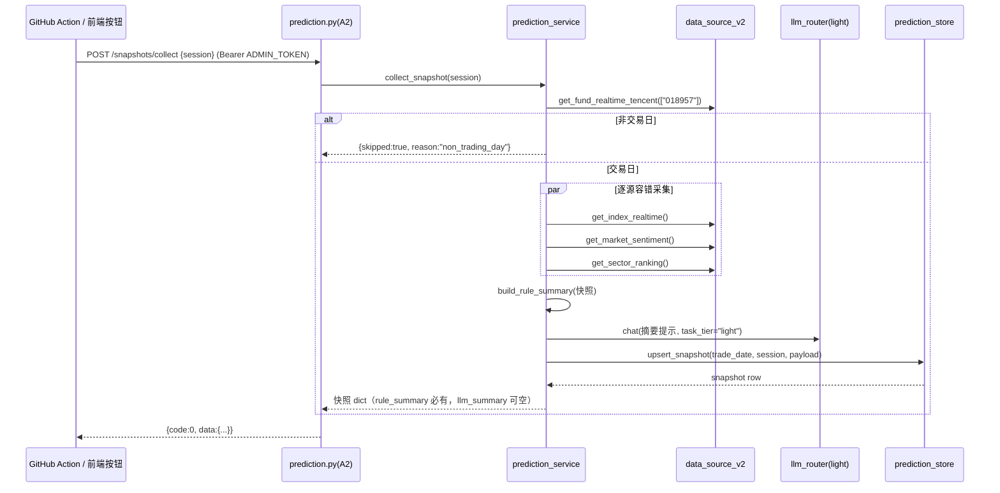
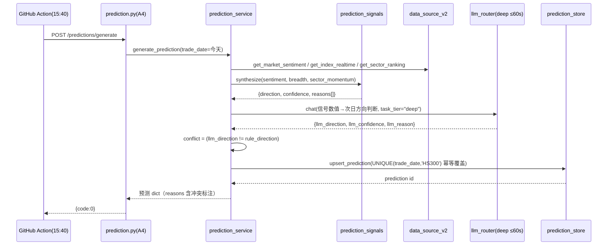
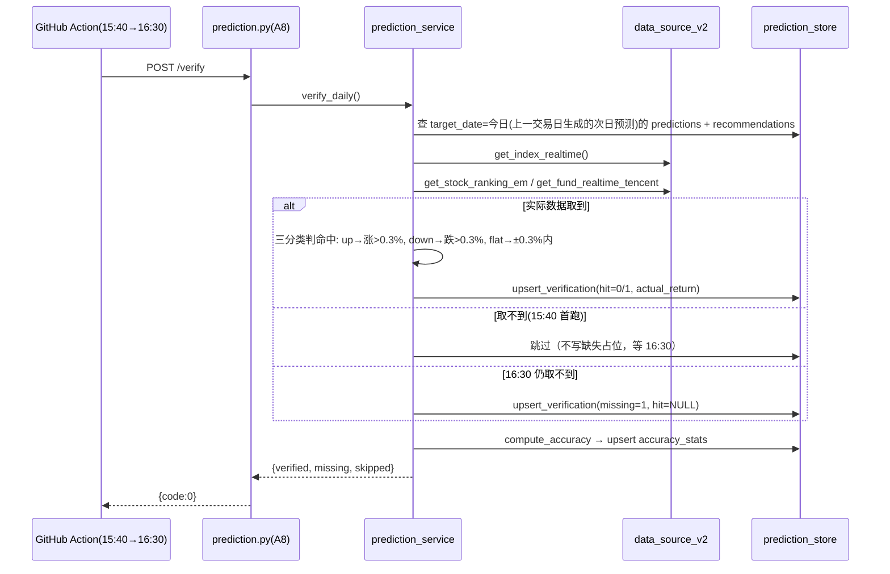
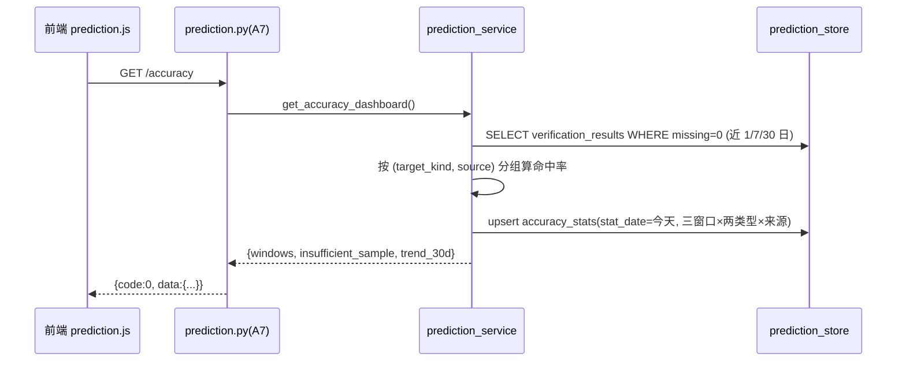

# 系统设计 + 任务分解：盘面时段分析 · 板块模块 · 趋势预测与推荐 · 准确率闭环

- **日期**：2026-11-07
- **作者**：高见远（架构师）
- **依据**：docs/prd-prediction-2026-11-07.md（许清楚）+ 主理人五项拍板
- **项目**：Fund-Assessment（D:/xm/wz/Fund-Assessment）

---

## 一、实现方案

### 1.1 核心技术挑战与对策

| 挑战 | 对策 |
|------|------|
| Action 无法直接写 Render 的 SQLite | **Action 只调线上 API，服务端写库**。新增 `prediction.yml` workflow，4 个 cron 时点用 `curl` 携带 `Authorization: Bearer $ADMIN_TOKEN`（GitHub secret）调 POST 端点；鉴权复用 `src/utils/auth.py::require_admin`（Bearer 头语义零改动）。顺带保活 Render 免休眠 |
| 预测"规则可追溯"红线（R4.1：LLM 不得编造标的） | **信号合成与标的选择全部在 `prediction_signals.py` 纯函数内完成**；LLM 只接收"已选定的标的 + 信号数值"做理由润色（standard/light 档），响应文本仅落 `llm_reason`，不参与 direction/confidence/标的生成。无法映射到 `source_signal` 的条目在 service 层丢弃并 logger.warning |
| 规则与 LLM 结论冲突 | 规则结果为最终 direction/confidence；LLM 结论存 `llm_direction/llm_confidence`，不一致时 `conflict_flag=1` 并在 reasons 中标注 |
| 上游数据源部分失败 | 快照采集逐源 try/except，失败字段置 None 并记入 `missing_fields`，绝不抛异常中断（R1.1 验收）；`DataSourceUnavailable` 统一捕获 |
| 非交易日守卫 | 服务端在 collect/generate/verify 入口统一跑 **018957 T+0 净值探针**（复刻 `scripts/gen_daily_report.py` 的守卫逻辑，独立实现避免从 scripts/ 反向 import），非交易日返回 `code=0, data.skipped=true, reason=non_trading_day`，Action 视为成功 |
| 验证数据 15:40 取不到 | 拍板：15:40 verify → 16:30 重试一次 → 仍失败写 `verification_results.missing=1`（占位行），统计时排除并在前端标"验证缺失" |
| Render 文件系统持久化 | prediction.db 落 `data/prediction.db`（与 trade.db 同盘）；Render 免费层重启可能丢盘是**已知既有限制**，与 trade.db 同待遇，不在本设计内解决 |

### 1.2 模块划分（架构模式：既有分层 Route → Service → Store，不引入新框架）

```
src/core/prediction_signals.py   纯函数规则信号引擎（零 IO、零 LLM）——可追溯性的唯一真源
src/core/prediction_service.py   编排层：采集/预测/推荐/验证/统计（IO + LLM 调用都在这层）
src/core/prediction_store.py     SQLite 存储层（参照 portfolio_store.py 模式：锁 + 原子操作 + 保留策略）
web/routes/prediction.py         FastAPI 路由（/api/prediction/*，逐端点手动挂 require_admin）
web/static/js/prediction.js      监控容器：时段卡片 + 次日预测 + AI 准确率看板
web/static/js/sector-board.js    行情容器：板块二级页（复用 /api/market/sector_flow 既有端点）
web/static/js/recommendations.js 策略容器：今日推荐区块
web/static/css/prediction.css    新区块样式（引用既有 stage5 token）
.github/workflows/prediction.yml 定时调度（09:35 / 13:05 / 15:40 / 16:30 北京时间）
scripts/gen_weekly_report.py     周度优化报告（P1，可后续批次）
```

LLM 分档使用（不破坏 llm_task_tier 五条硬约束，均经 `chat(task_tier=...)` 走既有路由）：

- 快照一句话总结：`task_tier="light"`（预算 15s，后台线程调用，不占请求预算）
- 次日预测辅助判断：`task_tier="deep"`（预算 ≤60s，Action 15:40 场景无前端 90s 限制；手动触发时经 `asyncio.to_thread` 包装）
- 推荐理由润色：`task_tier="light"`（只润色，不给标的）

### 1.3 prediction.db 表结构（DDL 级）

库文件：`data/prediction.db`，PRAGMA `journal_mode=WAL`，连接 `check_same_thread=False` + 模块级 `threading.Lock`（参照 portfolio_store 锁模式）。

```sql
-- 1. 时段快照（R1.1/R1.2）
CREATE TABLE IF NOT EXISTS session_snapshots (
    id            INTEGER PRIMARY KEY AUTOINCREMENT,
    trade_date    TEXT NOT NULL,              -- YYYY-MM-DD（北京时间）
    session       TEXT NOT NULL CHECK (session IN ('morning','noon','close')),
    collected_at  TEXT NOT NULL,              -- ISO 8601 UTC
    payload_json  TEXT NOT NULL,              -- 原始快照: indices/advancers/decliners/sentiment/top_sectors
    missing_fields TEXT NOT NULL DEFAULT '',  -- JSON 数组: 采集失败的字段名
    rule_summary  TEXT NOT NULL DEFAULT '',   -- 规则摘要（涨跌家数、板块领涨领跌）
    llm_summary   TEXT NOT NULL DEFAULT '',   -- LLM light 一句话（失败时空串）
    UNIQUE (trade_date, session)
);
CREATE INDEX IF NOT EXISTS idx_ss_date ON session_snapshots (trade_date);

-- 2. 次日预测（R3.1）
CREATE TABLE IF NOT EXISTS predictions (
    id              INTEGER PRIMARY KEY AUTOINCREMENT,
    trade_date      TEXT NOT NULL,            -- 预测生成日
    target_date     TEXT NOT NULL,            -- 预测目标日（次交易日）
    benchmark       TEXT NOT NULL DEFAULT 'HS300',  -- P0 只做沪深300
    direction       TEXT NOT NULL CHECK (direction IN ('up','down','flat')),  -- 最终=规则
    confidence      REAL NOT NULL,            -- 0~100，规则信号合成
    rule_direction  TEXT NOT NULL,
    rule_confidence REAL NOT NULL,
    rule_reasons    TEXT NOT NULL DEFAULT '[]', -- JSON: [{signal, value, verdict}...]
    llm_direction   TEXT,                     -- LLM deep 结论（可空）
    llm_confidence  REAL,
    llm_reason      TEXT NOT NULL DEFAULT '',
    conflict_flag   INTEGER NOT NULL DEFAULT 0,  -- 1=规则与 LLM 冲突（以规则为准）
    created_at      TEXT NOT NULL,
    UNIQUE (trade_date, benchmark)            -- 同日同基准幂等覆盖（R3.3）
);
CREATE INDEX IF NOT EXISTS idx_pred_date ON predictions (trade_date);
CREATE INDEX IF NOT EXISTS idx_pred_target ON predictions (target_date);

-- 3. 推荐（R4.1）
CREATE TABLE IF NOT EXISTS recommendations (
    id              INTEGER PRIMARY KEY AUTOINCREMENT,
    trade_date      TEXT NOT NULL,
    target_date     TEXT NOT NULL,            -- 次交易日（回看用）
    symbol          TEXT NOT NULL,            -- 6 位股票码 / 6 位基金码
    name            TEXT NOT NULL DEFAULT '',
    kind            TEXT NOT NULL CHECK (kind IN ('stock','fund')),
    direction       TEXT NOT NULL CHECK (direction IN ('up','down')),
    confidence      REAL NOT NULL,
    reason          TEXT NOT NULL DEFAULT '', -- ≤2 句（LLM 润色后）
    source_signal   TEXT NOT NULL,            -- 可追溯: 如 "sector_momentum:半导体|breadth_ratio>1.5"
    realized_return REAL,                     -- P1 R4.4: 次日涨跌幅 %
    created_at      TEXT NOT NULL
);
CREATE INDEX IF NOT EXISTS idx_rec_date ON recommendations (trade_date);
CREATE INDEX IF NOT EXISTS idx_rec_target ON recommendations (target_date);

-- 4. 验证结果（R6.1）
CREATE TABLE IF NOT EXISTS verification_results (
    id            INTEGER PRIMARY KEY AUTOINCREMENT,
    trade_date    TEXT NOT NULL,              -- 行情实际发生日（=被验证目标的 target_date）
    target_kind   TEXT NOT NULL CHECK (target_kind IN ('prediction','recommendation')),
    target_id     INTEGER NOT NULL,
    expected      TEXT NOT NULL DEFAULT '',   -- 预测方向 / 推荐方向
    actual        TEXT NOT NULL DEFAULT '',   -- 实际方向（missing=1 时为空）
    hit           INTEGER,                    -- 1 命中 / 0 未命中 / NULL 缺失
    actual_return REAL,                       -- 实际涨跌幅 %
    missing       INTEGER NOT NULL DEFAULT 0, -- 1=验证缺失（15:40+16:30 均失败）
    verified_at   TEXT NOT NULL,
    UNIQUE (trade_date, target_kind, target_id)   -- 幂等 upsert
);
CREATE INDEX IF NOT EXISTS idx_ver_date ON verification_results (trade_date);

-- 5. 准确率统计（R6.2，365 天保留）
CREATE TABLE IF NOT EXISTS accuracy_stats (
    id          INTEGER PRIMARY KEY AUTOINCREMENT,
    stat_date   TEXT NOT NULL,                -- 统计生成日
    window      TEXT NOT NULL CHECK (window IN ('day','7d','30d')),
    target_kind TEXT NOT NULL CHECK (target_kind IN ('prediction','recommendation')),
    source      TEXT NOT NULL CHECK (source IN ('rule','llm','mixed')),
    hits        INTEGER NOT NULL DEFAULT 0,
    total       INTEGER NOT NULL DEFAULT 0,
    hit_rate    REAL,                         -- 样本 <5 → NULL（"样本不足"）
    created_at  TEXT NOT NULL,
    UNIQUE (stat_date, window, target_kind, source)
);
CREATE INDEX IF NOT EXISTS idx_acc_date ON accuracy_stats (stat_date);
```

**保留策略（R5.2）**：明细三表 + verification 保留 180 天，accuracy_stats 保留 365 天；`prediction_store.cleanup(retention_days)` 在 app 启动时调用一次 + 每日 verify 成功后顺带调用；SQL 带 `trade_date < 今日` 条件保证不误删当日。

### 1.4 API 清单

统一响应 `{code, message, data}`（`src/core/response.py`）；**每个写端点逐个手动挂 `dependencies=[Depends(require_admin)]`（曾漏挂出过 P0，验收时逐一核对）**；GET 端点公开读（与既有 anon read 口径一致）。

| # | 方法 | 路径 | 鉴权 | 用途 |
|---|------|------|------|------|
| A1 | GET | `/api/prediction/snapshots?date=&days=5` | 公开 | 当日/近 N 日三时段快照（R1.3 数据源） |
| A2 | POST | `/api/prediction/snapshots/collect` | admin | 采集指定时段快照（R1.1 + R1.4 手动触发；5 分钟幂等） |
| A3 | GET | `/api/prediction/predictions?days=30` | 公开 | 历史预测（R3.2） |
| A4 | POST | `/api/prediction/predictions/generate` | admin | 生成当日次日预测（R3.1/R3.3；同日幂等覆盖） |
| A5 | GET | `/api/prediction/recommendations?date=` | 公开 | 今日/历史推荐（R4.3） |
| A6 | POST | `/api/prediction/recommendations/generate` | admin | 生成当日推荐（R4.1；同日幂等覆盖） |
| A7 | GET | `/api/prediction/accuracy` | 公开 | 三窗口命中率 + 30 日走势（R6.3） |
| A8 | POST | `/api/prediction/verify` | admin | 验证今日预测与推荐（target_date=今日，即上一交易日生成的次日预测；R6.1；Action 15:40 与 16:30 重试均调它；幂等 upsert） |
| A9 | GET | `/api/market/sector_flow` | 公开 | **既有端点直接复用**（R2.1 板块榜数据源，`get_sector_ranking` 双上游） |
| A10 | PUT | `/api/fund/positions/{fund_code}/shares` | admin | R7.1 份额行内编辑自助修正 |

请求/响应示例（关键端点）：

```
POST /api/prediction/snapshots/collect        # Header: Authorization: Bearer <ADMIN_TOKEN>
  {"session": "morning"}
→ 200 {"code":0, "message":"success", "data":{
     "trade_date":"2026-11-09","session":"morning","collected_at":"2026-11-09T01:35:12Z",
     "payload":{"indices":[{"name":"沪深300","change_pct":0.42}],
                "advancers":3120,"decliners":1780,"sentiment_score":62.5,
                "top_sectors":[{"name":"半导体","change_pct":2.1,"leader":"xxx"}]},
     "missing_fields":[], "rule_summary":"涨多跌少…", "llm_summary":"市场情绪回暖…"}}

POST /api/prediction/verify
→ 200 {"code":0, "data":{"verified":7, "missing":1, "skipped":false,
                          "detail":[{"target_kind":"prediction","target_id":42,"hit":1}]}}

GET /api/prediction/accuracy
→ 200 {"code":0, "data":{
     "windows":{"day":{"prediction":{"rule":{"hits":3,"total":4,"hit_rate":0.75}},
                      "recommendation":{"rule":{...}}}, "7d":{...}, "30d":{...}},
     "insufficient_sample":true,             // 任一窗口 total<5
     "trend_30d":[{"stat_date":"2026-11-07","hit_rate":0.71,"total":9}]}}

PUT /api/fund/positions/002891/shares
  {"shares": 12345.67}
→ 200 {"code":0, "data":{"fund_code":"002891","shares":12345.67,"estimated":false}}
```

### 1.5 Action ↔ API 调用契约

`.github/workflows/prediction.yml`，4 个 job（同一 workflow，`on: schedule` + `workflow_dispatch`）：

| 北京时间 | UTC cron | 步骤（每步 curl，失败不阻塞下一步，汇总上报） |
|----------|----------|------|
| 09:35 | `35 1 * * 1-5` | POST `/snapshots/collect {"session":"morning"}` |
| 13:05 | `5 5 * * 1-5` | POST `/snapshots/collect {"session":"noon"}` |
| 15:40 | `40 7 * * 1-5` | ① POST `/snapshots/collect {"session":"close"}` ② POST `/predictions/generate` ③ POST `/recommendations/generate` ④ POST `/verify` |
| 16:30 | `30 8 * * 1-5` | POST `/verify`（重试；服务端若数据仍取不到 → 写 missing=1 占位） |

契约要点：
- Base URL：`secret PREDICT_API_BASE`（Render 线上域名，新增 secret；不 hardcode）
- 鉴权：`Authorization: Bearer ${{ secrets.ADMIN_TOKEN }}`
- 非交易日：服务端 018957 探针返回 `{code:0, data:{skipped:true, reason:"non_trading_day"}}`，Action 记 notice 后 exit 0（与 daily-report 同口径）
- 每步 curl `--max-time 120 --retry 1`，失败打 `::warning::`，非全部失败则 job exit 0
- LLM deep 调用发生在 15:40 job 内部（服务端），Action 无感知；总时长预留 timeout-minutes: 15
- **库备份（主理人补充，2026-11-07）**：Render 免费层磁盘非持久 → 每日验证完成后，15:40 job 通过 `GET /api/prediction/export`（挂 require_admin）拉取 prediction.db 一致性快照，追加推送到 `daily-reports` 分支 `db_backup/prediction_YYYYMMDD.db`（库内全是公开行情+基金代码，可入库）。**人工恢复**：从 `daily-reports` 分支下载 `db_backup/prediction_<日期>.db`，覆盖到服务端 `data/prediction.db` 后重启服务即可。

---

## 二、框架选型确认

**零新依赖。** 全部复用既有栈：

| 能力 | 复用 |
|------|------|
| Web/路由 | FastAPI + 既有 `APIRouter` 注册模式（web/api.py include_router） |
| 存储 | 标准库 `sqlite3`（WAL），参照 portfolio_store 锁/校验模式 |
| 行情/情绪/板块 | `data_source_v2.get_index_realtime / get_market_sentiment / get_sector_ranking / get_fund_realtime_tencent / get_stock_ranking_em` |
| LLM 三档 | `llm_router.chat(task_tier="light"/"deep"/"standard")`，不动 llm_task_tier.py |
| 鉴权 | `src/utils/auth.require_admin`（Bearer 头），零改动 |
| 交易日守卫 | 018957 探针（复刻 gen_daily_report 逻辑，~30 行） |
| 板块聚合 | `config/sector_map.yaml` + 既有聚合逻辑 |
| 前端 | 原生 JS 独立文件 + `freshness.js` 徽章组件 + STAGE5 token，无构建步骤、无 CDN |
| 定时 | GitHub Actions cron（既有 daily-report.yml 同模式） |

理由：需求本质是"既有数据源的规则化消费 + 持久化 + 定时调度"，任何新框架（APScheduler/Celery/pandas）都是负资产；服务端常驻 scheduler 已被拍板排除（统一走 Action）。

---

## 三、文件列表

| 路径 | 新增/修改 | 说明 |
|------|-----------|------|
| `src/core/prediction_store.py` | 新增 | SQLite 存储层：建表/索引/upsert/查询/保留清理 |
| `src/core/prediction_signals.py` | 新增 | 纯函数信号引擎：广度/情绪/板块动量 → 方向+置信度+推荐标的（可追溯） |
| `src/core/prediction_service.py` | 新增 | 编排：collect_snapshot / generate_prediction / generate_recommendations / verify_daily / compute_accuracy |
| `config/prediction_signals.yaml` | 新增 | 信号阈值集中配置（R6.5 顺带落地）：情绪分档、动量窗口、置信度权重 |
| `web/routes/prediction.py` | 新增 | `/api/prediction/*` 路由（A1~A8），逐端点挂 require_admin |
| `web/api.py` | 修改 | `include_router(prediction.router, prefix="/api/prediction")`（**挂载动作必须验收核对**） |
| `web/routes/fund.py` | 修改 | A10 份额行内编辑端点（校验 >0、有限数；写入既有 user_fund_positions.json） |
| `.github/workflows/prediction.yml` | 新增 | 4 时点调度 + workflow_dispatch |
| `web/static/js/prediction.js` | 新增 | 监控容器：时段卡片/立即采集按钮/次日预测卡片/准确率看板 |
| `web/static/js/sector-board.js` | 新增 | 行情容器"板块"二级页（调既有 /api/market/sector_flow） |
| `web/static/js/recommendations.js` | 新增 | 策略容器"今日推荐"区块（含免责声明脚注） |
| `web/static/css/prediction.css` | 新增 | 新区块样式（引用 stage5 token，红涨绿跌） |
| `web/static/index.html` | 修改 | 五容器内追加锚点区块 + `<script>` 引入（见下） |
| `tests/test_prediction_store.py` | 新增 | 建表/幂等/保留策略/不碰 trade.db |
| `tests/test_prediction_signals.py` | 新增 | 信号合成/冲突/可追溯性/标的丢弃 |
| `tests/test_prediction_service.py` | 新增 | mock 数据源+LLM 的编排/幂等/非交易日/验证缺失 |
| `tests/test_prediction_routes.py` | 新增 | 鉴权 401/响应结构/挂载存在性 |
| `tests/test_fund_share_edit.py` | 新增 | R7.1 编辑合法/非法值 |
| `scripts/gen_weekly_report.py` | 新增（P1，可后续批次） | 周度优化报告 → docs/ |

**index.html 锚点清单**（新约定前缀 `STAGE6-PRED`，格式沿用 `<!-- ===== STAGE6-PRED: xxx ===== -->`；index.html 本体只加锚点区块与 script/css 引用行，JS/CSS 全部独立文件）：

| 锚点名 | 位置 | 内容 |
|--------|------|------|
| `STAGE6-PRED: monitor-session` | 监控容器 | 三时段卡片横排 + 立即采集按钮（R1.3/R1.4） |
| `STAGE6-PRED: monitor-prediction` | 监控容器 | 次日预测卡片 + 近 30 日展开（R3.2） |
| `STAGE6-PRED: monitor-accuracy` | 监控容器 | AI 准确率看板（R6.3） |
| `STAGE6-PRED: market-sector-board` | 行情容器二级 tab"板块" | 板块涨跌榜（R2.1） |
| `STAGE6-PRED: strategy-recommend` | 策略容器 | 今日推荐列表（R4.3/R4.2） |
| `STAGE6-PRED: holdings-share-edit` | 持仓表格行内 | 估算值角标 + 行内编辑（R7.1） |
| `STAGE6-PRED: freshness-coverage` | 全局 | R7.2/R7.3 补角标与北向/QDII 说明文案的 JS 挂载点 |

---

## 四、关键流程时序

### 4.1 时段快照采集（Action 09:35/13:05/15:40 或手动按钮）



### 4.2 次日预测生成（15:40，紧随盘后快照）



### 4.3 每日验证（15:40 首跑，16:30 重试）



### 4.4 准确率统计（verify 成功后自动 + 前端 GET 实时计算双通道）



---

## 五、任务列表（按依赖排序，5 个任务）

### T01 项目基础设施与数据层
- **涉及文件**：`src/core/prediction_store.py`、`config/prediction_signals.yaml`、`tests/test_prediction_store.py`、`src/core/__init__.py`（如需导出）
- **内容**：DDL 建表 + 索引 + WAL；UNIQUE 幂等 upsert API；保留策略 cleanup(180/365)；信号阈值配置加载函数
- **验收**：`pytest tests/test_prediction_store.py`（建表幂等、upsert 覆盖、cleanup 不误删当日、**trade.db/risk.db mtime+hash 零改动断言**）；`ruff check` 通过
- **依赖**：无 ｜ **P0**

### T02 规则信号引擎 + 编排服务
- **涉及文件**：`src/core/prediction_signals.py`、`src/core/prediction_service.py`、`tests/test_prediction_signals.py`、`tests/test_prediction_service.py`
- **内容**：广度/情绪/板块动量三信号合成（方向+置信度+reasons）；推荐标的从规则信号生成（sector_map 映射成分股/关联基金，无信号可追溯即丢弃）；018957 交易日探针；快照采集/预测生成/推荐生成/验证/统计五个编排函数（LLM 全部 try/except 降级）
- **验收**：`pytest tests/test_prediction_signals.py tests/test_prediction_service.py`（mock 数据源与 LLM：**R4.1 红线测试——LLM mock 返回编造标的时最终推荐不含该标的**；冲突 flag；非交易日 skipped；验证缺失占位；样本<5 hit_rate=None）
- **依赖**：T01 ｜ **P0**（含 P1 的 R3.3/R4.4/R5.2 顺带实现）

### T03 API 路由 + Action 工作流
- **涉及文件**：`web/routes/prediction.py`、`web/api.py`（修改）、`.github/workflows/prediction.yml`、`web/routes/fund.py`（修改：A10）、`tests/test_prediction_routes.py`、`tests/test_fund_share_edit.py`
- **内容**：A1~A8 端点（**逐端点挂 `dependencies=[Depends(require_admin)]`**）；api.py include_router；prediction.yml 4 cron + workflow_dispatch + curl 契约；A10 份额编辑
- **验收**：`pytest tests/test_prediction_routes.py`（无 token → 401；响应结构 `{code,message,data}`；**断言 `app.include_router` 后 `/openapi.json` 含全部 8 条 /api/prediction 路径**——防漏挂 P0）；`pytest tests/test_fund_share_edit.py`；workflow_dispatch 手动触发一次跑通全链（手工步骤：Actions 页 Run workflow → 查 Render 日志与 prediction.db 行数）
- **依赖**：T02 ｜ **P0**

### T04 前端：监控容器三区块 + 板块二级页
- **涉及文件**：`web/static/js/prediction.js`、`web/static/js/sector-board.js`、`web/static/css/prediction.css`、`web/static/index.html`（修改：4 个锚点区块 + 引用行）
- **内容**：时段卡片（rule/llm 摘要 + 采集时间 + 立即采集按钮 5 分钟幂等 + "未采集"占位）；次日预测卡片（30 日历史展开）；准确率看板（三窗口 + 走势条 + 样本量 + "样本不足"明确态）；板块榜（红涨绿跌、领涨股、错误态、Freshness 角标，锚点 `STAGE6-PRED: monitor-session/monitor-prediction/monitor-accuracy/market-sector-board`）
- **验收**：手工走查——监控容器三卡片渲染、无快照时段显示"未采集"不留空白；板块页 ≥30 行且错误注入显示错误态；抽查 4 个区块均有 Freshness 角标；`pytest tests/test_api.py` 全量回归不破
- **依赖**：T03 ｜ **P0**

### T05 前端：推荐区 + 既有页面数据补全收尾
- **涉及文件**：`web/static/js/recommendations.js`、`web/static/index.html`（修改：`STAGE6-PRED: strategy-recommend / holdings-share-edit / freshness-coverage` 锚点）、`web/static/js/fund 持仓渲染`（经 fund.py 数据注入 estimated 标识，前端行内编辑）、`tests/test_accuracy_reconciliation.py`
- **内容**：今日推荐列表（置信度标签 + 理由 + **每卡片固定免责文案**）；持仓页 4 只份额估算角标 + 行内编辑调 A10；北向卡片口径文案（R7.3）；QDII 滞后文案（R7.4 顺带）；新鲜度角标补全至第 5 处页面（R7.2 收尾）；准确率对账测试
- **验收**：`pytest tests/test_accuracy_reconciliation.py`（看板数字 == 库内重算）；手工走查——推荐卡片底部免责文案必现、无信号显示"今日无满足条件的推荐"；002891/018957/017811/018816 四行有"估算值待复核"标识且编辑后刷新持久；北向卡片无裸 0；`pytest` 全量 ≥2327 passed 且 coverage ≥78；`ruff check` 通过
- **依赖**：T03（与 T04 可并行，集成走查在 T05 收尾）｜ **P0**（其中 R6.4 周报 `scripts/gen_weekly_report.py`、R7.5 走查清单为 P1，可后续批次）

**P0 覆盖核对（PRD 12 条）**：R1.1→T02/T03；R1.2→T02；R1.3→T04；R2.1→T04；R3.1→T02/T03；R3.2→T04；R4.1→T02；R4.2→T05；R4.3→T05；R5.1→T01；R6.1→T03；R6.2→T02/T03；R6.3→T04/T05；R7.1→T03/T05；R7.2→T04/T05；R7.3→T05 ✔ 全覆盖（R6.1 归 T03 workflow，R6.2 统计逻辑归 T02）。

---

## 六、共享知识（跨文件约定）

1. **响应结构**：所有新 API 一律 `{"code":0,"message":"success","data":...}`（`src/core/response.py`）；业务失败 `code=-1`，鉴权失败由 require_admin 抛 401/503，不自行造错误结构。
2. **鉴权**：写端点逐个手动 `dependencies=[Depends(require_admin)]`；Action 用 `Authorization: Bearer ${{ secrets.ADMIN_TOKEN }}`；**新增路由必须在 web/api.py include_router 并进 openapi.json 断言**。
3. **命名前缀**：后端函数/表/配置键统一 `prediction_` 前缀（`prediction_store` / `prediction_signals` / `prediction_service`）；前端锚点统一 `STAGE6-PRED:` 前缀；JS 全局对象 `window.PredictionPage` / `window.SectorBoard` / `window.RecommendPage`。
4. **新鲜度角标**：一律经 `web/static/js/freshness.js::Freshness.html({asOf, estimated, lagDays, note})`，禁止各页手拼时间文案；无信息返回空串不渲染。
5. **红涨绿跌**：涨跌幅 class 统一 `pred-up`（红）/`pred-down`（绿），定义于 prediction.css 引用 stage5 token。
6. **时间口径**：`trade_date` 存北京时间日期字符串 YYYY-MM-DD；`collected_at/created_at/verified_at` 存 ISO 8601 UTC；Render 为 UTC 环境，北京时间换算用 `_CST`（参照 data_source_v2 的 `_ts_to_date`）。
7. **规则可追溯红线**：direction/confidence/推荐标的只能出自 `prediction_signals.py` 纯函数；LLM 输出只进 `llm_*` 字段；无法映射 `source_signal` 的推荐条目必须丢弃并 `logger.warning`。
8. **失败降级**：任一上游/LLM 失败不抛 500——快照字段置 None 记 `missing_fields`，llm_summary/llm_reason 置空串，rule_summary/rule 结论必须完整返回。
9. **不碰区**：trade.db / risk.db 零改动（测试有 hash 断言）；SimulatedBroker、backtest.py、index.html 既有结构不动。

---

## 七、风险与待明确（≤5）

1. **Action cron 时效抖动**：GitHub Actions 定时可能延迟数分钟（15:40 可能 15:47 才跑）；LLM deep 在 15:40 job 内串行约 1–2 分钟，16:30 重试间隔足够缓冲。影响小，接受；若快照时点要求严格可后续改 Action 内重试循环。
2. **Render 免费层磁盘非持久**：prediction.db 与 trade.db 同样面临重启丢盘风险（既有架构限制，不在本设计解决）；若主理人后续要求，可升级为 Render disk 挂载或推库到 daily-reports 分支备份。
3. **推荐标的池质量**：板块动量 → 成分股的映射依赖 sector_map.yaml 覆盖度与 get_stock_ranking_em 上游；映射稀疏时可能"今日无满足条件的推荐"（这是 PRD 允许的正确降级，但上线初期命中率样本可能长期 <5，看板将显示"样本不足"——需向用户预期管理）。
4. **三分类阈值（±0.3% 判平）为初始拍脑袋值**：已收敛到 `config/prediction_signals.yaml`，依赖周度报告（R6.4）迭代；首月统计口径变更会导致历史 hit 不重算（按验证时点快照记录，不做追溯重算）——属预期行为，报告中会标注。
5. **北向/QDII 文案的具体措辞**已按 R7.3/R7.4 口径给出，最终文案字句请主理人/用户过目确认（功能不受影响）。

## 八、依赖包

**预计零新增。** 全部使用既有依赖（fastapi / sqlite3 标准库 / loguru / pyyaml 既有 / requests 既有）。
