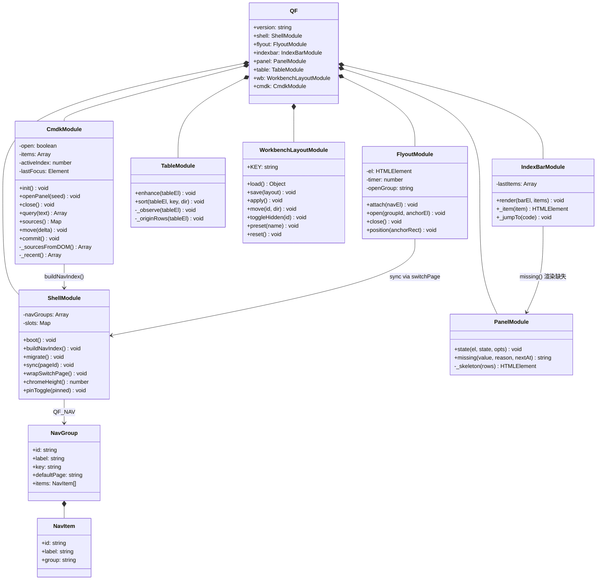
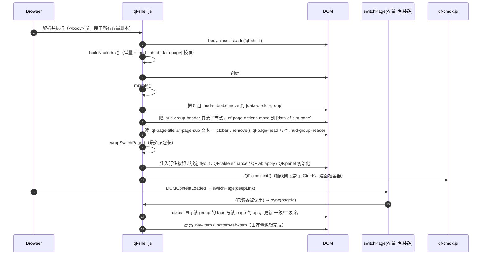
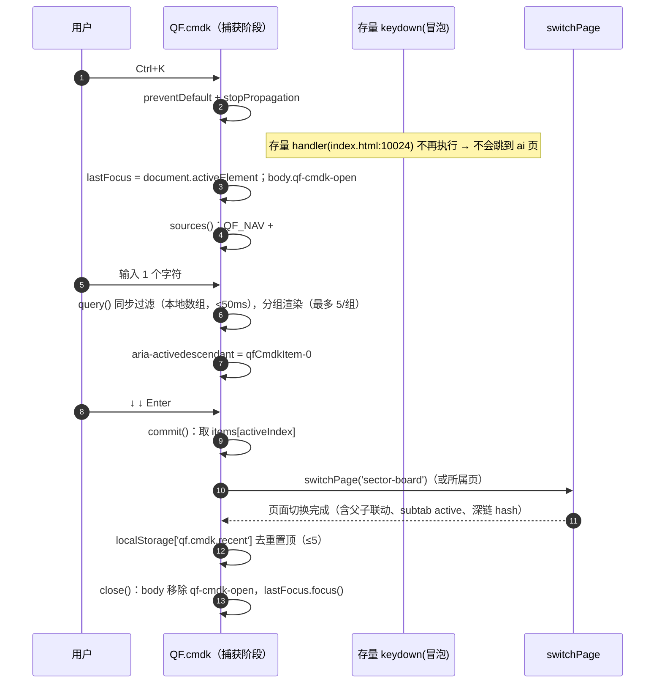
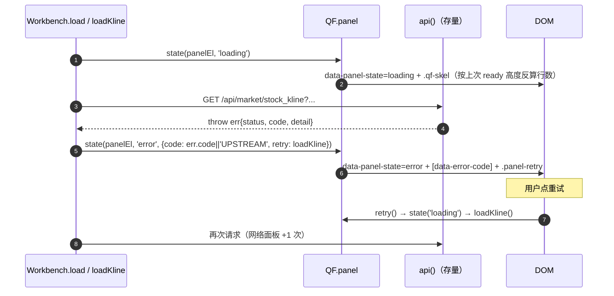
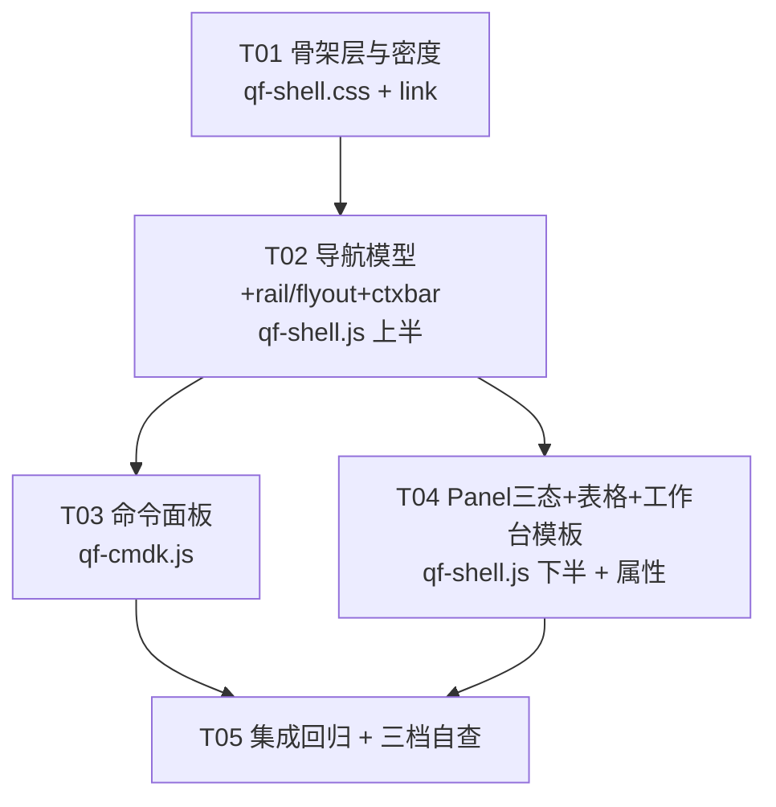

# 增量架构设计 + 任务分解：QuantFlow Pro 终端化 UI（STAGE8 · Shell）

- **文档类型**：增量架构设计（只描述本次变更；不重述存量架构）
- **版本**：v1.0 / 2026-11-22
- **上游输入**：`docs/prd-ui-terminal-2026-11-22.md`（PM）、`docs/video-insights-2026-11-22.md`
- **基线代码**：`61372e2`（`web/static/index.html` 10292 行 / `css/terminal-ui.css` 1643 行 / `js/workbench.js` 1282 行）
- **唯一交付物**：本文档。本轮**不修改任何源码/样式**，实现由工程师按 §11 任务表接力。
- **行号约定**：下文所有 `文件:行号` 均为本轮实际打开文件核对所得（非 PRD 转述）。

---

## 0. 拍板决策的落地方式（一句话版）

| 决策 | 落地实现 | 关键证据/依据 |
|---|---|---|
| 侧栏默认 56px 图标轨，hover **浮层**展开 168（不推挤） | `.sidebar` 宽度恒为 `--qf-rail-w:56px`；展开态是 `position:fixed` 的 `#qf-flyout`（JS 定位），**sidebar 自身宽度不变** → 内容区零抖动；钉住后 `body.qf-nav-pinned` 才把 sidebar 改 168px 并推挤 | `.main-layout{overflow:hidden}`（`index.html:71`）会裁掉 absolute 子层，故 flyout 必须 fixed（§12 风险 R1） |
| 指数条不做迷你走势，只做 名称+点位+涨跌幅+成交额+方向箭头，整卡可点 | `QF.indexbar.render()` 接管 `#indexBar` 渲染，不画 sparkline；成交额取既有字段 `amount`（`web/routes/market.py:537-563` 的 `IndexRealtimeItem` 已含 `amount`）；≤1200px 横向滚动 | 指数条改动只替换 `bar.innerHTML` 段（`index.html:4592-4601`） |
| **数据诚实性（2026-11-22 补充拍板）**：**删除**指数卡片的伪迷你走势，改为真实字段；任何图表数据必须可追溯到接口字段 | 删 `drawSparkline()`（`index.html:4682-4721`）+ 其调用（`4633`）+ 卡片内 `<svg class="sparkline">`（`4618`）；卡片改渲染 成交额/涨跌幅/方向箭头，缺失 `—`+`title`。**连带必须改 1 条测试**（`test_frontend_workbench.py:812-816` 反向断言），详见 **§15** | `drawSparkline` 是确定性 PRNG，唯一真实输入是 `isUp`（涨跌方向），见 `index.html:4682-4702` |
| 不做密度开关，直接调紧（tabs 44→36、标题区合并、行高 28） | 全部规则放在 `body.qf-shell` + `@media (min-width:901px)` 下；`.hud-subtab` 视觉高 28、命中区用 `::after` 撑回 44（不破坏 `hud.css:634-636` 的 48px 移动端契约） | 移动端触控契约被测试钉死（`test_frontend_workbench.py:625-641`），故密度只在 ≥901px 生效 |

---

## 1. 实现方案总览

### 1.1 核心难点与对策

| # | 难点 | 为什么难 | 对策 |
|---|---|---|---|
| D1 | 零构建、零框架、零 npm | 没有模块系统、没有组件生命周期 | 单一全局命名空间 `window.QF`，5 个自洽子模块，只在 `qf-shell.js` / `qf-cmdk.js` 顶部做 `(function(){ 'use strict'; … })()` IIFE，末尾挂载到 `window.QF` |
| D2 | 不能改存量页面结构 | `index.html` 有 12 个测试文件做**静态字符串契约**（如 `test_frontend_workbench.py:38-46/212/237`） | HTML 只加 **3 行**（1 `<link>` + 2 `<script>`）；结构性改造全部在**运行时 DOM 搬运**（move 不是 clone，避免 id 重复）+ `body.qf-shell` 类开关 |
| D3 | chrome 要降 30%+，但二级 tab 要常驻 | 现有二级 tab 在每页内部（`.hud-group-header`），不在骨架层 | **一次性搬移**：把每个 `.page` 的 `.hud-subtabs` / `.qf-page-actions` 真实移入 sticky `.qf-ctxbar` 的分组容器，靠 `is-active` 切换显示；`switchPage` 的全局 `querySelectorAll('.hud-subtab')`（`index.html:3815`）依然命中 → 父子联动零破坏 |
| D4 | flyout 被 `overflow:hidden` 裁剪 | `.main-layout{overflow:hidden}`（`index.html:71`）+ `.sidebar{overflow-y:auto}` 双层裁剪 | flyout 挂到 `<body>` 下、`position:fixed`、`z-index:var(--qf-z-overlay)`(60)，坐标由 `getBoundingClientRect()` 计算 |
| D5 | 命令面板与既有 `Ctrl+K` 冲突 | 存量监听在 `index.html:10024-10034`，冒泡阶段且直接 `return` | 用**捕获阶段**监听 + `stopPropagation()`（§4.2），零改动存量 handler |
| D6 | 排序/模板会与页面 `innerHTML` 重渲染打架 | 各 `*.js` 用整块 `innerHTML` 覆盖 tbody | 排序用 `MutationObserver` + 单次重放（`_reapplying` 标志位防死循环，§6.3）；工作台模板只对**静态面板节点**做 `appendChild` 重排（面板壳本身不被 JS 重写，`workbench.js` 只重写 `#wb*Body`） |

### 1.2 新增/改动文件清单（共 5 个文件，新增 ~1150 行）

| # | 文件 | 状态 | 行数预算 | 职责 | 加载位置 |
|---|---|---|---|---|---|
| F1 | `web/static/css/qf-shell.css` | 新增 | ~560 | 令牌补充（`--qf-rail-w` 等 7 个布局变量）、rail/ctxbar/flyout、指数条、密度、`.qf-panel` 三态、`.qf-table`、工作台编辑态、命令面板样式 | `<head>` 末尾，**在 `terminal-ui.css` 之后**（见 1.3） |
| F2 | `web/static/js/qf-shell.js` | 新增 | ~430 | `QF_NAV`、`QF.shell`（boot/sync/chromeHeight）、`QF.flyout`、`QF.indexbar`、`QF.panel`、`QF.table`、`QF.wb` | `</body>` 前最后一个 script |
| F3 | `web/static/js/qf-cmdk.js` | 新增 | ~330 | `QF.cmdk`（命令面板：索引、过滤、键盘、焦点管理、无障碍） | 紧跟 F2 之后 |
| F4 | `web/static/index.html` | **改 4 处** | +3 行（锚点）+ 指数卡模板净 −15 行 | ① `<link href="/static/css/qf-shell.css?v=…">`；② `<script src="/static/js/qf-shell.js?v=…">`；③ `<script src="/static/js/qf-cmdk.js?v=…">`；④ `loadIndexData` 内：指数条 3 行挂载 + **删除伪走势**（删 `4611` svgId、`4618` svg、`4629-4634` 循环、`4681-4721` 函数、`441` 无用样式；卡片模板改为成交额/箭头） | 见 1.3 / §15 |
| F5 | `web/static/js/workbench.js` | **改 1 行** | +1 | `renderIndices` 给 `.wb-idx` 加 `data-index-code`（指数条点击高亮用） | 不变 |

> **实测交付量（2026-11-22 复核，工程师交付后回填）**：`qf-shell.css` **634** 行、`qf-shell.js` **1170** 行、`qf-cmdk.js` **471** 行 → 新增合计 **2275 行**，为设计预算（≈1150）的 1.98 倍、超出「≤1500 行」建议线 52%。超出部分经抽查为**注释密度与 a11y/降级分支**（无计划外功能，除下述 sector-board 文案收口），**功能面未超范围**；交付报告应按实测数字陈述，不得写"约 1150 行"。改动文件：`index.html`(+60/−84)、`workbench.js`(+22/−1)、`sector-board.js`(+16/−9)。

> 说明：`index.html` 的 3 处插入点均使用新锚点注释 `<!-- ===== STAGE8: shell ===== -->`，与既有 `STAGE5/6/7` 锚点风格一致，便于 QA 与后续 diff 定位。除这 4 处（含 3 行挂载）外，**不改任何存量标签、函数体、样式**。

### 1.3 加载顺序与「terminal-ui.css 必须最后加载」的处理（重要）

现状：`terminal-ui.css` 是存量**最后**一个样式（`index.html:1024`），它承载 `≥1280px` 侧栏收成 78px 图标轨的规则（`terminal-ui.css:691-730`）。新骨架必须把侧栏改成 56px，若 `qf-shell.css` 排在它之前会被它压掉。

**方案：不改 `terminal-ui.css` 的位置，在其之后新增一层 STAGE8；用「作用域 + 更高特异性」双保险，做到既覆盖骨架、又绝不影响页面内样式。**

```css
/* qf-shell.css 顶部：所有规则无条件挂在 body.qf-shell 下 */
body.qf-shell.hud-theme .sidebar { … }   /* 0,3,1 → 压过 aurora 的 body.hud-theme .sidebar(0,2,1) 与 terminal-ui 的 .sidebar(0,1,0) */
```

- 该层**只允许**写三类选择器：`body.qf-shell …`（骨架）、`.qf-*`（新增组件）、`body.qf-shell .page …`（密度）。
- 回滚开关：`document.body.classList.remove('qf-shell')` → 全文件失效，页面回到当前线上外观（`?shell=off` 时 boot 直接 return，类都不加）。

```
<head> 加载顺序（改后）：
  tokens.css → stage5-typography → hud.css → stage6.css → prediction.css
  → stage5-responsive → stage5-motion → aurora-theme → workbench.css
  → global-market.css → terminal-ui.css  ← 存量最后一层，位置不动
  → qf-shell.css                          ← 新增 STAGE8 层（唯一覆盖骨架的层）
</body> 加载顺序（改后）：
  …, version-modal.js → qf-shell.js → qf-cmdk.js   ← 必须是最后两个（switchPage 包装最外层）
```

> 注：`qf-shell.js` 必须晚于 `stage6-portfolio.js`(`index.html:10262`)、`evolution.js`(10264)、`workbench.js`(10276) 等所有包装 `switchPage` 的文件。**它是链上最外层包装**，因此能观察到全部页面切换（含 `watchboard`/`risk`/`evolution`）。这与既有惯例一致（`stage6-portfolio.js:98-105` 的 `_origSwitchPage` 包装法）。

---

## 2. 全局骨架

### 2.1 `<body>` 上的类/属性

| 名称 | 谁加 | 含义 |
|---|---|---|
| `qf-shell` | `qf-shell.js` boot 时 `document.body.classList.add('qf-shell')` | **总开关**。CSS 全部挂在此类下；移除即回滚 |
| `qf-nav-pinned` | 钉住按钮 / localStorage `qf.nav.pinned === '1'` | 侧栏 168px 常驻并推挤内容 |
| `qf-cmdk-open` | 命令面板打开时 | 锁背景滚动（`overflow:hidden`）+ 遮罩 |
| `qf-wb-edit` | 工作台「编辑布局」态 | 显示 ▲▼/👁 控件与底部操作条 |
| `data-qf-shell="v1"` | boot | 版本标记，方便 QA 断言「新骨架已挂载」 |

### 2.2 布局结构：仍是 flex，只改「轨道宽度」

现状（`index.html:61-80`）：

```css
.app{display:flex;flex-direction:column;height:100vh}
.main-layout{display:flex;flex:1;overflow:hidden}
.sidebar{width:180px;min-width:180px; …}
.content{flex:1;overflow-y:auto;padding:20px}
```

改后（`qf-shell.css`，**不改 `.app`/`.main-layout` 结构**，只重定义轨道）：

```css
body.qf-shell{ --qf-rail-w:56px; --qf-rail-w-pinned:168px; --qf-tab-h:28px;
               --qf-row-h:28px; --qf-ctx-h:36px; --qf-topbar-h:48px;
               --qf-content-pad:12px; }

/* 轨道：恒 56，只有 pinned 才变 168（transition 只做 flex-basis，避免 reflow 抖动） */
body.qf-shell.hud-theme .sidebar{
  width:var(--qf-rail-w); min-width:var(--qf-rail-w); flex:0 0 var(--qf-rail-w);
  padding:8px 0; overflow:visible;              /* 关键：让 flyout 定位基准可用 */
  transition:flex-basis var(--duration-base) var(--ease-out);
}
body.qf-shell.qf-nav-pinned.hud-theme .sidebar{
  width:var(--qf-rail-w-pinned); min-width:var(--qf-rail-w-pinned); flex-basis:var(--qf-rail-w-pinned);
}
body.qf-shell .content{ padding:var(--qf-content-pad); }
```

内容区**不需要**改 `grid-template`：`.main-layout` 是 flex，`.content{flex:1}` 自动吃掉剩余宽度；56px 轨道比现有 78/180/200 都窄，内容反而变宽（`≥1440` 实测多出 22~144px）。

> **为什么不用 CSS Grid 重写 `.app`**：`.app` 的 `height:100vh` + `.main-layout{overflow:hidden}` + `.content{overflow-y:auto}` 是「单滚动容器」结构，换成 grid 需要同时改三处 overflow 语义，回滚成本高、收益为零。**结论：保持 flex，只换轨道宽度**。

### 2.3 侧栏 56px 图标轨（不改 nav-item 的 HTML）

现有 `.nav-item` 结构（`index.html:1058-1072`）已自带 `aria-label` 与 `.kbd`，因此 56px 态只需 CSS：

```css
@media (min-width:901px){
  body.qf-shell .nav-item{ height:44px; justify-content:center; padding:0; border-left-width:0; }
  body.qf-shell .nav-item > span:not(.nav-icon){ display:none; }   /* 隐藏文字与 kbd，保留 aria-label */
  body.qf-shell .nav-item .nav-icon{ width:auto; height:20px; }
  body.qf-shell .nav-item.active{ background:var(--qf-cyan-soft); }
  body.qf-shell .nav-item.active::before{ content:''; position:absolute; left:0; top:8px; bottom:8px;
      width:2px; border-radius:0 2px 2px 0; background:var(--qf-neon-cyan); }
}
body.qf-shell.qf-nav-pinned .nav-item > span:not(.nav-icon){ display:inline; }  /* pinned 显示文字 */
```

- 折叠/钉住按钮：JS 注入 `<button id="qfRailPin" class="qf-rail-pin" aria-pressed="false" aria-label="钉住侧栏">`，放在 `.sidebar` 末尾（`appendChild`，不改原结构）。
- 键盘可达性：`.nav-item` 已是 `tabindex="0"`（`index.html:1058`），`focusin` 同样触发 flyout（与 hover 同逻辑）。

### 2.4 上下文条 `.qf-ctxbar`（sticky 36px，二级 tab 常驻）

**这是本方案最关键的复用点**：不新建平行导航，而是把已有的导航与操作节点**搬进** ctxbar。

DOM（boot 时 JS 创建，插在 `<main class="content">` 首位，即 `index.html:1076` 之后）：

```html
<div class="qf-ctxbar" id="qfCtxbar" role="region" aria-label="页面上下文">
  <div class="qf-ctxbar__id">
    <span class="qf-ctxbar__group" id="qfCtxGroup">行情</span>
    <span class="qf-ctxbar__sep">/</span>
    <span class="qf-ctxbar__page"  id="qfCtxPage">工作台</span>
  </div>
  <div class="qf-ctxbar__tabs" id="qfCtxTabs">
    <!-- 每个 group 一个容器：[data-qf-slot-group="hud-market"]，内含搬运来的 .hud-subtabs -->
  </div>
  <div class="qf-ctxbar__ops" id="qfCtxOps">
    <!-- 每个 page / group 一个容器：[data-qf-slot-page="position"] / [data-qf-slot-group="hud-holdings"] -->
  </div>
  <button class="qf-ctxbar__kbd" id="qfCtxCmdk" aria-label="打开命令面板（Ctrl+K）">⌘K</button>
</div>
```

搬运规则（`QF.shell.migrate()`，boot 执行一次）：

| 来源（现状） | 目标 | 方式 |
|---|---|---|
| `.page > .hud-group-header > .hud-subtabs`（`index.html:1085/1330/1442/1492/1500`，5 处；另一处在 `page-risk:1373` 是 `.st6-window-tabs`） | `#qfCtxTabs > [data-qf-slot-group=<pageId>]` | **move**（`appendChild`），保留 id 与 onclick，不克隆 |
| `.page > .hud-group-header` 的其余子节点（`index.html:1339-1342` 持仓两个按钮；`index.html:1373-1378` 风险窗口 tab） | `#qfCtxOps > [data-qf-slot-page=<pageId>]` | move |
| `.page > .qf-page-head > .qf-page-actions`（5 处：`index.html:1257/1316/1513/1642/1979`） | `#qfCtxOps > [data-qf-slot-page=<pageId>]` | move |
| `.page > .qf-page-head` 的 `.qf-page-title` / `.qf-page-sub` 文本 | `#qfCtxGroup/#qfCtxPage` 文本 + `.title` 属性（完整描述作为 tooltip） | 读文本后 **`remove()` 整个 `.qf-page-head`** |
| 搬空后的 `.hud-group-header` | — | `remove()` |

> **为什么必须 `remove()` 而不是 CSS 隐藏**：US-1 的验收是 `document.querySelectorAll('.page.active .qf-page-title').length === 0`（PRD:82），`display:none` 仍会被 `querySelectorAll` 命中。文本已完整保留到 ctxbar（工具提示承载原描述），信息零丢失。

**sync（每次 `switchPage` 后执行）**：`is-active` 只标记 `[data-qf-slot-group=<activeGroup>]` 与 `[data-qf-slot-page=<activePage>]`；其余 `display:none`。

ctxbar CSS 要点：

```css
body.qf-shell .qf-ctxbar{
  position:sticky; top:0; z-index:var(--qf-z-sticky);   /* 30，来自 tokens.css:141 */
  display:flex; align-items:center; gap:8px;
  height:var(--qf-ctx-h); min-height:var(--qf-ctx-h);
  margin:0 0 8px; padding:0 4px 0 8px;
  background:var(--qf-bg-deep);
  border-bottom:1px solid var(--qf-line-1);
  backdrop-filter:blur(12px);
}
body.qf-shell .qf-ctxbar__tabs{ display:flex; gap:4px; overflow-x:auto; scrollbar-width:none; white-space:nowrap; }
body.qf-shell .qf-ctxbar > [data-qf-slot-group],
body.qf-shell .qf-ctxbar > [data-qf-slot-page]{ display:none; }
body.qf-shell .qf-ctxbar > .is-active{ display:flex; align-items:center; gap:6px; }
```

密度（本方案「不设开关」的核心落点，`@media (min-width:901px)`）：

```css
body.qf-shell .hud-subtab{ min-height:var(--qf-tab-h); padding:0 10px; font-size:12.5px; position:relative; border-radius:4px; }
body.qf-shell .hud-subtab::after{ content:''; position:absolute; inset:-8px -3px; }  /* 命中区 44px，守住 K2 */
body.qf-shell .hud-subtab.active{ background:transparent; color:var(--qf-neon-cyan); box-shadow:inset 0 -2px 0 var(--qf-neon-cyan); }
body.qf-shell .card{ padding:12px; border-radius:var(--qf-radius-xs); }
body.qf-shell .card-title{ margin-bottom:8px; font-size:13px; }
```

### 2.5 断点

| 断点 | 侧栏 | 上下文条 | 指数条 | 内容 |
|---|---|---|---|---|
| **>1200px** | 56 rail（pinned 168），hover/focus flyout 220px | 36px sticky，单行不滚动 | 名称+点位+涨跌幅+成交额+箭头，一行铺开 | padding 12 |
| **900–1200px** | 56 rail（pinned 168），flyout 220px | 36px sticky，tabs `overflow-x:auto` | **横向滚动**（`overflow-x:auto`，不换行、不产生页面级横向滚动） | padding 12 |
| **<900px（含 ≤768 移动）** | `display:none`（沿用 `index.html:539`），不做重复侧栏；底部 tab 沿用 `index.html:3119-3148` | 36px sticky，tabs 横向滚动（移动端不隐藏，作为页内二级导航） | 沿用现状 `display:none`（`index.html:540`；移动跑马灯不在本轮） | padding 12 |

> `<900` 与 `<768` 的差异处理：`qf-shell.css` 的骨架规则统一用 `@media (min-width:901px)` 包裹（桌面专属），`900–1200` 只额外给指数条加 `overflow-x:auto`。这样既满足主理人「≤900 用底部 tab、不重复侧栏」，也不会碰 `hud.css:626-641` 的移动端 48px 触点契约。

---

## 3. 导航数据模型 `QF_NAV`

### 3.1 事实校正：`STAGE5_PAGE_MAP` 缺 3 个真实页面（本轮不修，但要登记）

从 DOM 实抄（`index.html:1085-1095 / 1330-1336 / 1442-1450 / 1492 / 1500`）与 `STAGE5_PAGE_MAP`（`index.html:3723-3743`）逐项比对：

| 二级页 id | 中文 | 所属一级（DOM 实际） | 在 `STAGE5_PAGE_MAP` 里？ |
|---|---|---|---|
| `workbench` | 工作台 | hud-market | ✅ 3725 |
| `market` | 行情总览 | hud-market | ✅ |
| `review` | 短线复盘 | hud-market | ✅ |
| `global` | 国际市场 | hud-market | ✅ |
| `data` | 深度数据 | hud-market | ✅ |
| `sector-board` | 板块 | hud-market | ✅ 3731 |
| `market-style` | 市场风格 | hud-market | ✅ 3732 |
| `position` | 持仓管理 | hud-holdings | ✅ |
| `fund` | 基金管理 | hud-holdings | ✅ |
| `trade` | 交易执行 | hud-holdings | ✅ |
| **`watchboard`** | **盯盘** | hud-holdings | ❌ **缺失**（由 `stage6-portfolio.js:98-105` 自行包装补齐父联动） |
| **`risk`** | **风险** | hud-holdings | ❌ **缺失**（同上） |
| `strategy` | 策略中心 | hud-strategy | ✅ |
| `ai` | 智能分析 | hud-strategy | ✅ |
| `gate` | 出手三问 | hud-strategy | ✅ |
| `dispatch` | 一句话调度 | hud-strategy | ✅ |
| **`evolution`** | **策略进化** | hud-strategy | ❌ **缺失**（由 `evolution.js:100-115` 包装） |
| `recommend` | 今日推荐 | hud-strategy | ✅ |
| `monitor` | 监控预警 | hud-monitor | ✅ |
| `config` | 系统配置 | hud-settings | ✅ |

**结论**：`QF_NAV` 必须收录 **20** 个二级页（不是 17 个）。若只按 `STAGE5_PAGE_MAP` 建，命令面板会漏掉盯盘/风险/策略进化三页，且这三页在 ctxbar 里会显示错误的 tab 组。

> **⚠️ 写死这句话，防止下一轮有人按 17 页改**：
> **`STAGE5_PAGE_MAP` 缺 `watchboard` / `risk` / `evolution` 是既有缺陷（不是本轮引入），本轮以 `QF_NAV` 兜住，不改映射。** 任何"按 `STAGE5_PAGE_MAP` 的 17 个键来枚举页面"的改法都是错的；`QF_NAV` 的真源是 **5 组 20 页**（§3.2），并用 DOM `.hud-subtab[data-page]` 校准。缺陷编号 `BUG-STAGE5-MAP-INCOMPLETE`（§16）。

### 3.2 `QF_NAV` 静态常量（可直接落盘为 JS）

```js
window.QF_NAV = {
  version: 1,
  /* 图标用文字短码，rail 复用既有 SVG（从 .nav-item 里直接沿用，不新增资源） */
  groups: [
    { id:'hud-market',   label:'行情', key:'1', defaultPage:'workbench',
      items:[ {id:'workbench',label:'工作台'}, {id:'market',label:'行情总览'},
              {id:'review',label:'短线复盘'}, {id:'global',label:'国际市场'},
              {id:'data',label:'深度数据'},   {id:'sector-board',label:'板块'},
              {id:'market-style',label:'市场风格'} ] },
    { id:'hud-holdings', label:'持仓', key:'2', defaultPage:'position',
      items:[ {id:'position',label:'持仓管理'}, {id:'fund',label:'基金管理'},
              {id:'trade',label:'交易执行'},    {id:'watchboard',label:'盯盘'},
              {id:'risk',label:'风险'} ] },
    { id:'hud-strategy', label:'策略', key:'3', defaultPage:'strategy',
      items:[ {id:'strategy',label:'策略中心'}, {id:'ai',label:'智能分析'},
              {id:'gate',label:'出手三问'},     {id:'dispatch',label:'一句话调度'},
              {id:'evolution',label:'策略进化'}, {id:'recommend',label:'今日推荐'} ] },
    { id:'hud-monitor',  label:'监控', key:'4', defaultPage:'monitor',
      items:[ {id:'monitor',label:'监控预警'} ] },
    { id:'hud-settings', label:'设置', key:'5', defaultPage:'config',
      items:[ {id:'config',label:'系统配置'} ] }
  ],
  /* 派生索引，boot 时由 groups 自动生成，不手写 */
  byId: {},   // pageId → { id, label, group, groupLabel, isGroup }
  byGroup: {} // groupId → group 对象
};
```

### 3.3 DOM 校准（单一真源 = 实际 sub-tab DOM）

```js
QF.shell.buildNavIndex = function () {
  // ① 先按静态常量建索引（保证 DOM 异常时命令面板仍可用）
  // ② 再用 DOM 校准：以 .page > .hud-group-header .hud-subtab[data-page] 的实际顺序与文案为准
  //    若发现常量里没有的 data-page → 追加进对应 group（label 取 textContent）
  //    （这正是把 watchboard/risk/evolution 纳入进来的兜底路径）
  // ③ 只读遍历，绝不写 STAGE5_PAGE_MAP / 不改 DOM 结构
};
```

- 判定 `isGroup`：`id` 命中 `STAGE5_GROUP_DEFAULT` 的 5 个键（`index.html:3745-3751`）→ 是聚合容器，命令面板命中时跳它的 `defaultPage`。
- `switchPage()` 仍是唯一路由入口：ctxbar tabs、flyout、命令面板、数字键 1-5、底部 tab **全部**调用 `switchPage(id)`。

---

## 4. 命令面板（`QF.cmdk`）

### 4.1 DOM 结构（打开时才建，关闭后保留节点复用）

```html
<div class="qf-cmdk" id="qfCmdk" role="dialog" aria-modal="true" aria-label="全局搜索">
  <div class="qf-cmdk__scrim" data-cmdk-close></div>
  <div class="qf-cmdk__box">
    <div class="qf-cmdk__input-row">
      <input id="qfCmdkInput" class="qf-cmdk__input" type="text" autocomplete="off" spellcheck="false"
             role="combobox" aria-expanded="true" aria-controls="qfCmdkList" aria-autocomplete="list"
             aria-activedescendant="" placeholder="搜索页面 / 基金 / 股票 / 板块…" />
      <kbd class="qf-cmdk__esc">Esc</kbd>
    </div>
    <div class="qf-cmdk__list" id="qfCmdkList" role="listbox" aria-label="搜索结果"></div>
    <div class="qf-cmdk__foot">
      <span><kbd>↑</kbd><kbd>↓</kbd> 移动</span><span><kbd>Enter</kbd> 直达</span><span><kbd>Esc</kbd> 关闭</span>
    </div>
  </div>
</div>
```

- 结果行一律 **`document.createElement` + `textContent`**，**禁止 innerHTML**（`test_frontend_workbench.py:750-776` 会扫描所有 `js/*.js` 的 innerHTML 插值，用 DOM API 从根上规避）。
- `z-index: var(--qf-z-modal)`(90)；`.qf-cmdk{position:fixed;inset:0}`；打开时 `body.qf-cmdk-open{overflow:hidden}`。

### 4.2 打开/关闭与焦点管理

| 场景 | 行为 |
|---|---|
| `Ctrl+K` / `⌘K` | **捕获阶段**监听：`document.addEventListener('keydown', onKey, true)`；命中后 `e.preventDefault(); e.stopPropagation();` → 彻底屏蔽存量 `index.html:10024-10034` 的 `switchPage('ai')` 行为（零改动存量代码） |
| `ctxbar` 右侧 `⌘K` 按钮 / 页脚提示 | 点击同样打开 |
| `Esc` | 关闭，`_lastFocus.focus()` 还原焦点到打开前的 `document.activeElement` |
| 点击遮罩 `[data-cmdk-close]` | 关闭 + 还焦点 |
| `Tab` / `Shift+Tab` | 焦点在 input 内循环（`role=dialog` 只有一个可聚焦输入 + 列表项由 `aria-activedescendant` 表达，`Tab` 时把焦点留在 input 并 `preventDefault`，避免焦点逃到背景页面） |
| 已打开时再按 `Ctrl+K` | 清空输入并保持打开 |

### 4.3 数据来源与降级（**严格零新增后端接口**）

| 分组 | 来源 | 可用性 | 取不到时 |
|---|---|---|---|
| **页面** | `QF_NAV`（本地常量 + DOM 校准） | **永远可用**（同步，0ms） | — |
| **最近的** （空输入时） | `localStorage['qf.cmdk.recent']`（≤5 条 pageId） | 永远可用 | 不渲染该分组 |
| **股票持仓** | DOM 抽取 `#positionBody tr` → `td[0].textContent`(代码) / `td[1]`(名称)（`<tbody id="positionBody">` 在 `index.html:2415`，列序 代码/名称/数量/成本/现价/盈亏/盈亏%/操作） | 访问过持仓页后可用 | 分组不渲染 |
| **基金持仓** | DOM 抽取 `#fundPositionBody tr` → `td[0]/td[1]`（`<tbody id="fundPositionBody">` 在 `index.html:2608`） | 访问过基金页后可用 | 分组不渲染 |
| **自选股** | DOM 抽取 `#watchlistBody tr` → `td[0]/td[1]`（表结构 `index.html:2925-2928`） | 访问过监控页后可用 | 分组不渲染 |
| **板块** | DOM 抽取 `#page-sector-board [data-sb-sector]`（`sector-board.js:216/256` 已带 `data-sb-sector`/`data-sb-code`） | 访问过板块页后可用 | 分组不渲染 |

**明确不做**（避免踩坑）：

- ❌ **不调 `/api/fund/positions`**：该端点带 `dependencies=[Depends(require_admin)]`（`web/routes/fund.py:196`），生产未配 `admin_token` 时**不可用**（前端 `api()` 会抛错并弹持久错误卡，`index.html:3551-3600`）→ 命令面板会带崩首屏体验。
- ❌ **不调 `/api/monitor/watchlist`**：同样 `require_admin`（`web/routes/monitor.py:208`）。
- ❌ 不做「输入即请求」的远程补全。若后续要加，唯一允许的端点是 **`GET /api/fund/search?q=`**（匿名可用，`web/routes/fund.py:518`，带 60s 进程缓存），且必须是**防抖 250ms 的可选增强**，不得阻塞首字符本地结果（PRD P0-4 要求首屏 ≤50ms）。本轮**不实现**，仅在文档登记为可选扩展。
- 结论：**本方案零新增接口，且不依赖任何需鉴权接口。**

### 4.4 匹配与排序

```
打分（降序）：代码完全相等 100 > 代码前缀 80 > 名称完全相等 70 > 名称包含 60 > 拼音首字母 40
过滤前缀语法（P2，可选实现）：'/' 只搜页面；'>' 只搜标的
每组最多 5 条；分组顺序：页面 → 股票 → 基金 → 板块 → 最近的
```

### 4.5 键盘交互与无障碍

| 键 | 行为 |
|---|---|
| `↑` / `↓` | 在**扁平化后的可选项数组**上移动；越界环绕；同步 `aria-activedescendant="qfCmdkItem-<i>"`；`scrollIntoView({block:'nearest'})` |
| `Enter` | 执行当前项：页面/分组 → `switchPage(id)`；标的 → `switchPage(其所属页)` + 若该行有 `data-sb-sector` 则 `row.click()`（复用既有抽屉逻辑，无新代码路径） |
| `Esc` | 关闭 |
| `Home`/`End` | 跳首/尾 |

无障碍契约：`role=dialog` + `aria-modal` + `role=combobox`（input）+ `role=listbox`/`option`（列表）+ `aria-activedescendant`（随移动更新）+ 每个 option 有 `aria-selected`。空结果时渲染 `.qf-cmdk__empty`（`role=status`，文案「没有匹配的页面或标的，试试输入 6 位股票代码」）。

---

## 5. Panel 三态组件 `QF.panel`

### 5.1 类/属性契约（**渐进增强：未标记的面板行为完全不变**）

| 钩子 | 加在哪 | 语义 |
|---|---|---|
| `data-qf-panel` | 面板根（现有 `.card` 或 `.wb-panel`） | 声明「这个面板受三态规范管理」 |
| `data-panel-state` | 同上，由 `QF.panel.state()` 写入 | `loading` / `empty` / `error` / `ready` |
| `data-empty-reason` | 同上，`empty` 时写入 | 非空字符串，说明「为什么没有」 |
| `[data-error-code]` | 面板根内错误块 | 错误码（`api()` 抛出的 `err.code`，`index.html:3585`） |
| `.qf-panel__body` | 面板内容容器 | 三态渲染的落点 |

```css
/* 只在 body.qf-shell 下生效；未标 data-qf-panel 的 .card 完全不受影响 */
body.qf-shell .card[data-qf-panel]{ padding:0; overflow:hidden; }
body.qf-shell .card[data-qf-panel] > .card-title{
  height:32px; margin:0; padding:0 10px; font-size:13px;
  border-bottom:1px solid var(--qf-panel-line); background:var(--qf-panel-bg-2);
}
```

即：**给存量 `.card` 加一个 `data-qf-panel` 属性即可获得统一面板头**，不动它的 `.card-title` 结构（`index.html` 里 20+ 面板的 `.card-title` 内部写法各异，一律不碰）。

### 5.2 API

```js
/** @param {Element|string} el 面板根或其子节点（内部用 closest('[data-qf-panel]') 归一）
 *  @param {'loading'|'empty'|'error'|'ready'} state
 *  @param {{title?:string, detail?:string, code?:string, retry?:Function, reason?:string}} opts */
QF.panel.state(el, state, opts)
```

行为：

| state | 渲染 | 副作用 |
|---|---|---|
| `loading` | `body` 内渲染 N 行 `.qf-skel`，**行数按面板上次 ready 的高度反算**（记录 `data-qf-skel-rows`），保证与 ready 高度差 ≤8px（US-5 无 CLS） | `data-panel-state="loading"` |
| `empty` | `◻ title` + `detail`（原因）+ 可选主操作 | `data-panel-state="empty"` + `data-empty-reason=detail` |
| `error` | `⚠ title` + `[data-error-code]` + `.panel-retry` 按钮 | 点击 retry 调 `opts.retry()`，并自动回到 `loading` |
| `ready` | 清空三态 DOM，移除 `data-empty-reason`/`[data-error-code]`，`data-panel-state="ready"` | 记录当前高度供下次 skeleton 反算 |

空态文案模板（统一语法：**事实 + 原因 + 下一步**）：

| 场景 | title | detail（`data-empty-reason`） | 操作 |
|---|---|---|---|
| 无数据 | 今日暂无龙虎榜数据 | 原因：非交易日，下一交易日 17:30 更新 | 查看历史 |
| 未授权 | 需要管理员 Token 才能读取持仓明细 | 原因：本地未配置 | 去设置 |
| 上游缺失 | 上游未返回涨跌家数 | 原因：数据源降级，60 秒后重试 | 立即重试 |

### 5.3 本轮落地面板（P0 范围，6 个，只加属性 + 1~3 行调用）

| 页面 | 面板 | 改动 |
|---|---|---|
| 工作台 | 承接分析 / 情绪雷达 / 资金连增 / 开仓纪律（`index.html:1136/1147/1199/1210`） | `section.wb-panel` 加 `data-qf-panel`；`workbench.js` 各 render 失败分支改调 `QF.panel.state`（每处 1~2 行，保留原兜底文案语义） |
| 策略中心 | 五维评估（`index.html:2123`）、K线走势（`index.html:2135`） | 加 `data-qf-panel`；`drawRadarChart` 空态分支与 `loadKline` 空态分支各 2 行改调 `QF.panel.state`（顺带修 §10 的「空白/角落」观感） |

> 未标记的面板：`data-panel-state` 不出现 → PRD M4「覆盖率 100%」本轮按**标记面板 100%** 交付，全站铺开列入后续（避免一次改 20+ 面板导致回归面失控）。

---

## 6. 表格规范 `.qf-table`

### 6.1 class 契约

```css
body.qf-shell .qf-table{ width:100%; border-collapse:separate; border-spacing:0; font-size:12.5px; }
body.qf-shell .qf-table thead th{
  position:sticky; top:0; z-index:var(--qf-z-sticky);
  height:28px; padding:0 8px; font-size:11px; font-weight:500;
  color:var(--qf-text-muted); text-align:left; white-space:nowrap;
  background:var(--qf-panel-bg-2);
  border-bottom:1px solid var(--qf-panel-line);
}
body.qf-shell .qf-table tbody td{ height:var(--qf-row-h); padding:0 8px; line-height:1.4; }
body.qf-shell .qf-table .is-num,
body.qf-shell .qf-table td[data-num]{ text-align:right; font-family:var(--qf-font-mono); font-variant-numeric:tabular-nums; }
body.qf-shell .qf-table .qf-table__sticky-col{ position:sticky; left:0; background:var(--qf-panel-bg); z-index:calc(var(--qf-z-sticky) - 1); }
body.qf-shell .qf-table-wrap{ overflow:auto; max-height:var(--qf-table-max-h, 60vh); }
body.qf-shell .qf-table[data-cols="wide"]{ min-width:1100px; }   /* ≥18 列时强制横向滚动，页面本身不滚 */
```

| 规范 | 实现 |
|---|---|
| 数字右对齐 + 等宽 | 单元格加 `.is-num` 或 `data-num`（渲染侧已有 `changeColor` 等类名习惯，工程师在 4 张表的数字列补类） |
| 粘性表头 | `thead th{position:sticky;top:0}`，**要求父容器 `.qf-table-wrap` 是滚动容器**（现状 `.table-wrap{overflow-x:auto}`（`index.html:233`）只横向；纵向滚动由内联 `max-height`+`overflow-y:auto` 提供，如 `index.html:2411`） |
| ≥18 列 | `data-cols="wide"` + `min-width`，横向滚动由 wrapper 承担 |
| 空值 | 统一 `—`，且**必须有 `title`**：`QF.missing(value, reason, nextAt)` → `<span class="qf-missing" title="原因…（更新于 HH:MM:SS）">—</span>` |
| 单位 | 进表头：`现价(元)` / `涨跌幅(%)` / `成交额(亿)`，单元格内不带单位 |
| tbody 空态 | `colspan` 单行 + `.qf-panel` 空态样式（保留表头与列宽） |

**本轮落地 4 张表**（只加 `class="qf-table"` + 数字列类）：持仓表（`index.html:2415`）、基金表（`index.html:2608`）、板块龙头（`sector-board.js` 渲染的 `sb-*` 表）、龙虎榜（`index.html` 深度数据面板）。

### 6.2 列排序：只做「给表头加 `data-sort-key` 即启用」

```html
<th data-sort-key="change_pct" data-sort-type="num">涨跌幅(%)</th>
```

```js
QF.table.enhance(tableEl)   // 幂等；boot 时对 document.querySelectorAll('.qf-table') 全量调用
QF.table.sort(tableEl, key, dir)  // 'desc' | 'asc'
```

- 排序键取 `td` 的 `textContent` 或 `td.dataset.sortValue`（有则优先，便于「-1.2 亿」这类带单位文本精确排序）。
- 点击循环：`descending → ascending → none`（第三下恢复原始顺序，原始顺序缓存在 `tableEl._qfOriginRows`）。
- `aria-sort="descending|ascending|none"` 同步写在 `th` 上（US-6 断言）。

### 6.3 如何避免与页面既有渲染冲突（关键）

各页面用整块 `tbody.innerHTML = …` 重渲染（如 `index.html:4592` 附近的列表渲染、`sector-board.js` 的表格渲染），重排后原 `<tr>` 全部作废。

```js
// qf-shell.js 内：单次重放 + 防死循环
QF.table._observe = function (tableEl) {
  if (tableEl._qfObs) return;
  var mo = new MutationObserver(function () {
    if (tableEl._qfReapplying) return;       // 自己改 DOM 时不重入
    var st = tableEl._qfSort;                // {key, dir} | null
    if (!st) return;
    tableEl._qfReapplying = true;
    QF.table.sort(tableEl, st.key, st.dir);  // 数据来了自动按用户上次的排序重排一次
    tableEl._qfReapplying = false;
  });
  mo.observe(tableEl.tBodies[0] || tableEl, { childList: true });
  tableEl._qfObs = mo;
};
```

- **不接管渲染**：页面写什么就渲染什么，只在用户点过排序后才做一次后置重排。
- 若页面重渲染时把表头也换掉（目前没有页面重写 `thead`），观察器会自然失效并不报错（`th` 查不到即 `return`）。
- 排序状态不持久化（刷新回页面自然顺序），避免"看起来是今日排序其实是昨天的"这类误导。

---

## 7. 工作台模板（`QF.wb`）

### 7.1 方案选择：按钮化「上移/下移/折叠/隐藏 + 恢复默认」，不做真拖拽

理由（工程判断，非倾向性表态）：

1. 真拖拽需要 `dragstart/dragover/drop` + 触摸回退 + 自动滚动，代码量 ≥250 行，且与 `#page-workbench .wb-grid{grid-template-columns:repeat(12,…)}`（`workbench.css:273-278`）的 `span-5/7/12` 组合会产生大量空隙，需要额外做 dense 打包。
2. 已有 12 列 span 组合，**上下移 + 折叠 + 隐藏**已能覆盖「把我关心的块排前面」这一真实需求；PRD P2-2 也明确「自由拖拽延后」。
3. 按钮方案可被 Playwright 精确断言，且键盘可达（a11y 硬要求）。

编辑态 UI：工作台右上角 `⋯` 里新增「编辑布局」→ `body.qf-wb-edit`，每个 `.wb-panel` 右上浮出 `▲ ▼ 👁`，底部出现操作条 `盘中预设 / 复盘预设 / 保存为模板 / 恢复默认 / 完成`。

### 7.2 面板 id 派生（不改渲染逻辑）

面板是**静态 DOM**（`index.html:1136-1240`，10 个 `section.wb-panel[aria-label]`），`workbench.js` 只重写 `#wb*Body`，从不重建 `.wb-grid` 结构 → 重排安全。

```js
const QF_WB_PANELS = [
  ['承接分析','hold'], ['情绪雷达','radar'], ['分歧转一致相位','phase'], ['涨停梯队','ladder'],
  ['行业热度','sector'], ['热门个股','hot'], ['资金连增','ddx'], ['开仓纪律','discipline'],
  ['资金水位','water'], ['持仓盘中估算','holdings']
];  // 由 section[aria-label] 映射，缺失映射的面板用 aria-label 原文兜底
```

内置预设：

| 预设 | order |
|---|---|
| `intraday` 盘中 | `hold, radar, phase, ddx, holdings, ladder` |
| `review` 复盘 | `ladder, sector, water, discipline, hot, radar` |

### 7.3 localStorage schema

```json
// key: qf.wb.layout.v1
{ "version": 1,
  "order": ["hold","radar","phase","ladder","sector","hot","ddx","discipline","water","holdings"],
  "hidden": ["hot"],
  "collapsed": ["discipline"],
  "preset": "intraday"   // "intraday" | "review" | "custom"
}
```

应用方式（纯前端、不写文件、不调后端）：

```js
apply(){ // 幂等：先按 order 重排（appendChild 保引用），再设 hidden/折叠类
  const grid = document.querySelector('#page-workbench .wb-grid');
  const map = panelMap();                       // id → section
  const order = sanitize(layout.order, map);    // 只保留仍存在的 id，新面板追加到末尾
  order.forEach(id => grid.appendChild(map[id]));
  grid.querySelectorAll('.wb-panel').forEach(el => {
    const id = idOf(el);
    el.hidden = layout.hidden.includes(id);
  });
  document.getElementById('page-workbench').classList.toggle('qf-wb-dense', true); // grid-auto-flow:dense 补空隙
}
```

**fail-safe（US-7 硬要求）**：`JSON.parse` 异常 / `version !== 1` / `order` 非数组 → `localStorage.removeItem('qf.wb.layout.v1')` + 用默认顺序渲染，**绝不白屏**。`apply()` 全程 `try/catch`，异常只 `console.warn`。

---

## 8. 数据/接口

**本方案预期零新增后端接口，零改动后端代码。** 全部数据消费点如下（均为存量端点/存量 DOM）：

| 用途 | 数据来源 | 是否需要鉴权 | 备注 |
|---|---|---|---|
| 指数情绪条（名称/点位/涨跌幅/成交额） | `GET /api/market/index_realtime`（`web/routes/market.py:537`） | 否 | 返回项已含 `code/name/price/change/change_pct/volume/amount`；缺失为 `null`，渲染 `—` + `title` |
| 命令面板·页面 | `QF_NAV` 本地常量 | — | 同步 0ms |
| 命令面板·持仓/基金/自选/板块 | **已渲染 DOM 抽取** | — | 无需请求；未访问过的页面自然无结果 |
| 面板三态重试 | 各页面既有 load 函数（如 `Workbench.load(true)`、`loadKline()`） | 视页面而定 | 重试只调既有函数，不新建请求路径 |
| 工作台模板 | `localStorage` | — | 单浏览器、不跨设备（PRD 待确认问题 3 已接受） |

**明确规避的坑**：

- `/api/fund/positions`（`web/routes/fund.py:196`）与 `/api/monitor/watchlist`（`web/routes/monitor.py:208`）均带 `require_admin`；未配 `admin_token` 时前端 `api()` 抛错 → 命令面板**不得**依赖这两个端点。
- 指数条**不请求**任何历史/分时接口（本方案已按拍板取消迷你走势，`/api/market/index_realtime` 不含时间序列）。

---

## 9. 结构图与时序图

### 9.1 类图（模块与契约）



### 9.2 时序图 A：boot 与上下文条搬运



### 9.3 时序图 B：Ctrl+K → 搜索 → 直达



### 9.4 时序图 C：面板三态（错误 → 重试）



---

## 10. 排查结论：策略页「K 线被挤成角落 / 五维评估空白」

**结论：两者都不是布局/尺寸约束问题，也都不是异步未渲染，而是「空态渲染策略」与「数据从未接线」两个独立缺陷。** 依据如下（均为实际代码核对）：

| 面板 | 现象 | 根因（已定位到行） | 归类 |
|---|---|---|---|
| 五维评估 | 整块空白，只有很小的字 | `drawRadarChart(scores)` 全站**只有一处调用且不传参**：`index.html:5911`（`loadStrategyData` 内 `drawRadarChart();`）。函数第一分支 `if (!scores)`（`index.html:5923-5931`）把画布压成 `viewBox 0 0 280 120` + `height=120`，只画两行提示文字，`compositeScore` 保持 `—`。**真正的数据源 `POST /api/strategy/analyze`（`src/agents/skill_registry.py:238-243`，`auth=True`）从未被接到雷达图** | **数据未接线**（功能缺陷，非样式） |
| K线走势 | 图被压成一条，像被挤到角落 | `loadKline()` 在 `items.length === 0` 时主动执行 `svg.setAttribute('viewBox','0 0 600 120')` + `height=120`（`index.html:6048`，注释写明「阶段5 空态瘦身：避免 300px 空框占满首屏」）。卡片本身没有变窄：`.grid-2{grid-template-columns:repeat(2,1fr)}`（`index.html:175`）+ `.grid-2 > *{min-width:0}`（`index.html:181`），1440 下每列 ≈600px | **空态尺寸策略**（有意为之，但产生了「被挤压」的误读） |

**处理决定**：

1. **不作为 P0 布局任务**：修复需要新增鉴权 POST 调用 + 确认 `/api/strategy/analyze` 返回体是否含五维键（当前前端只消费 `composite_score/signal/summary`，见 `index.html:6284-6289`）——**超出「≤30 行」标准，且引入鉴权依赖**。
2. **纳入 T4 的两个小动作**（各 ≤10 行，纯收益、无回归面）：
   - 两个面板加 `data-qf-panel`，空态改走 `QF.panel.state('empty', {reason})`，文案给「为什么空 + 怎么拿到数据」（消除"看起来坏了"的观感）；
   - 空态画布高度由 120px 提到 **220px**（与 ready 态同量级，≤8px CLS 阈值只对 `loading→ready` 生效，空态是稳定终态，不受该阈值约束）。
3. **单列后续缺陷单**（本文档 §13 登记）：`BUG-STRATEGY-RADAR-UNWIRED` —— 五维评估接线（需 PM 决定是否允许在无 admin token 时降级为"需要 Token"空态）。

---

## 11. 任务分解（5 个任务，按依赖排序）

> 总改动：新增 3 文件（≈1150 行）+ 改 2 文件（+4 行）。全部可回归。
> 并行性：T3 与 T4 只依赖 T2 的 `QF` 命名空间与 `sync()` 钩子，**可并行**。

### T01 · 骨架层与密度（CSS only，可独立验收）

| 项 | 内容 |
|---|---|
| **文件** | 新增 `web/static/css/qf-shell.css`；改 `web/static/index.html`（+1 `<link>`，锚点 `<!-- ===== STAGE8: shell ===== -->` 插在 `index.html:1024` 的 `terminal-ui.css` 之后） |
| **做什么** | ① `body.qf-shell` 全套布局变量（`--qf-rail-w` 等 7 个）；② rail 56 / pinned 168 / flyout 样式；③ `.qf-ctxbar`（36px sticky）+ `.qf-ctxbar__*` + 密度覆盖（`.hud-subtab` 28/命中 44、`.card` padding 12、`.card-title` 13px/8px）；④ `.qf-index-bar` 条目 + ≤1200 横向滚动；⑤ `.qf-panel` / `.qf-table` / `.qf-cmdk` / `.qf-wb-*` 样式；⑥ 三档断点（>1200 / 900–1200 / <900） |
| **依赖** | 无 |
| **优先级** | P0 |
| **验收** | ① `python -m pytest tests/ -q` 与基线（**3392 passed / 1 skipped**，collection 3393）持平、0 failed；② `node --check web/static/js/*.js` 全通过；③ 只加 `<link>` 未加 JS 时，页面**外观零变化**（因为无 `body.qf-shell` 类）；④ `grep -c 'terminal-ui.css' web/static/index.html` 仍为 1 且位置未变 |

### T02 · 导航模型 + rail/flyout + ctxbar 搬运（骨架中枢）

| 项 | 内容 |
|---|---|
| **文件** | 新增 `web/static/js/qf-shell.js`（上半，≈250 行）；改 `index.html`（+1 `<script>`，插在 `index.html:10290` 之后） |
| **做什么** | ① `QF_NAV` 常量 + `buildNavIndex()`（含 DOM 校准，把 `watchboard/risk/evolution` 纳入）；② `QF.shell.boot()`：加 `body.qf-shell`、建 `#qfCtxbar`、`migrate()` 搬 tabs/actions、`remove()` `.qf-page-head` 与空 `.hud-group-header`（title/sub 文本转 ctxbar + tooltip）；③ `QF.shell.sync(pageId)` + `wrapSwitchPage()`（最外层包装）；④ `QF.flyout`（fixed 浮层、hover 150ms 意图、`focus-within`、Esc 关闭、aria-expanded）；⑤ 钉住按钮 + `localStorage['qf.nav.pinned']`；⑥ `QF.shell.chromeHeight()` 供 QA 度量 |
| **依赖** | T01 |
| **优先级** | P0 |
| **验收** | ① 1440/1280/1024 三档：`QF.shell.chromeHeight() ≤ 136`；`.topbar` 计算高 = 48、`.qf-ctxbar` = 36；② 20 个二级页逐一点 `switchPage` → ctxbar tabs 组正确、`is-active` 唯一、控制台 0 error；③ flyout 项数 === 当前 group 的 `items.length`（行情 7 / 持仓 5 / 策略 6 / 监控 1 / 设置 1）；④ 钉住 → 刷新后仍 168；⑤ `?shell=off` → 与线上基线视觉一致（人工比对截图） |

### T03 · 命令面板（可与 T04 并行）

| 项 | 内容 |
|---|---|
| **文件** | 新增 `web/static/js/qf-cmdk.js`（≈330 行）；改 `index.html`（+1 `<script>`，紧跟 `qf-shell.js`） |
| **做什么** | §4 全部：捕获阶段 `Ctrl+K`、DOM 构建（**仅 `textContent`**）、4+1 组数据源（QF_NAV / `#positionBody` / `#fundPositionBody` / `#watchlistBody` / `[data-sb-sector]` / recent）、打分排序、`↑↓/Enter/Esc/Home/End`、`aria-activedescendant`、空结果与空输入两态、焦点还原、`qf.cmdk.recent` 持久化 |
| **依赖** | T02（需要 `QF_NAV` 与 `switchPage` 包装） |
| **优先级** | P0 |
| **验收** | ① `Ctrl+K` → 输入 1 字符 → `Enter` 到达 6 个抽样页面（键数 = 3）；② 打开后 `#aiStockInput` **不再**被聚焦、当前页不跳到 `ai`（验证与存量 `Ctrl+K` 无冲突）；③ `Esc` 后 `document.activeElement` === 打开前元素；④ 结果行不含 `innerHTML`（`grep -c 'innerHTML' qf-cmdk.js` 应为 0）；⑤ 未配 admin token 环境下打开面板：0 网络请求、0 报错 |

### T04 · 组件规范：Panel 三态 + 表格 + 工作台模板 + 指数卡（含删除伪走势）（可与 T03 并行）

| 项 | 内容 |
|---|---|
| **文件** | `web/static/js/qf-shell.js`（下半 +≈180 行）；`web/static/js/workbench.js`（+1 行 `data-index-code`）；`index.html`（① 6 个面板加 `data-qf-panel` 属性；② 4 张表加 `class="qf-table"`；③ `loadIndexData` 内 3 行挂载 `QF.indexbar.render`） |
| **做什么** | ① `QF.indexbar.render()`（名称/点位/涨跌幅/成交额/箭头，整卡可点 → `switchPage('workbench')` + 目标卡高亮，缺失 `—`+`title`）；①b **删除指数卡片伪迷你走势**（`drawSparkline` 函数 + 调用 + 卡片内 `<svg class="sparkline">` + 无用 `.sparkline` 样式），卡片改渲染 `成交额`（复用全局 `fmtMoney`，`index.html:3457`）+ 方向箭头 `▲/▼/—` + `data-index-code`；**同步把 `tests/test_frontend_workbench.py:812-816` 改为反向断言**（见 §15.4，这是本方案唯一允许修改的测试）；② `QF.panel.state()` 四态 + `QF.missing()`；③ `QF.table.enhance/sort` + `MutationObserver` 单次重放；④ `QF.wb`（`qf.wb.layout.v1`、上移/下移/折叠/隐藏、两预设、重置、fail-safe）；⑤ 策略页 K线/五维空态高度 120→220（§10） |
| **依赖** | T02 |
| **优先级** | P0（工作台模板为 P1，已含在本任务内，改动很小） |
| **验收** | ① 指数条 4 条均含 `名称/点位/涨跌幅/成交额/箭头`，点第 2 条后 `#wbIndexCards .wb-idx[data-index-code]` 高亮命中且 `.page.active` 为 workbench；①c `grep -c 'drawSparkline' web/static/index.html` = 0、`grep -c 'sparkline' web/static/index.html` = 0（卡片区无任何走势图形），且指数卡在 `amount` 缺失时显示 `—` 且 `title` 非空；② 4 张表 `font-variant-numeric:tabular-nums` + `thead th` 吸顶（滚动 200px 后 `top` 差 ≤1px）+ 点表头 3 次 `aria-sort` 依次 `descending→ascending→none`；③ 工作台：隐藏 1 块 + 上移 1 块 → 刷新后一致；写入 `qf.wb.layout.v1 = '{坏JSON'` 后刷新 → 默认布局 + key 被清除；④ 6 个标记面板 `data-panel-state` 覆盖率 100%，`empty` 带 `data-empty-reason` |

### T05 · 集成回归与三档自查（收口）

| 项 | 内容 |
|---|---|
| **文件** | 不改代码（只允许修 T01–T04 引入的缺陷）；产出 `docs/qa-shell-checklist.md`（QA 可另建） |
| **做什么** | ① 全量 pytest；② `node --check` 全部新 JS；③ Playwright 三档（1440×900 / 1280×800 / 390×844）× 20 页走查：0 console.error、`document.documentElement.scrollWidth <= innerWidth`、首屏面板数、chrome 高度、CLS；④ 回滚演练（`?shell=off`、`body.qf-shell` 移除、`localStorage` 清空）；⑤ 旧页兼容：`STAGE5_PAGE_MAP` **全 17 键** + `QF_NAV` 补的 3 键（watchboard/risk/evolution）逐一 `switchPage` 无死链；⑥ 面板三态按**标记面板**口径核对（非全站） |
| **依赖** | T03、T04 |
| **优先级** | P0 |
| **验收** | `python -m pytest tests/ -q`（`D:/dev-tools/Python312/python.exe`）**passed ≥3392 且 failed = 0**（基线 3392 passed / 1 skipped，team-lead 实测；本轮的 1 条测试改写为**授权范围内 1 换 1**，用例数持平。**注**：QA 新增的 `tests/test_frontend_shell_contract.py` 会使总数上升，此时以「原有用例数不减少 + 0 failed」为准，不以总数持平为准）；M1–M10 中除 M5/M7 的**范围口径**外全绿；三档截图归档 `docs/`。<br>**范围口径（必须写进 QA 报告原话）**：M4 = 「标记面板 100%（6/6）」，M5 = 「标记面板抽样 100%」，**均不代表全站 100%**；全站铺开见 `P2-PANEL-COVERAGE`。M7（头部彩色 chip ≤2）= 本轮**未做**，见 `P2-BADGE-CONVERGENCE`；`P2-DEGRADE-CHIP` 是同一批的降级徽标收敛。QA 若按 PRD 字面判 FAIL，请引用本节与 §16 登记号，不视为本轮回归 |

**任务依赖图**



---

## 12. 风险与回滚（5 条真实风险）

| # | 风险 | 触发场景 | 缓解措施 | 回滚开关 |
|---|---|---|---|---|
| **R1** | **flyout 被 `overflow:hidden` 裁剪 / 定位漂移** | `.main-layout{overflow:hidden}`（`index.html:71`）+ `.sidebar{overflow-y:auto}`；若 flyout 用 `position:absolute` 必然被裁；窗口滚动/缩放后坐标失效 | flyout 挂 `document.body`、`position:fixed`、坐标由 `getBoundingClientRect()` 每次 open 时计算；`resize`/`scroll` 时若打开则 `close()`（不做跟随，避免抖动）；CSS 自带 `max-height:calc(100vh - 24px)` + `overflow-y:auto` | `body.qf-shell` 移除 → flyout 不再创建（`QF.flyout` 也不 attach） |
| **R2** | **命令面板与存量 `Ctrl+K` 双触发**（跳到 ai 页） | 捕获阶段若被其它框架/handler 抢占，或 `stopPropagation` 漏了 `keyup` | 捕获阶段 `preventDefault+stopPropagation`；同时对 `keydown` 与 `keyup` 都拦 `Ctrl/Cmd+K`；面板打开时 `body.qf-cmdk-open` 可作为 QA 观测点 | URL `?shell=off` / 移除 `qf-cmdk.js` script 标签 → 完全回到存量行为（`index.html:10024` 原样接管） |
| **R3** | **粘性表头与父容器 `overflow` 冲突**（表头不粘或粘错位置） | `thead th{position:sticky;top:0}` 要求**最近的可滚动祖先**是 `.qf-table-wrap`；现状很多表的滚动祖先带内联 `max-height:300px;overflow-y:auto`（如 `index.html:2214/2411/2925`），还有 `.content` 也是滚动容器 → 可能"粘在卡片里"而不是"粘在视口下" | 明确约定：**要吸顶的表必须被 `.qf-table-wrap`（`overflow:auto` + `max-height`）包裹**；本轮 4 张表逐个确认包裹关系；若父级 `overflow:visible`，`sticky` 会退化到 `.content`，此时额外加 `.qf-table-wrap` 一层即可（不改表格本身） | 删除表格上的 `qf-table` 类 → 回到完全存量样式 |
| **R4** | **`remove()` 掉 `.qf-page-head` 后，页面操作按钮丢失** | 5 个页面的 `.qf-page-actions` 在 `.qf-page-head` 内（`index.html:1257/1316/1513/1642/1979`），先 remove 后搬会丢按钮 | 搬移顺序固定：**先 move `.qf-page-actions` 进 ctxbar slot，再 remove `.qf-page-head`**；`migrate()` 结束做断言：`document.querySelectorAll('.qf-page-actions').length` 与 boot 前一致，不一致则 `console.error` 并整体放弃 migrate（回滚到未搬迁状态） | 同上：`?shell=off` 或移除 `body.qf-shell`（migrate 在 boot 前判断开关，关闭时一步都不执行） |
| **R5** | **ctxbar 搬运破坏 `switchPage` 父子联动 / 子页自包装逻辑** | `switchPage` 用全局 `querySelectorAll('.hud-subtab')`（`index.html:3815-3826`）、`evolution.js:107-108`、`stage6-portfolio.js:86-87` 同款；节点换父级后若被 CSS 隐藏或重复 id，会静默失效 | move 而非 clone → **id 不重复、节点同一**；ctxbar 内 `.hud-subtab` 仍满足全部选择器；`#hudSectorTabs` 在卡片内（`index.html:2659`）不参与搬运；T05 逐页断言 `.page.active` + `.hud-subtab.active[data-page]` 双正确 | 移除 `qf-shell.js` script 标签 → 回到未搬迁 DOM |

**统一回滚机制**：`?shell=off`（或 `localStorage['qf.shell.off']='1'`）→ `qf-shell.js` 在 boot 首行判定并 `return`，不建节点、不搬运、不加 `body.qf-shell`；`qf-cmdk.js` 检测 `QF.shell.enabled === false` 时不初始化。**回滚粒度到"文件级"，不需要回滚 commit。**

---

## 13. 共享知识（给工程师的硬约束清单）

### 13.1 命名与文件

- 新类名/属性一律 `qf-` 前缀；已占用（勿复用）：`.qf-page-head / .qf-page-title / .qf-page-sub / .qf-page-actions / .qf-kpi* / .qf-ds / .qf-callout / .qf-disc* / .qf-flow* / .qf-fs-* / .qf-stagger / .qf-page-in / .qf-track-wide`。本方案新引入：`.qf-shell`(body 类) / `.qf-ctxbar*` / `.qf-flyout*` / `.qf-index-bar` / `.qf-panel*` / `.qf-skel` / `.qf-missing` / `.qf-table*` / `.qf-cmdk*` / `.qf-wb-*` / `.qf-rail-pin`。
- **不要动** `web/static/css/terminal-ui.css`（最后加载层，位置与内容都不改）。
- **不要动** `tokens.css` 既有 token 值；新增布局 token 写在 `qf-shell.css` 的 `body.qf-shell{}` 里。
- 禁止硬编码颜色：只用 `--qf-sem-up(#F87171)/--qf-sem-down(#34D399)`、`--qf-neon-cyan`、`--qf-cyan-soft/--qf-cyan-line`、`--qf-text-*`、`--qf-panel-*`、`--qf-line-*`、`--qf-bg-*`（全部见 `tokens.css:14-169`）。
- 涨红跌绿：涨 `var(--qf-sem-up)`、跌 `var(--qf-sem-down)`。注意站内历史遗留 `--color-down:#22c55e`（`index.html:34`）**不是** token 语义里的绿，新代码不要用 `--color-*`。

### 13.2 必须守住的测试契约（改前先读，改后必跑）

| 测试 | 锁死什么 | 本方案的遵守方式 |
|---|---|---|
| `tests/test_frontend_workbench.py:38-46` | `'<span class="hud-subtab active" data-page="workbench"'`、`"workbench: { parent: 'hud-market' },"`、`'<link …workbench.css>'` 等**字面量**必须存在 | 不重排、不格式化 `STAGE5_PAGE_MAP` 与 subtab 标签；`<link>` 只追加 |
| `…:212 / 237` | `index.html` 静态文本里 `class="qf-page-head"` **≥4 处** | `.qf-page-head` 只在**运行时** remove，HTML 原文一字不改 |
| `…:625-641` | 移动端 `.hud-subtab{height:auto;min-height:48px;min-width:48px}`、`.btn-sm` 48px 必须留在 `hud.css` | 密度规则全部包在 `@media (min-width:901px)`；不碰 `hud.css` |
| `…:750-776` | 扫描 **所有** `js/*.js` 的 innerHTML 插值，未转义的上游文本字段（`name/reason/title/label/note/…`）即失败 | 新 JS 的列表/面板渲染**一律 `textContent`**；确需 HTML 时用 `escapeHtml()` 包全部上游字段 |
| `…:812-816` | 原断言「`index.html` 必须含 `drawSparkline(svgId, …)`」 | **本轮唯一允许修改的测试**：按 §15.4 改成反向断言（`'drawSparkline' not in html`）。改后用例总数不变、不下降；理由与证据见 §15 |
| `…:796-810` | `loadIndexData` 函数体内必须有 `pctKnown`/`priceKnown`，且不得出现裸 `${sign}${fmtNum(idx.change_pct)}%` | 新版 `QF.indexbar.render` 内部同样维护 `pctKnown` 守卫；旧渲染分支保留为 fallback |
| `tests/test_frontend_error_state_contract.py` | 3 个 loader 的 `!r.ok` 先判再判空 | 不碰 `prediction.js` / `recommendations.js` |

**跑测命令**：`D:/dev-tools/Python312/python.exe -m pytest tests/ -q`（**基线 3392 passed / 1 skipped**（collection 3393，2026-11-22 实测），**不得下降、不得出现 failed**；QA 新增用例只会抬高总数）。前端无单测框架，QA 用 Playwright 1.60（chromium 可用）。

### 13.3 如何验证「布局无溢出」（判据）

```js
// 对某个元素：溢出 = 子元素超出**父元素内容盒**（不是视口）
function overflows(el) {
  const cs = getComputedStyle(el.parentElement);
  const padR = parseFloat(cs.paddingRight) + parseFloat(cs.borderRightWidth);
  const padB = parseFloat(cs.paddingBottom) + parseFloat(cs.borderBottomWidth);
  const p = el.parentElement.getBoundingClientRect();
  const r = el.getBoundingClientRect();
  return (r.right > p.right - padR + 0.5) || (r.bottom > p.bottom - padB + 0.5);
}
// 页面级横向滚动（PRD M9）：必须为 false
document.documentElement.scrollWidth <= window.innerWidth
```

排查顺序（本仓库踩过的真实坑）：① 有 `white-space:nowrap` 的 ticker/文本；② 表格在 `grid` 轨道里被 `min-content` 撑宽（需 `min-width:0`，见 `index.html:181` 的既有注释）；③ `<svg width="100%">` 在 flex 容器里失高；④ 内联 `min-width:860px` 的表（`index.html:187`）必须被 `overflow-x:auto` 包裹。

### 13.4 Playwright 三档自查脚本骨架（QA 可直接用）

```python
# 三档：1440x900 / 1280x800 / 390x844
PAGES = ['workbench','market','review','global','data','sector-board','market-style',
         'position','fund','trade','watchboard','risk','strategy','ai','gate','dispatch',
         'evolution','recommend','monitor','config']
# 每档每页：
# 1) errs = []  page.on('console', lambda m: errs.append(m.text) if m.type=='error' else None)
# 2) goto(f'https://…/#{p}') → wait_for_timeout(1200)
# 3) assert page.evaluate('document.documentElement.scrollWidth <= window.innerWidth + 1')
# 4) assert page.evaluate('QF.shell.chromeHeight() <= 136')
# 5) 页面级：assert page.locator('.page.active').get_attribute('id') == f'page-{p}'
# 6) 截图：docs/shots/{w}x{h}-{p}.png（供人工看"密度/层级"）
```

### 13.5 本方案登记但不做的后续项（索引；编号与现象以 **§16 遗留缺陷登记** 为准）

| ID | 内容 | 原因 |
|---|---|---|
| `BUG-STRATEGY-RADAR-UNWIRED` | 五维评估接线（`drawRadarChart` 无数据源，`index.html:5911`） | 需 `POST /api/strategy/analyze` + 鉴权 + 返回体字段确认（§10） |
| `BUG-STAGE5-MAP-INCOMPLETE` | `watchboard`/`risk`/`evolution` 未进 `STAGE5_PAGE_MAP` | PRD 硬约束「不动该映射」；本轮由 `QF_NAV` 兜住 |
| `P2-MOBILE-TICKER` | 移动端指数跑马灯（现 `≤768` 直接 `display:none`，`index.html:540`） | 主理人已定「移动端只保底部 tab」 |
| `P2-DEGRADE-CHIP` | `.qf-degrade-chip` 统一降级徽标（PRD P0-7） | 与 `data-gate.js`/`freshness.js` 的既有徽标体系需要单独一轮收敛，避免本轮面过大 |
| `P2-PANEL-COVERAGE` | 全站 20+ 面板的三态铺开（本轮 6 个） | 控制回归面；机制已就位，后续按页续做 |
| `P2-BADGE-CONVERGENCE` | 头部彩色 chip 收敛（PRD M7：≤2 个） | 需逐页改文案层级，与骨架正交；与 `P2-DEGRADE-CHIP` 同批做 |

---

## 14. 与 PRD 验收指标（M1–M10）的映射

| 指标 | 本方案由谁保证 |
|---|---|
| M1 首屏完整面板 ≥3 | T01 密度 + T02 ctxbar（chrome 84px）+ T04 空态高度 |
| M2 chrome ≤136px | `topbar 48 + ctxbar 36 = 84`；`QF.shell.chromeHeight()` 为唯一度量口径 |
| M3 ≤3 键直达 | T03（本地数组同步过滤） |
| M4 三态覆盖率 | T04：**仅按「标记面板」判定 100%（6/6）**；全站 20+ 面板铺开不在本轮（`P2-PANEL-COVERAGE`，§16）。QA 不得用 `.page.active [data-panel-state]` 总数与 PRD 字面的「全站面板总数」相除 |
| M5 空/错态合规 | `QF.panel.state` 强制写 `data-empty-reason` / `[data-error-code]` + `.panel-retry`；抽样范围 = **已标记面板**（非全站），全站铺开同上 |
| M6 表格 4 张达标 | T04 `QF.table.enhance` 幂等增强 |
| M7 彩色 chip ≤2 | 本方案不改 chip：ctxbar 只承接"页面级操作按钮"，原有 `.wb-tag` 等徽标收敛列入 `P2-PANEL-COVERAGE` 同轮（**M7 本轮不承诺全绿，如实标注**） |
| M8 控制台 0 error | T05 三档 × 20 页 |
| M9 横向溢出 0 | §13.3 判据 + T05 |
| M10 CLS ≤0.1 | `QF.panel` loading 骨架按上次 ready 高度反算；`.qf-ctxbar` 固定 36px 不参与回流 |
| PRD P1-3 板块占比口径（**非** M1–M10，但本轮达成文案层） | T04 范围外由工程师顺带收口并经复核：分母显式化 + 缺失不计入口径统一，**计算逻辑未改** → 「**部分达成（文案层）**」，`SCOPE-SECTOR-KPI-TEXT`（§16.2）。**不得写「已完成」** |
| **数据诚实性（§15，本轮新增）** | T04：删除 `drawSparkline` 合成走势；指数卡/指数条只显示 `name/price/change/change_pct/amount` 真实字段，缺失 `—`+`title`；`grep -c sparkline index.html = 0` |

> **交付纪律（team-lead 2026-11-22 定）**：本表凡出现「部分达成 / 未做」，**必须带 §16 登记编号**，不接受"已知但未登记"。
> 本轮范围外项一律按此登记：**M7（头部彩色 chip ≤2）= 未做 → `P2-BADGE-CONVERGENCE`**；**M5 全站 20+ 面板全覆盖 = 部分达成（标记面板 6/6）→ `P2-PANEL-COVERAGE`**；降级徽标统一 = 未做 → `P2-DEGRADE-CHIP`；五维评估接线 = 未做 → `BUG-STRATEGY-RADAR-UNWIRED`；`STAGE5_PAGE_MAP` 3 页缺失 = 既存缺陷、本轮 `QF_NAV` 兜住 → `BUG-STAGE5-MAP-INCOMPLETE`。建议下一轮把这四项合并为「徽标 + 文案 + 面板覆盖收敛」专项。

---

## 15. 数据诚实性红线（2026-11-22 补充拍板，P0）

### 15.1 红线（四条，违反即不可上线）

1. **可追溯**：任何图形/数字的数据源必须能指到一个接口字段（或明确的本地计算输入）。禁止"为了好看"生成点位。
2. **无数据就不画**：没有真实序列 → 不画线、不画柱、不画气泡；改为 `—` + `title` 说明原因，或空态（`.qf-panel[data-panel-state=empty]`）。
3. **禁止三件套**：不得用 **随机 / 插值 / 上次缓存值** 伪装成本次真实数据；缓存必须伴随新鲜度标识（`Freshness` / `dataQualityBadge`）。
4. **代理指标必须标注口径**：模型/回测/模拟类输出（如"净值模拟口径"）必须在使用处写明"模拟/假设性"，否则视为伪造。

> 依据：项目既有原则"数据错了不能显示成功"（`docs/video-insights-2026-11-22.md` 第 6 条视频主题对应），以及 2026-07-31 批次已修的 8 处 mock 回退（`index.html:5394/5516/5549/5868/5877/5921/6037/6208/6459` 注释）。

### 15.2 本轮唯一在产违规项：指数卡片伪迷你走势

| 项 | 事实（实读代码） |
|---|---|
| 函数 | `drawSparkline(svgId, isUp, seedStr)`，`index.html:4682-4721` |
| 数据来源 | 无接口字段。`hash = 种子(idx.code)` → `nextRand()` 确定性 PRNG（`4693-4694`）生成 20 个点（`4698-4702`） |
| 唯一真实输入 | `isUp`（布尔，来自 `change_pct >= 0`），只影响斜率方向（`4699` 的 `-0.4 / -0.6`） |
| 展示位置 | 行情页指数卡片（`<svg class="sparkline" width="100" height="40">`，`4618`），**看起来像当日分时走势** |
| 为什么是问题 | 用户会据此判断"今天在拉升/在跳水"，而曲线形状只由股票代码字符串决定；刷新不变才更糟（更像真数据） |

**处置（T04，P0）**：

```diff
- const svgId = 'spark-' + idx.code.replace(...);            // 4611 删
- <svg id="${svgId}" class="sparkline" ...></svg>             // 4618 删
+ <!-- 卡片右侧改为：方向箭头 ▲/▼/— + 成交额（fmtMoney，缺失 '—'+title） -->
- indices.forEach(idx => { ... drawSparkline(...) });         // 4629-4634 删
- function drawSparkline(svgId, isUp, seedStr) { ... }        // 4681-4721 删
- .sparkline { display:inline-block; vertical-align:middle; } // 441 删（已无引用）
+ <div class="card" data-index-code="${escapeHtml(idx.code)}"> <!-- 供指数条点击高亮 -->
```

改后指数卡片承载的**全部是真实字段**（均来自 `GET /api/market/index_realtime`，`web/routes/market.py:537-563`）：

| 展示项 | 字段 | 缺失表现 |
|---|---|---|
| 名称 | `name` | `—` |
| 点位（26px 等宽 + 数字滚动） | `price` | 不参与 countup，显示 `—` |
| 涨跌额 / 涨跌幅 | `change` / `change_pct` | `—`（不拼 `%`，沿用既有 `pctKnown` 守卫） |
| 方向箭头（钩子 `.qf-idx-dir`） | `change_pct` 符号 → `▲/▼/—` | `—`（中性色） |
| **成交额**（新增） | `amount`（钩子 `.qf-idx-amount`，守卫变量 `amountKnown`） | `—` + `title="上游未返回成交额（更新于 HH:MM:SS）"` |
| 截至时间 | 本地渲染时刻 | 恒定存在（`Freshness.html`） |

同时保持既有测试约束不被破坏：`pctKnown` / `priceKnown` 两个守卫变量**必须保留**（`test_frontend_workbench.py:796-810` 要求它们在 `loadIndexData` 函数体内，且禁止裸 `${sign}${fmtNum(idx.change_pct)}%` 与无条件 `data-countup="${idx.price}"`）。

### 15.3 全仓「合成数据」审计清单（交付 team-lead，按结论分类）

排查方式：`grep -rn 'Math.random|模拟|伪造|示例数据|mock|fake' web/static/**`、全量通读图表渲染函数（`drawSparkline` / `drawRadarChart` / `drawPieChart` / `loadKline` / `sector-board` 气泡图 / `global-market` 比例条）。

| # | 位置 | 性质 | 结论 / 处置 |
|---|---|---|---|
| 1 | `index.html:4682-4721 drawSparkline` + `4633` 调用 + `4618` 容器 | **确定性 PRNG 合成走势**（唯一真实输入是涨跌方向） | ⚠️ **唯一在产违规 → 本轮删除**（§15.2，T04） |
| 2 | `index.html:6037-6056` K 线无数据分支 | 曾用 `Math.random` 造假 K 线，2026-07-31 已改为空态 | ✅ 合规（本轮只把空态高度 120→220，不改数据语义） |
| 3 | `index.html:5921-5931 drawRadarChart` 空态分支 | 曾用 mock 五维分（75/60/80/65/55），已改空态 | ✅ 合规（本轮规范空态文案，接线另立 `BUG-STRATEGY-RADAR-UNWIRED`） |
| 4 | `index.html:5394-5396 / 5516-5518 / 5549 / 5868-5879 / 6208 / 6459` | 原 `defaultStocks` / `defaultSectors` / `defaultNews` / `defaultHistory` / `defaultTrades` mock 回退，均已改为空态 | ✅ 合规（注释可证） |
| 5 | `index.html:8915-8980 drawPieChart(positions)` | 输入是真实持仓数组 | ✅ 合规 |
| 6 | `evolution.js:189`「指标(净值模拟口径)」+ `src/strategies/evolution.py:13` | 后端代理指标（净值模拟），**UI 与代码注释双处标注口径** | ✅ 合规（红线第 4 条：已标注）。建议后续把这句标注提升为可见徽标 `模拟` |
| 7 | `global-market.js:139` 比例条 / `sector-board.js:216-260` 气泡与行 / `workbench.js` 各 render | 缺失即「—」，注释明示"不补 0、不伪造" | ✅ 合规 |
| 8 | `index.html:1042 / 9964` `badge-mock`「模拟」+ `markDataUpdated()` | 数据质量徽标（诚实标记） | ✅ 合规（不要删） |
| 9 | `index.html:3520-3547 apiCached()` + localStorage 缓存 | 缓存秒开 + 后台刷新；UI 有 `Freshness` / 数据质量徽标标注 | ⚠️ **观察项**（非违规）：缓存值不经标注就直接当实时值用的地方要逐个确认；本轮不改，登记后续 |
| 10 | 全仓 `Math.random` | 仅 2 处**注释**（`4685`、`6037`），无运行时代码 | ✅ 已清零 |
| 11 | `factor-research.html` / `ma-optimizer.html` / `stock-compare.html` | 明确"不内置或自动填充模拟行情"（`factor-research.html:96`），数据来自上传/接口 | ✅ 合规 |

**净结论：生产页面把生成数据当真实数据展示的只剩 1 处（#1），其余 10 项要么已修复、要么是已标注的模型输出。本轮完成后全站清零。**

### 15.4 连带测试改动（本方案唯一允许修改的测试；**已获 team-lead 2026-11-22 批准，1 换 1**）

**批准理由（写进交付报告）**：旧断言锁定的对象是「已被产品决策删除的那个调用」，其语义前提（存在合成走势）消失，因此不是"放宽标准"；新断言要求 `drawSparkline` / `sparkline` 在 `index.html` 中**彻底不存在**，并新增「真实字段钩子 + 缺失守卫」检查 —— 契约从**"守卫假数据的 null 边界"**升级为**"禁止假数据存在"**，严格度是提高的。

**约束**：只改这一条用例；用例总数不得减少（1 换 1）；其它断言与其它的测试文件一律不动。

#### BEFORE（原文，`tests/test_frontend_workbench.py:812-816`，逐字引用）

```python
def test_index_sparkline_guards_null_change_pct():
    """`null >= 0` 在 JS 里为 true(null 被强转为 0), 缺失涨跌幅不得画成"上涨"走势。"""
    html = _index()
    assert "drawSparkline(svgId, idx.change_pct >= 0" not in html, "sparkline 仍在裸比较 null >= 0"
    assert "drawSparkline(svgId, idx.change_pct != null && idx.change_pct >= 0" in html
```

#### AFTER（实际落地版：`test_index_cards_drop_synthetic_sparkline_and_explain_missing_amount`，`tests/test_frontend_workbench.py:812-836`）

> 工程师按本契约落地时调整了函数名与断言组织，**断言覆盖比设计基准更全**（额外锁住了 `data-index-code` 钩子，见 `tests/test_frontend_workbench.py:837`；早前复核误判为缺断言已撤回，见 §16.2 `OPT-TEST-SPLIT`），与本设计一致的 6 条断言为：`drawSparkline`/`sparkline` 彻底不存在、`qf-idx-dir`/`qf-idx-amount` 出口、`上游未返回成交额` 原因、`fmtMoney(Number(` 禁止、`pctKnown`/`priceKnown`/`amountKnown` 守卫、函数体切片锚点。设计基准版如下（供对照）：

```python
def test_index_cards_have_no_synthetic_sparkline():
    """数据诚实性(2026-11-22): `drawSparkline` 用 idx.code 作种子做确定性 PRNG 生成 20 个点,
    唯一真实输入是涨跌方向(isUp), 却在指数卡片上冒充当日分时走势。产品决策: 删除该图形,
    卡片只显示可追溯字段(成交额/涨跌幅/方向箭头)。
    契约由「守卫假数据的 null 边界」升级为「禁止假数据存在」。"""
    html = _index()
    # 1) 合成走势彻底不存在(不是隐藏、不是保留但不用、不是挪去注释)
    assert "drawSparkline" not in html, "drawSparkline 仍在(合成走势未删除)"
    assert 'class="sparkline"' not in html, "指数卡片仍残留 sparkline 容器"
    # 2) 卡片改为真实字段, 且带可断言钩子(缺失时渲染「—」+ title)
    start = html.index("async function loadIndexData()")
    end = html.index("async function loadGlobalIndexBar()")
    body = html[start:end]
    assert "amountKnown" in body, "成交额缺缺失守卫(会被 Number(null)===0 画成「0.00」)"
    assert "qf-idx-amount" in body, "成交额缺少钩子 .qf-idx-amount"
    assert "qf-idx-dir" in body, "方向箭头缺少钩子 .qf-idx-dir"
    assert "data-index-code" in body, "卡片未带 data-index-code(指数条无法高亮命中)"
    assert "fmtMoney(Number(" not in body, "成交额缺失被 Number() 归一成 0(M-04 同类缺陷)"
    # 3) 既有缺失守卫不得回退(价格 / 涨跌幅)
    assert "pctKnown" in body and "priceKnown" in body
```

**工程师必须实现的钩子名（测试与实现对齐，缺一个就红）**：

| 钩子 | 位置 | 语义 |
|---|---|---|
| `amountKnown` | `loadIndexData` 内局部变量 | `idx.amount != null && isFinite(idx.amount)`，与既有 `pctKnown`/`priceKnown` 同款写法 |
| `.qf-idx-amount` | 卡片内成交额节点 class | 文案 `成交 1.23亿`，缺失 `—` 且 `title` 说明原因 |
| `.qf-idx-dir` | 卡片内方向箭头节点 class | `▲` / `▼` / `—`（`change_pct` 缺失为 `—`，中性色） |
| `data-index-code` | 卡片根 `div.card` 属性 | `escapeHtml(idx.code)`，供指数条点击后高亮命中 |

影响面：**用例总数不变**（1 换 1），`pytest` 仍应 ≥3392 passed、0 failed（基线 3392/1 skipped，本改写为授权范围内 1 换 1，总数不变）；除本例外不改任何测试文件（`data-index-code` 断言已存在，无需补，见 §16.2 `OPT-TEST-SPLIT`）。

### 15.5 防复发（建议随 T05 落地）

1. **静态断言**（低成本，可并入上面的测试文件）：`web/static/js/*.js` 与 `index.html` 中，凡 `draw`/`render` 且名为 chart/spark/curve 的函数体内不得出现 `Math.random`；不得出现 `seedStr` 式的代码派生数据。
2. **Code review checklist**（写进 T05 的验收说明）：新增图形必须回答"这个点来自哪个字段"；答不出来就不许合。
3. **UI 契约**：`QF.panel.state()` 是唯一的"没数据"表达方式；`.qf-skel`/空态/`—`+`title` 三选一，不允许第四种（自绘假图形）。

---

## 16. 遗留缺陷登记（交付报告引用区）

> 编号规则：`BUG-*` = 存量缺陷（本轮不修，已确认根因）；`P2-*` = 本轮主动延后的改进项；`OBS-*` = 观察项（非缺陷，需后续确认）。
> 本区是**交付报告的引用源**：报告里出现"部分达成/本轮未做"时，必须带上本表的登记号与现象描述，避免被读成"漏做"。
> 章节编号说明：§14 已被「PRD 验收指标映射」占用、§15 为「数据诚实性红线」，故本区编为 §16，未重排既有章节以免打断交叉引用。

### 16.1 本轮必须登记的 4 项（team-lead 指定）

| 编号 | 现象 | 根因（实测行号） | 建议处理轮次 |
|---|---|---|---|
| **`BUG-STAGE5-MAP-INCOMPLETE`** | 盯盘 / 风险 / 策略进化三页在 `STAGE5_PAGE_MAP` 中无条目；任何"按映射枚举页面"的代码都会漏掉它们（命令面板、走查清单、面包屑都会中招） | `index.html:3723-3743` 的映射只有 17 键，缺 `watchboard`/`risk`/`evolution`；这三页的父联动靠各自包装 `switchPage` 补齐（`stage6-portfolio.js:98-105`、`evolution.js:100-115`），而 DOM 里它们是真实二级 tab（`index.html:1335/1336/1448`） | **本轮**：由 `QF_NAV`（§3.2，20 页）兜住，**不改映射**。**下一轮**：把 3 键并入 `STAGE5_PAGE_MAP` 并删除 3 处包装分支（约 −20 行死逻辑），统一一处真源 |
| **`BUG-STRATEGY-RADAR-UNWIRED`** | 策略中心「五维评估」永远空白：只有 120px 小画布 + 「暂无评分数据」，综合评分恒 `—` | `drawRadarChart(scores)` 全站**只有一处调用且不传参**（`index.html:5911`），首分支 `if (!scores)`（`5923-5931`）恒真。真实数据源 `POST /api/strategy/analyze`（`src/agents/skill_registry.py:238-243`，`auth=True`）从未接线；且前端只消费 `composite_score/signal/summary`（`index.html:6284-6289`），返回体是否含五维键**未验证** | **本轮**：只做空态规范化（`data-qf-panel` + `QF.panel.state('empty')`，§10）。**下一轮**：先确认 `/api/strategy/analyze` 返回体五维字段 → 决定「接线」还是「改为显式需要 Token」的降级空态（需 PM 定口径，涉及鉴权） |
| **`P2-PANEL-COVERAGE`** | 面板三态（loading/empty/error/ready）本轮只覆盖 **6 个标记面板**，全站 20+ 面板未标记 → PRD M4「覆盖率 100%」按字面达不到 | 全站面板结构各异（`.card` + `.card-title` 写法不统一，空态文案有 `—`、`上游未返回计数(指数代理)`、整块空白、`未配置管理员 Token` CTA 至少 4 种）。机制已就位（`data-qf-panel` 属性 + `QF.panel.state()`），但需逐页改渲染分支 | **本轮**：6/6 标记面板 100%（不再扩大，避免把回归面从 5 文件推到 20+ 处）。**下一轮**：按页续做（建议顺序：持仓 → 基金 → 板块 → 复盘 → 全局），每页一批、独立回归 |
| **`P2-DEGRADE-CHIP`** | 页面级数据降级仍是 4–5 个并行徽标（数据质量/新鲜度/就绪/降级），PRD P0-7 要求收敛为 1 个 `.qf-degrade-chip` + popover 明细 | 徽标来源分散：`markDataUpdated()`（`index.html:9960-9970`）、`freshness.js`、`workbench.js` 的 `wbReadyTag`（`index.html:1112`）、`data-gate.js` 三段门禁。统一需要一套"降级项聚合器" | **本轮**：不动（`QF.missing()` 只解决单元格级缺失说明）。**下一轮**：与 `P2-BADGE-CONVERGENCE` 合并做「徽标与降级文案收敛」专项 |

### 16.2 附加登记（本轮自行发现，非 team-lead 指定，供后续排期）

| 编号 | 现象 | 根因 / 事实 | 建议 |
|---|---|---|---|
| `P2-BADGE-CONVERGENCE` | PRD M7「头部彩色 chip ≤2」本轮未做（工作台标题行仍有 5 个 `.wb-tag`，`index.html:1108-1112`） | 徽标分散在 `.wb-head-left`、`.qf-page-head`、各页 `.card-title` 三处；收敛需逐页改文案层级 | 与 `P2-DEGRADE-CHIP` 同批：先定「1 中性时段 + 1 最高优先级异常 + popover 明细」的统一组件，再逐页替换 |
| `BUG-KLINE-EMPTY-HEIGHT` | 策略页 K 线在无数据时"像被挤成一条" | `loadKline()` 空态主动压到 `viewBox 600×120` + `height=120`（`index.html:6048`，注释「空态瘦身」）；卡片宽度正常（`.grid-2` 1fr 1fr + `min-width:0`）。**不是布局挤压** | 本轮 T04 顺带：空态高度 120 → 220 + 走 `QF.panel.state('empty')` |
| `P2-MOBILE-TICKER` | 移动端（≤768）完全没有指数条（`index.html:540` `display:none`） | 主理人已定「移动端只保底部 tab，不重复侧栏」 | 若后续要做移动跑马灯，**必须先有真实序列数据**（否则违反 §15 红线），建议直接复用 `amount/change_pct` 做无图形的纯文字滚动 |
| `OBS-CACHE-FRESHNESS` | `apiCached()`（`index.html:3520-3547`）先返回 localStorage 缓存、后台静默刷新；某些消费点未渲染新鲜度标识 → 缓存值可能被读成实时值 | 缓存本身合规（有 TTL），风险在**标注可见性**：`markDataUpdated()`/`Freshness` 只在部分面板出现 | 下一轮做一次「缓存消费点 × 新鲜度标注」矩阵核对；不满足者补 `Freshness.html({asOf})` |
| ~~`GAP-TEST-INDEX-CODE`~~ `OPT-TEST-SPLIT`（**原判断为误报，已撤回**） | 原判断称「docstring ④ 宣称覆盖 `data-index-code` 但无断言」。**实际断言存在**：`tests/test_frontend_workbench.py:837` `assert 'data-index-code="${escapeHtml(idx.code)}"' in body`（与 docstring ④ 第 820 行一致）。**误报成因**（记录以免复发）：复核时用 `grep -A 24` 取函数体，窗口停在 836 行，恰好漏掉第 837 行这条断言。 | 无缺陷。仅剩一条**可选优化**：该长字面量把「属性存在」与「已转义」耦合成一个字符串，未来把 `escapeHtml` 换成等价 `esc` 会误红 | **✅ 已撤回，不需要任何人补断言**（QA 请勿为此改测试）。可选优化（非必须、非缺陷）：拆成 `assert 'data-index-code="' in body` + `assert "escapeHtml(idx.code)" in body` 两条，等价覆盖、抗误伤。**由谁做、做不做都可，不得记入缺陷单** |
| `SCOPE-SECTOR-KPI-TEXT` | 板块页 KPI 文案改为「占比 X%（分母 N 个）· 缺失涨跌幅 M 个不计入」（`sector-board.js:123-136`，`+15/−10`） | **不在本轮设计任务清单内**（属 PRD P1-3 口径目标）。经逐行复核：`up/down/flat` 计算式与分母 `pctItems.length` **均未改动**，只改注释与说明串；`up+flat+down===pctItems.length` 构造上恒成立 → 纯文案、零计算风险 | **✅ 已定（team-lead 2026-11-22）：接受并入本轮，不回退**。理由：把「分母是谁」写到用户眼前，正是线上「58 个 / 100%」与「8 个 / 0%」并存时最缺的信息。**报告口径（照抄）**：「PRD P1-3 **部分达成**（文案层：分母显式化 + 缺失口径统一；**计算逻辑未改**）」——**不得写成「P1-3 已完成」** |
| `OBS-EVOLUTION-PROXY` | 策略进化"指标(净值模拟口径)"是后端代理指标 | `evolution.js:189` 与 `src/strategies/evolution.py:13` 双处已标注口径，**合规**（§15 红线第 4 条） | 建议把文字标注升级为可见 `模拟` 徽标，减少误读 |

### 16.3 交付报告引用模板（直接抄）

> 本轮交付 P0 骨架/导航/命令面板/组件规范与指数卡数据诚实性整改。**范围外未做项均已在设计文档 §16 登记**：面板三态覆盖为「**标记面板 6/6 = 100%**」（全站铺开 `P2-PANEL-COVERAGE`）；头部 chip 收敛（M7）未做（`P2-BADGE-CONVERGENCE`，与 `P2-DEGRADE-CHIP` 同批）；`STAGE5_PAGE_MAP` 缺 3 页由 `QF_NAV` 兜住（`BUG-STAGE5-MAP-INCOMPLETE`，映射本身按约束未改）；五维评估仅做空态规范化（`BUG-STRATEGY-RADAR-UNWIRED`）。以上均非本轮回归。
>
> **测试基线口径（照抄，勿写「用例数上升」）**：全量 `pytest` **3392 passed / 1 skipped / 0 failed**，与基线**持平**（其中 1 条按 team-lead 授权做 1 换 1 改写：`test_index_sparkline_guards_null_change_pct` → `test_index_cards_drop_synthetic_sparkline_and_explain_missing_amount`，断言由「守卫假数据边界」升级为「禁止假数据存在」）。
> **P1-3 口径（照抄，勿写「已完成」）**：PRD P1-3 **部分达成**（文案层：分母显式化 + 缺失口径统一；计算逻辑未改），见 `SCOPE-SECTOR-KPI-TEXT`。

### 16.4 交付纪律（team-lead 2026-11-22 定，硬约束）

1. 交付报告中**凡出现「部分达成 / 未做 / 延后」，必须附 §16 登记编号**，不接受"已知但未登记"。
2. QA 若按 PRD 字面判 FAIL，报告须引用对应登记号，并注明**「非本轮回归」**。
3. 新增范围外发现时，先在本节登记（编号 + 现象 + 根因行号 + 建议轮次），再进报告；不允许只在口头/聊天里提。
4. 编号一经分配不回收、不复用；修复后把该行状态改为「已修复（轮次/日期）」而不是删除。
