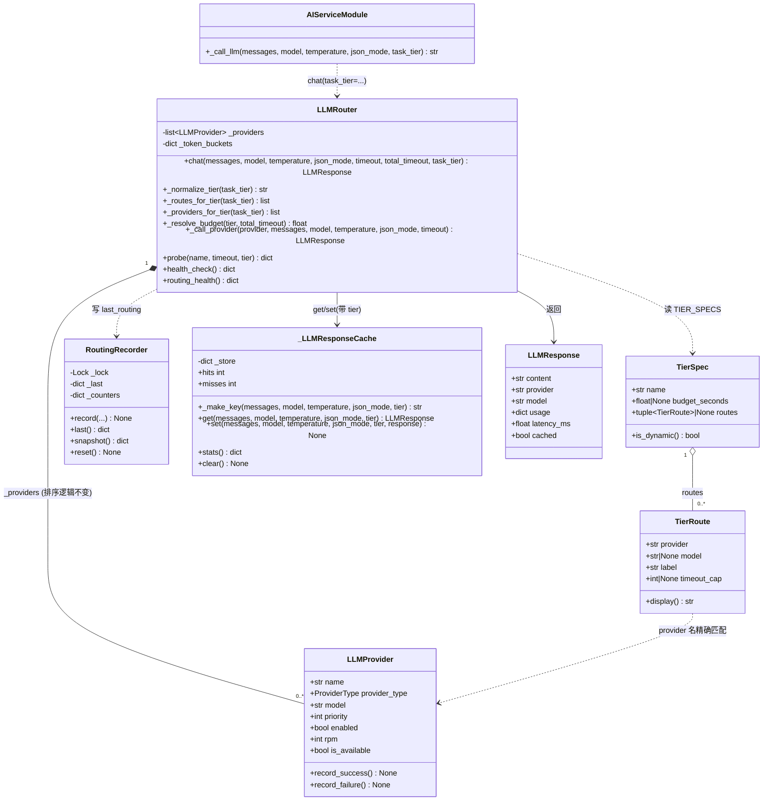
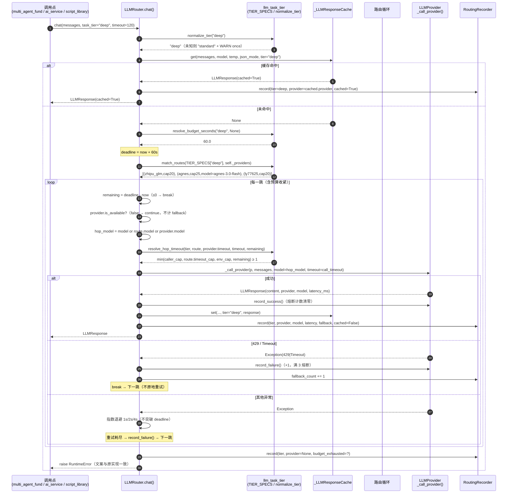
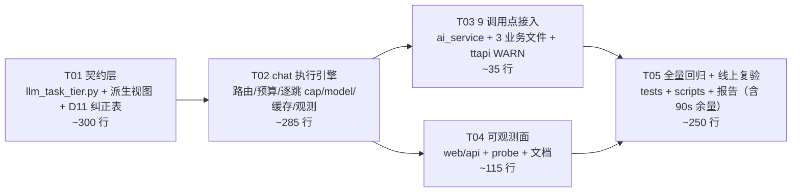

# 增量架构设计：按任务难度分层调度 LLM（Task-Tier Routing）

- **Language**: 中文
- **Programming Language**: Python（后端 `src/core/llm_router.py` 及其调用点；**零前端改动**）
- **Project Name**: `fund_assessment_llm_task_routing`
- **文档类型**: 增量系统设计 + 任务分解
- **日期**: 2026-11-07
- **作者**: 高见远（架构师）
- **上游输入**: `docs/llm-task-routing-prd-2026-11-07.md`（**PRD v2**，许清楚）+ 主理人两轮补充事实与拍板
- **主理人已拍板决策**: **D1~D13**（本文 §1.2 逐条落地，不再复议；D9~D13 覆盖前序 D3/D4 的部分口径）
- **新增强约束**: **前端 90s 硬 abort**（`web/static/index.html:6034`，外生约束，不可改）→ 见 §1.5
- **状态**: 待评审 → 交给工程师实现

---

## 0. 结论摘要（先看这 8 行）

| # | 结论 | 依据 |
|---|---|---|
| 1 | `chat()` 签名追加 `task_tier: str = "standard"`，**standard 档的动态链恒等于 `self._providers` 全链原序** | 现有 4 条用例（`test_chat_429_opens_circuit_after_3_requests` 等）向 router 动态 `add_provider()` 后要求 `chat()` 必须遍历到它们，**standard 不可能是静态配置表**（§1.1 矛盾 1） |
| 2 | 分层只发生在 `deep` / `light`，`standard` 是"保底档 = 全链"，不承担分层职责 | 同上；且 AC2 直接要求 `_providers_for_tier("standard") == list(self._providers)` |
| 3 | model 覆盖是**路由条目级**（`TierRoute.model`），随降级逐跳切换，绝不全局下发；另加**平台级模型 ID 纠正表**修线上 `AGNES_MODEL` 旧值（D11） | 修复现状 `model` 参数广播给所有 Provider 的缺陷（§1.1 矛盾 2） |
| 4 | 缓存 key **必须加 tier**，因为三个档位的首跳是同一个 `(zhipu_glm, glm-4.7-flash)`，model 进 key 提供零隔离 | F3 + AC5（§1.1 矛盾 3，这是本次设计最"反直觉"的一条） |
| 5 | tier 映射**只写在代码常量**里，不进 `config/*.yaml`；只给 timeout 留 env 旋钮 + 一个 `LLM_TIER_ROUTING_ENABLED` 旁路开关 | §1.3 |
| 6 | 预算按 D12：deep **60s**（glm 20 / agnes 25 / gemini 20）、light **15s**（各 10）、standard 继承 `LLM_TOTAL_TIMEOUT`（25s，**单跳 cap 默认不设**，见 §1.5/B5） | 既满足前端 90s abort，又保住"不传 tier 时逐字节不变" |
| 7 | 新增 1 个纯数据模块 `src/core/llm_task_tier.py`，`llm_router.py` 只加薄封装 | `llm_router.py` 已 994 行；纯数据模块可脱离 env 单测，无循环依赖 |
| 8 | **前端 90s 硬 abort 是外生约束**（`web/static/index.html:6034`）：deep 墙钟上界 ≈62s，余量 ≥25s；单跳必须**逐跳封顶**（20/25/20），否则一个 Provider 吃掉 60s 预算、后两跳无机会 | §1.5 算术证明 + D12（这是"deep 预算 60s"之外的第二个时间约束） |
| 9 | **`_call_ttapi_direct` 死兜底：保留 + 加 WARN（不改逻辑、不改测试）** | 线上无 `TTAPI_API_KEY`，该路径在发请求前就 `raise ValueError`，真实成本 = 0；改造成"链末档重试"会把 60s 翻倍成 120s 击穿前端 90s（§1.6） |
| 10 | 任务分解 **5 个任务**，依赖链 `T01 → T02 → {T03 ‖ T04} → T05` | §5 |

---

## 1. 设计决策记录

### 1.1 三个设计矛盾的裁决

#### 矛盾 1：C2「standard 链必须等于现有顺序」vs P0-1「默认 standard」

**裁决：选 (b) 的强化版 —— 默认值 `"standard"`，且 standard 的链在运行时动态等于 `list(self._providers)` 全链原序（不查表、不过滤、不改序）。同时接受 `None` 作为同义入参。**

**理由（这是硬证据，不是偏好）：**

`tests/test_llm_router.py` 中有 4 条用例先用 `patch.dict(os.environ, {}, clear=True)` 造出**空 router**，再 `router.add_provider(...)` 注入临时 Provider，然后**要求 `chat()` 真的遍历到它**：

| 用例 | 行 | 硬要求 |
|---|---|---|
| `test_chat_all_providers_fail` | 117-133 | `chat()` 必须抛 `RuntimeError` 且走进 `fail_provider` |
| `test_chat_non_429_still_retries` | 763-796 | 注入 `flaky`，断言 `calls["n"] == 3`（真的按退避重试了它） |
| `test_chat_429_opens_circuit_after_3_requests` | 798-826 | 注入 `always_429`，断言 `provider._fail_count == i+1`（熔断计数依赖"真的被遍历到"） |
| `test_health_check_returns_all_fields` | 829-853 | 注入 `test_p`，要求出现在 `health_check()` |
| `tests/test_llm_budget.py` 全部 3 条 | 29-54 | 注入 `slow`，断言 `_call_provider` 被调用 |

这些 Provider 名字（`fail_provider` / `flaky` / `always_429` / `test_p` / `slow` / `healthy` / `a` / `b`）**不可能出现在任何静态 tier 映射表里**。若 standard 链取自配置表，这 8+ 条用例会全部改变语义（不是改断言文案能救的，是"根本没调用到"）。**因此 standard 必须是运行时派生的全链视图。**

顺带论证 (a)（默认 `None`）为何不选：`None` 与 `"standard"` 会成为两套并存的行为（前者不过滤、后者可过滤），而 AC2 又要求 `_providers_for_tier("standard") == _providers`，等于把 `"standard"` 钉死成全链 —— 那么 `None` 和 `"standard"` 行为必然相同，多一个默认值分支只是纯认知负担。**保留 `None` 仅作向后兼容别名**（老调用点/第三方脚本可能显式传 `None`），行为等价于 `"standard"`。

**`_providers_for_tier` 契约（完整版见 §3）：**

| 入参 | 返回 | 说明 |
|---|---|---|
| `None` | `list(self._providers)`（原序，元素同一性不变） | 别名 → `"standard"` |
| `"standard"` / `"STANDARD "` / `" Standard"` | `list(self._providers)`（原序） | 大小写与空白归一化后精确匹配 |
| `"deep"` | `[zhipu_glm, agnes, ly77625]` 中**实际已加载**的那些（原序按 D9 映射表顺序） | 缺省的跳过 |
| `"light"` | `[zhipu_glm, agnes]` 中实际已加载的那些 | 同上 |
| `""` / `"bogus"` / `123` / `[]` | 同 `"standard"` + **一条 WARN**（同一非法值只 WARN 一次） | D8 |
| 映射表命中但**一个 Provider 都没加载** | 回落 `list(self._providers)` + WARN | fail-open，见 §3 |
| 全局旁路 `LLM_TIER_ROUTING_ENABLED=0` | 一律 `list(self._providers)` | 运维回滚开关 |

> 注意返回的是 `LLMProvider` 对象本身（不是副本），`is_available` 熔断状态与 `_fail_count` 仍是**唯一实例共享**——这是 AC3 / 熔断计数不变量所要求的。`LLMProvider` 是 dataclass 且 `_key_lock` 已标 `compare=False`，所以 `[p for p in router._providers] == list(router._providers)` 逐元素为真，AC2 的字面断言可原样通过。

#### 矛盾 2：`chat(model=...)` 是全局覆盖

现状：`chat(model=m)` → 循环内 `_call_provider(provider, ..., model=m)`，**每一个** provider 都收到 `m`。若 tier 链里 `agnes` 条目要覆盖成 `agnes-3.0-flash`，绝不能把该 model 发给 `zhipu_glm`。

**裁决：model 覆盖内聚在路由条目上，逐跳解析，`_call_provider` 每次只收到"这一跳该用的模型"。**

数据结构（`TierRoute.model`）：

```python
TierRoute(provider="agnes", model="agnes-3.0-flash", label="agnes_30")
```

**匹配规则：provider 名精确字符串相等（大小写敏感，`==`，不做前缀/模糊/别名匹配）。** 不做"model 归属表"，因为 model 名不是全局唯一的（同名 model 在不同平台上语义可能不同），而 provider 名在 router 内已是主键（`_token_buckets` 也用它做 key）。

**逐跳解析与降级切换规则：**

```
effective_model(第 i 跳) =
      model 参数（调用方显式指定，最高优先级）
   或 route_i.model（该跳的路由覆盖）
   或 provider_i.model（Provider 自身配置）
```

- 显式 `model=` 入参仍保持"最强覆盖"语义（向后兼容：`_call_llm` 里 `model if model != _DEFAULT_MODEL else None`，正常路径下恒为 `None`）。
- 降级到下一跳时，`effective_model` **按下一跳自己的 `route.model` 重新计算**，不存在"沿链继承"。即 deep 三跳的模型分别是：`zhipu_glm` → `glm-4.7-flash`（provider 默认）、`agnes` → `agnes-3.0-flash`（route 覆盖）、`ly77625` → `gemini-3.8-flash`（provider 默认）。
- `route.model=None` 一律表示"用 Provider 自己的 `model`"，**不写死**。这样 `ZHIPU_MODEL` / `LY77625_MODEL` 这类既有 env 覆盖继续有效。**只有 `agnes` 需要覆盖**（线上 `AGNES_MODEL=agnes-2.0-flash` 已 500），且 D11 给了两道独立保险：`_load_from_env` 的纠正表 + `route.model`。
- 归一化是**逐跳**的：`hop_model = 显式 model 入参 or route.model or provider.model`，然后在 `_call_provider` 内 `use_model = hop_model or provider.model`。**同一个 model 字符串绝不会被发给第二个 Provider**（除调用方显式 `model=` 的场景，那是调用方自己的意图）。

**为什么不用"新增 Provider `agnes_30`"（D7 已否决，此处补全技术论证）：** 除 D7 的测试硬断言外，新增 Provider 还会引入第三个 `rpm` 令牌桶与独立熔断器，让 `agnes` 与 `agnes_30` 表现为"两条异源链路"，而它们其实是同一上游、同一 Key —— 与 F1（伪冗余）同类错误。

#### 矛盾 3：缓存 key 与 tier 的关系

**裁决：`tier` 必须进缓存 key。`model` 进 key 提供的隔离度为零。**

反直觉但必须看清的三点：

1. **查 key 发生在路由之前。** `chat()` 第一行就是 `_llm_cache.get(...)`，此时还没选 Provider，**不可能知道"这次会用哪个 model"**。所以 key 里只能放请求级参数（`messages / model 入参 / temperature / json_mode / tier`），放 resolved model 在时序上做不到。

2. **三个档位的首跳是同一个模型。** 按 D3 与"light 不消耗未知额度"的约束，`deep[0] = zhipu_glm/(默认 glm-4.7-flash)`、`standard[0] = zhipu_glm/(默认 glm-4.7-flash)`、`light[0] = zhipu_glm/(默认 glm-4.7-flash)`。**如果 key 只靠 model 区分，那么三档 key 完全相同** —— light 的答案会 100% 命中给 deep，F3 的污染不是"可能"，是"必然"。这是把 tier 放进 key 的决定性理由。

3. **AC5 的字面要求也需要它。** AC5："先以 light 调同一 prompt，再以 deep 调同一 prompt，第二次 `cached == False`"。若不加 tier，第二次必然 `cached == True`（因为首跳同模型）。

**实现方式（最小侵入，零测试破坏）：**

```python
def _make_key(self, messages, model, temperature, json_mode, tier: str = "") -> str:
    payload = _json.dumps({
        "m": messages, "model": model or "",
        "temp": round(temperature, 2), "json_mode": json_mode,
        "tier": tier,                      # ← 新增，恒为规范化后的档名（默认 "standard"）
    }, sort_keys=True, ensure_ascii=False)
```

- `get()` / `set()` 的第 5 位参数**带默认值 `tier=""`**，因此任何直接调用方（含未来第三方脚本）不传也不炸。
- `chat()` 里 tier 永远是**规范化后的字符串**（`"standard"` / `"deep"` / `"light"`），不会是 `None` 或 `""`，避免"未传"与"standard"产生两套 key。
- `_make_key` 是私有方法，全仓 `tests/` 无任何直接调用（已 grep 确认），只被 `get`/`set` 使用 —— 加参数零风险。
- **副作用（可接受且有意为之）**：部署后旧缓存条目因 key 变化全部失效，等价于一次冷启动。缓存 TTL 仅 300s，无持久化，无业务影响。`tests/conftest.py:61-91` 已对每个用例 `_llm_cache.clear()`，因此测试间无跨档串扰。

### 1.2 D1~D13 落实方式

| 编号 | 决策 | 落实位置 / 做法 | 验收信号 |
|---|---|---|---|
| **D1** | 不引入付费模型，`agnes-2.5-pro-*` 保留配置但永不入链 | 代码中**本就不存在** `agnes-2.5-pro-alpha/beta` 这两个 Provider（它们是 Agnes 平台的 model 名，从未在 `_load_from_env` 里注册）。因此**零改动**，只在 `TIER_SPECS` 与文档排除表中声明"不入链"，并写单测断言三档链中不含这些 model 字符串 | `tests/test_llm_task_tier.py::test_no_paid_model_in_any_tier` |
| **D2** | `deep` 总预算 **60s**（非 90s） | `TIER_SPECS["deep"].budget_seconds = 60.0`；注释写明"Render 免费层 ~100s 请求上限、**前端 90s 硬 abort**，留余量；deep 实测 9.7~16.5s，60s 够 3 次降级" | `routing.budgets_seconds["deep"] == 60.0` |
| **D3** | ~~合规优先：deep 首位 `zhipu_glm`~~ → **由 D9 细化并取代**（结论一致：首位 zhipu_glm；但第 2/3 顺位由 D9 重排） | 见 D9 | 见 D9 |
| **D4** | 失效对象 `enabled=False` 保留（不删代码、不改 priority） | `_load_from_env()` 中 ttapi 分支加 `enabled=False`（**只加一行，不动 `priority=0`**）；`agnes-2.5-pro-alpha/beta` 在代码中**无对应 Provider**（是 Agnes 平台 model 名），零改动，仅登记在 `GLOBAL_EXCLUDED_MODELS`；`zhipu_glm_45` 的处置见 D10 | `git diff` 中 `priority=` 行数 = 0；`probe()` 仍返回 ttapi（probe 不看 `enabled`） |
| **D5** | `agnes-2.5-flash` 从**所有档位**排除 | `TIER_SPECS` 中任何 `TierRoute.model` 都不等于 `agnes-2.5-flash`；单测断言 | `test_no_agnes_25_flash_in_any_tier` |
| **D6** | `agnes-3.0-flash` **可入 deep 链**（原议为第三顺位，**D9 已提升为第 2 顺位**） | `TierRoute("agnes", "agnes-3.0-flash", "agnes_30")` 同时出现在 `deep[1]`（0-based）与 `light[1]` | `routes["deep"][1]["model"] == "agnes-3.0-flash"`；`routing.routes.deep[1].label == "agnes_30"` |
| **D7** | **禁止新增 Provider**；改用 `tier → [(provider_name, model_override)]` 映射 | 新模块 `src/core/llm_task_tier.py` 定义 `TierRoute`/`TierSpec`/`TIER_SPECS`；`LLMRouter` 增 `_routes_for_tier()` 派生视图；`_providers` / `add_provider()` / `sort()` **一行不动**；`AGNES_MODEL=agnes-2.0-flash` 问题由 **D11 纠正表 + `route.model` 覆盖**双保险解决（不需要新增 `agnes_30` Provider） | `len(router._providers)` 不变（仍 15 个加载分支）；`_providers[0..2]` / `_providers[-1]` 断言原样通过 |
| **D8** | 未知 tier → 回落默认档 + WARN，绝不抛异常 | `normalize_tier()` 对 `None`/空串/非字符串/未知字符串一律返回 `"standard"`，并用模块级 `set` 去重 WARN（防日志刷屏） | `test_unknown_tier_falls_back_with_warn`（AC8） |
| **D9** | **deep 链顺序（最终）**：`zhipu_glm(glm-4.7-flash) → agnes(agnes-3.0-flash) → ly77625(gemini-3.8-flash)`；standard / light 沿用 PRD v2 | `TIER_SPECS["deep"].routes` 按此序；`light = zhipu_glm → agnes(3.0)`；standard 见 D13（动态全链，在线上等价于同序，见下方"自洽性核验"） | `_providers_for_tier("deep") == ["zhipu_glm", "agnes", "ly77625"]` |
| **D10** | `zhipu_glm_45` → **`enabled=False`，不删除，`priority` 数值不动** | `_load_from_env()` 的 `zhipu_glm_45` 分支加 `enabled=False`。**同时保留 `same_upstream_as` 标注**（F1） | ① `test_llm_router.py:511` 的 `_providers[1].name == "zhipu_glm_45"` 与 `:512` 的 `priority == 1` 仍绿（`enabled` 不影响列表成员与 priority）；② `probe()` 侧 4 条用例仍绿（见下方"零回归核验"） |
| **D11** | `agnes` 过期模型 ID 必须在**代码层纠正**（改 `os.getenv` 默认值对线上 env 无效）；**同时** tier 链显式 `model_override` 双保险 | 新增纯函数 `correct_model_id(provider, model)` + 常量表 `KNOWN_MODEL_REPLACEMENTS`（`"agnes:agnes-2.0-flash" → "agnes-3.0-flash"` 等），在 `_load_from_env()` 构造 agnes Provider 时调用并 WARN；`TierRoute("agnes", "agnes-3.0-flash", "agnes_30")` 作第二道保险 | 单测：`AGNES_MODEL=agnes-2.0-flash` → `provider.model == "agnes-3.0-flash"` 且产生 1 条 WARN；再断言 tier 链第二跳解析出的 model 亦是 `agnes-3.0-flash`（两道保险独立生效） |
| **D12** | 预算（含前端 90s 约束）：deep 单跳 `20/25/20` + 链预算 **60s**；light 单跳 `10/10` + 链预算 **15s**；standard 25s | `TierRoute.timeout_cap = 20 / 25 / 20`（deep）、`10 / 10`（light）；`TierSpec.budget_seconds = 60 / 15`；standard `budget_seconds=None` 继承 `LLM_TOTAL_TIMEOUT`(25)。**standard 的"各 15s"以 `LLM_TIER_HOP_TIMEOUT_STANDARD` env 形式落地、默认不启用** —— 见 §1.5 的偏离说明（B5） | ① `multi_agent_fund` 的 `timeout=120` 被收紧：首跳 `_call_provider` 实收 `timeout == 20`，`budget == 60`；② 最坏墙钟 ≤ 62s < 90s（§1.5 算术） |
| **D13** | standard 的 AC2 处理采用**方案 (b)**：默认 `"standard"`，standard 链 = **全量 `_providers` 按 priority 原序**，不做 tier 过滤，靠运行时 `is_available` 跳过 disabled；`None` 等价 `"standard"`（不造第二种默认语义） | `TierSpec(routes=None)` + `spec.is_dynamic → [(p, None) for p in self._providers]`；与 §1.1 矛盾 1 的裁决完全一致（我原本已选此方案，D13 予以确认） | `_providers_for_tier("standard") == list(self._providers)` 字面成立，AC2 无需特例 |

**D9 与 D13 的自洽性核验（重要，避免工程师误以为两条冲突）：**

D9 说 "standard = zhipu_glm → agnes(3.0) → ly77625"，D13 说 "standard = 全量 `_providers` 原序"。两者**不冲突**，因为 D10 把 `zhipu_glm_45` 设为 `enabled=False`：

线上实际加载 4 个 Provider，按 priority 排序为 `zhipu_glm(-1) → zhipu_glm_45(1) → agnes(90) → ly77625(95)`。`chat()` 循环内 `is_available` 为假即 `continue`，于是 standard 的**有效跳序** = `zhipu_glm → agnes → ly77625`（`zhipu_glm_45` 被运行时跳过）。配合 D11 的模型纠正，agnes 的 model 自动变为 `agnes-3.0-flash`。**结论：D13 的机制在线上产生的行为就是 D9 声明的标准链，不需要为 standard 写任何静态映射。**

**D10 零回归核验（逐条用例）：**

| 用例 | 断言 | `enabled=False` 的影响 |
|---|---|---|
| `test_llm_probe_api.py:71-72` | `ok_count == 2`，results == `["zhipu_glm", "zhipu_glm_45"]` | **无影响** —— `probe()` 不检查 `is_available`（本文明确要求保持不变） |
| `test_llm_free_providers.py:167` | probe results 含 `zhipu_glm_45` | 同上，无影响 |
| `test_llm_free_providers.py:120-126` | `[p.name for p in _providers]` 名单含 `zhipu_glm_45` | 无影响（`enabled` 不改列表成员） |
| `test_llm_free_providers.py:130-137` | `model == "glm-4.5-flash"`、`priority == 1`、`rpm == 30` | 无影响 |
| `test_llm_router.py:509-516` | `_providers[1].name`、`priority == 1` | 无影响 |

> 唯一副作用：`available_providers` 与 `health_check()[...]["available"]` 不再含 `zhipu_glm_45`——**无任何用例断言这两处包含它**（已 grep 全仓确认）。这正是 D10 想要的效果：它从"可用链"消失，但配置与 priority 全部保留。

### 1.2.1 x-deepseek-v4.1-flash 是否纳入（主理人要求给结论）

**结论：本期不纳入任何档位的链。**

| 维度 | 判断 |
|---|---|
| 与 `gemini-3.8-flash` 的关系 | **同一个 provider（`ly77625`）** → 共享同一 `TokenBucket`、同一熔断器、同一（未验证的）额度、同一数据出口。加它**不增加任何可用性冗余**，属 F1 同类错误（把同源当异源） |
| 证据强度 | E1 样本是 `{"ok":true,"cap":2}`（2.72s、JSON 严格）—— 只证明"能出短 JSON"，**未验证 2K~6K 长输出**（deep 的硬需求）。与 `agnes-3.0-flash` 当初的疑问同性质 |
| 放进 light 是否合适 | PRD §5.1 明确"不给最廉价任务消耗 `ly77625` 未知额度"，放 light 违背该原则 |
| 放进 deep 是否合适 | D9 已定 `ly77625` 只做末位异源兜底，再加同 provider 的第二模型等于把末位自我重复 |

→ 登记为 **P2 候选**，写入 `docs/free-llm-providers.md`；补测"长 prompt 2K+ 输出"后再评估。**不阻塞本期。**

### 1.3 配置化决策：代码常量 vs `config/*.yaml`

**裁决：tier 映射只写代码常量，不进 yaml；只为"预算"和"全局旁路"开 env 旋钮。**

| 方案 | 优点 | 致命问题 | 结论 |
|---|---|---|---|
| `config/settings.yaml` | 无需改代码即可调 | ① `src/utils/config.py:36` 用 `Path("config")` **相对 CWD** 加载，CWD 不是仓库根时静默读不到 → 静默退回默认值，路由悄悄变了，与 G3「可控可回滚」直接冲突；② `Config` 是首次 import 时的单例，改 yaml 必须重启，和改代码等价；③ yaml 里 model 名无类型检查，拼错只在线上 400 才发现；④ 新增"文件缺失 / 字段缺失"两类失败模式，收益为零 | **否决** |
| `os.getenv` 环境变量 | 线上可热调 | 主理人明确：Render 环境变量手工维护，比代码更不可靠（D7 已因 env 失配踩过 `AGNES_MODEL` 的坑）；且 `deep` 首位是谁属于**合规决策**，不该由 ops 面板决定 | **否决（映射部分）** |
| **代码常量** | 类型安全、PR 可评审、单测直接断言常量、随代码一起灰度/回滚、无新增失败模式 | ops 不能改路由（但这正是想要的：路由是设计决策不是运维参数） | **采纳** |

**保留的 env 旋钮（仅 2 类，都只影响"多大/开不开"，不影响"发给谁"）：**

| env | 默认 | 作用 |
|---|---|---|
| `LLM_TIER_ROUTING_ENABLED` | `1` | 全局旁路：`0` → 所有档位退化为全链，等价"分层上线但未启用"。**这是唯一的线上回滚开关，一条环境变量即可恢复今日行为，不需要回滚代码** |
| `LLM_TIER_TIMEOUT_DEEP` / `_STANDARD` / `_LIGHT` | `60` / 空(=25) / `15` | 覆盖各档**链总预算**；`STANDARD` 留空即继承 `LLM_TOTAL_TIMEOUT`（见 §4.1） |
| `LLM_TIER_HOP_TIMEOUT_<TIER>` | 空（未设置） | 覆盖该档**单跳上限**。默认不设 → 走各跳 `TierRoute.timeout_cap` 或旧公式。**D12 里 "standard 各 15s" 就是靠这条落地而不是写死常量**（理由见 §1.5 B5） |

> 取舍理由一句话：**"发给谁"进代码受 review 保护，"多久/开不开"进 env 保持运维弹性。**

### 1.4 必须写进设计的三条已知限制（不是缺陷，是设计边界）

| # | 限制 | 后果 | 处置 |
|---|---|---|---|
| **L1** | **首跳同源**：`deep[0]`、`standard[0]`、`light[0]` 全是 `zhipu_glm/glm-4.7-flash`（D9 合规优先 + 免费 + 200K 上下文的必然结果） | 分层只分层了**降级链**与**预算**，没有分层"正常路径"。高峰期 30 rpm 打满时三档**一起 429**，分层不能缓解主力模型压力；这也是为什么缓存 tier 隔离是必需的（矛盾 3） | 接受。令牌桶已按 provider 共享限流，不会超额打穿。好消息：D9 把 `agnes(3.0)` 提到 deep 第 2 顺位，deep 的**第 2 跳起就已异源**（今日是全 GLM 系），可用性实质改善。若要连首跳也分层，唯一解是接入新的异源免费 Provider（本期 Non-Goal），列 P2 |
| **L2** | `zhipu_glm` 与 `zhipu_glm_45` 共享 Key/配额（F1） | 二者若同时可用只是两次同源重试，**不构成冗余** | **D10 已直接消除该风险**：`zhipu_glm_45` 置 `enabled=False`，运行时不再消耗同一 30 rpm 配额，把限流预算全部让给 `zhipu_glm`。`health` 仍以 `same_upstream_groups` 保留"它们同源"的事实标注，避免运维误判 |
| **L3** | `agnes` 平台的 `agnes-3.0-flash` 线上可用性未验证（该账户曾 403 / `agnes-2.0-flash` 曾 500） | 它是 deep **第 2 顺位**与 light 第 2 顺位 → 若不可用，deep 有效链降为 `zhipu_glm → ly77625`（2 跳） | 接受（fail-open：死了就跳下一跳）。**注意：即使降为 2 跳，仍优于今日**——今日第 2 跳是同源 `zhipu_glm_45`（D10 已禁用），伪冗余；新方案第 2 跳是真正的异源。`probe(tier=deep)` 可一键验证；D11 的纠正表保证"平台恢复后用的也是当前 ID" |

### 1.5 前端 90s 硬 abort 是外生约束（时间预算证明）

**事实（已核实，不改前端）：** `web/static/index.html:6034` `const timeoutMs = 90000;` + `:6035` `setTimeout(() => _fundAnalyzeAbortController.abort(), timeoutMs)`；`:6032` 附近进度文案写死 `${elapsedSec}s / ~90s`。**前端 90s 一到就 abort，后端仍在跑，用户看到"失败"而不是"降级后成功"。**

**设计后果（必须写死的三条）：**

1. **deep 的 60s 是硬上限，不是建议值。** 任何让 deep 链总耗时可超过 ~85s 的设计（如 PRD 原建议的 90s、或让单 provider 撑满 90s）都会导致"后端还在降级、前端已 abort"的**最坏组合**：用户拿不到结果，且后端继续消耗额度。
2. **单跳超时必须逐跳封顶，且最坏墙钟要有算术证明**（下表）。
3. **禁止"再套一层全链重试"**（这也是我否决 `_call_ttapi_direct` 改成"tier 链最后一档重试"的原因之一，见 §1.6）。

**最坏墙钟算术（deep 档，`multi_agent_fund` 传 `timeout=120` 的情形）：**

| 项 | 值 | 推导 |
|---|---|---|
| 链总预算 | `B = 60s` | `TIER_SPECS["deep"].budget_seconds` |
| 第 1 跳上限 | `min(120, cap 20, remaining 60) = 20s` | `caller_cap=120` 被 `route.timeout_cap=20` 与 `remaining` 双重夹逼 |
| 第 2 跳上限 | `min(120, cap 25, remaining 40) = 25s` | 累计 45s |
| 第 3 跳上限 | `min(120, cap 20, remaining 15) = 15s` | 累计 60s，`remaining` 见底 |
| 预算外溢上界 | `+ max(1, int(...)) 的 1s 下限` ≈ **+1s**；令牌桶等待在 `min(10, remaining)` 内且计入 `deadline`；退避 `delay = min(delay, deadline-now)` 同样计入 | 代码里三处等待都被 `deadline` 夹住 |
| **整链墙钟上界** | **≈ 61~62s** | 60 + ≤1s 取整外溢 + 计时粒度 |
| 加上 prompt 构建 / 令牌桶瞬时竞争 / JSON 解析 | **≈ 65s** | 实测 deep 端到端 9.7~16.5s，此为悲观上界 |
| 前端硬限 | **90s** | 余量 **≥ 25s** ✅ |

**standard / light 的对照：** standard `B=25s` → 墙钟 ≤26s；light `B=15s` → ≤16s。两者都远低于 90s，且不经过 7 智能体前端（只有 `multi_agent_fund` 走 deep 且受 90s 约束）。**三档全部满足 `墙钟 < 90s`。**

**D12 中 "standard 各 15s" 的落地偏离（需主理人确认，B5）：**

D13 要求 standard = 动态全链、**不改变今日任何行为**；而今日 standard 跳的上限是 `min(provider.timeout, remaining ≤ 25)`（例：`zhipu_glm` 可跑到 25s）。若按 D12 把 standard 跳硬压到 15s，则：

- 今日一个 18s 才返回的 JSON 抽取会**成功**，改后会在 15s 处 `Timeout` → 落到下一跳 `agnes` → 可能拿到不同模型的结果；
- 这违反 G3「不传 tier 时行为 100% 可复现」与 AC2 的字面要求。

**我的处理：standard 的单跳 cap 默认 `None`（不改），但提供 `LLM_TIER_HOP_TIMEOUT_STANDARD` env 作为可选收紧（默认未设置）。** 即：能力具备、默认零回归。若主理人坚持"standard 一律 15s"，只需线上加一条 env，无需改代码 —— 但请明确接受"这是行为变更"。

### 1.6 `_call_ttapi_direct` 死兜底的最终结论

**结论：保留现状（不改代码），只补一条可见性 WARN。**

**这不是"偷懒不改"，而是基于实测事实推翻 PRD 的假设：**

| 事实 | 核实 | 含义 |
|---|---|---|
| 线上 `/api/health` 显示 `ai_keys.ttapi = false` | `_check_api_keys()["ttapi"] = bool(_get_ttapi_api_key())`（`ai_service.py:85`） | Render 未配置 `TTAPI_API_KEY` |
| `_call_ttapi_direct` 第一行就检查 key | `ai_service.py:537-539`：`if not ttapi_api_key: raise ValueError("TTAPI_API_KEY 未配置...")` | **线上该路径根本不会 `requests.post`**，在本地就抛 `ValueError` |
| 因此真实成本 | **0 次网络请求、0 秒延迟、0 额度** | PRD 说"兜底必然失败/白跑 4.83s"是**基于 Key 存在的假设**；线上无 Key，成本可忽略 |

**三种方案对比（为什么选 A）：**

| 方案 | 后果 | 裁决 |
|---|---|---|
| **A. 保留现状 + 补 WARN** | 线上零成本；`tests/test_ai_service.py:608,620` 两条断言原样通过（AC1 不受影响）；真实故障通过日志与 `last_routing.error` 可见 | **✅ 采纳** |
| B. 改造成"tier 链最后一档重试" | `chat()` 已对全链逐个降级；再套一层 = 把 60s 预算翻倍到 120s，**直接击穿前端 90s abort**，且熔断计数被重复累加。这是三个方案里**唯一会造成线上可见故障**的 | ❌ 明确否决 |
| C. 直接抛错 | 逻辑最干净，但必须改写 `test_falls_back_to_ttapi_on_router_unavailable`(:608) 与 `test_falls_back_to_ttapi_on_router_exception`(:620) 的断言 → 与 AC1「既有断言不改、用例不减」冲突 | ⏸ 缓到下一增量（需主理人授权改断言） |

**方案 A 的具体改动（3 行）：** 在 `_call_llm` 的 `except RuntimeError` / `except Exception` 两个分支里，调用 `_call_ttapi_direct` **之前**加一条

```python
logger.warning(
    f"[llm-routing] Router 全链失败，进入 _call_ttapi_direct 兜底（该路径无 Key 时必然失败，"
    f"请检查 Provider 配置）: {e}"
)
```

并给函数加上 `# DEPRECATED(2026-11-07): ttapi.io 已 404（E1），保留仅为兼容既有测试；P2 移除`

---

## 2. 数据结构与接口

### 2.1 改动文件总览

| 文件（相对路径） | 类型 | 预计改动 | 说明 |
|---|---|---|---|
| `src/core/llm_task_tier.py` | **新增** | ~235 行 | 纯数据 + 纯函数，零第三方依赖，不 import `llm_router`（无循环依赖） |
| `src/core/llm_router.py` | 修改 | **+195 / -13** | `chat` / `_call_provider` 调用点 / `_LLMResponseCache` / `probe` / `health_check` / 新增 `routing_health` / `_load_from_env` 三处（D4 ttapi、D10 glm_45、D11 agnes） |
| `src/core/ai_service.py` | 修改 | +30 / -3 | `_call_llm(task_tier=...)` 透传 + 6 处调用点 + ttapi 兜底前加 WARN（§1.6） |
| `src/analysis/multi_agent_fund.py` | 修改 | +3 | `task_tier="deep"` + 时间护栏注释 |
| `src/analysis/script_library.py` | 修改 | +1 | `task_tier="light"` |
| `src/analysis/news_aggregator.py` | 修改 | +1 | `task_tier="light"` |
| `web/api.py` | 修改 | +40 / -3 | `/api/health/llm` 增 `routing` 段；`/probe` 增 `tier` 参数 |
| `tests/test_llm_task_tier.py` | **新增** | ~220 行 | 契约层单测（AC2/AC3/AC4'/AC8 + 排除集 + D11 双保险 + D12 逐跳 cap） |
| `tests/test_llm_router.py` | 修改 | +110（**只追加，不改既有断言**） | AC5/AC6/AC7 + 缓存 tier + last_routing + model 不串档 |
| `tests/test_llm_budget.py` | 修改 | +45（只追加） | **deep 120→60 收紧锁死**、逐跳 cap、墙钟上界（AC15） |
| `tests/test_llm_probe_api.py` | 修改 | +45（只追加） | `routing` 段 + `probe?tier=` + 无 key 泄露（AC9/AC10/AC11） |
| `tests/test_llm_tier_routing_regression.py` | **新增** | ~140 行 | 端到端 tier 契约回归（QA 侧） |
| `scripts/verify_llm_tier_routing.py` | **新增** | ~110 行 | 线上复验脚本（AC9~AC15） |
| `docs/free-llm-providers.md` | 修改 | +30 | 补 tier 归属 / 失效与同源标注 / `x-deepseek` P2 说明 |
| `docs/llm-task-routing-verification-2026-11-07.md` | **新增** | - | QA 复验报告 |

**禁改清单**：`_providers.sort(...)`（2 处）、任何 `priority=` 行、**`web/static/**`（前端 90s 是外生约束）**、`requirements*.txt`、`pyproject.toml`。

### 2.2 `src/core/llm_task_tier.py`（新模块，可直接照抄实现）

```python
"""任务难度分层路由的纯数据与纯函数定义（零第三方依赖、零 os.getenv 副作用）。

设计约束（见 docs/llm-task-routing-design-2026-11-07.md）：
- 只描述"哪个档位该用哪些 (provider, model)"，不持有一分钱运行时状态
- 不 import src.core.llm_router（避免循环依赖）；对 Provider 对象仅做鸭子类型（name/model）
- 不新增 Provider（D7）：所有 provider 名必须已存在于 _load_from_env
"""
from __future__ import annotations

import os
from dataclasses import dataclass
from typing import Any

TIER_DEEP = "deep"
TIER_STANDARD = "standard"
TIER_LIGHT = "light"
DEFAULT_TIER = TIER_STANDARD


@dataclass(frozen=True)
class TierRoute:
    """一条路由条目：把某个 provider 按指定模型使用。"""
    provider: str                     # 必须精确等于 LLMProvider.name（大小写敏感）
    model: str | None = None          # None = 沿用 provider.model（保留 ZHIPU_MODEL 等 env 覆盖）
    label: str = ""                   # 展示名（health/日志/AC 命名），空则用 provider
    timeout_cap: int | None = None    # 该跳硬上限（秒），None = 用 provider.timeout

    @property
    def display(self) -> str:
        return self.label or self.provider


@dataclass(frozen=True)
class TierSpec:
    """一个难度档位的规格。"""
    name: str
    budget_seconds: float | None = None       # None = 继承 LLM_TOTAL_TIMEOUT（默认 25s）
    routes: tuple[TierRoute, ...] | None = None  # None = 动态继承 self._providers 全链（仅 standard）

    @property
    def is_dynamic(self) -> bool:
        return self.routes is None


# ===== 三档映射（唯一事实源；改这里必须过 code review，不进 yaml）=====
# D12 单跳上限（timeout_cap）：deep 20/25/20（和 65 > 预算 60 → 末跳被 remaining 夹到 15，整链 ≤60s）
#                              light 10/10（预算 15s → 第 2 跳被夹到 5s）
TIER_SPECS: dict[str, TierSpec] = {
    # D9 deep 链（最终）：zhipu_glm → agnes(3.0) → ly77625
    #  - glm 首位：现状即 priority=-1 在跑，不改变数据出境面（唯一不新增合规暴露的选择）
    #  - agnes(3.0) 第 2：E1 实测 JSON 严格 + 582 tokens 完整 7 分析师 schema，正好补 GLM "JSON mode 未验证"的软肋
    #  - gemini 末位：保留质量优势，但不让它成为默认数据出口（中转站额度/合规 E4 未验证）
    #  - D2 总预算 60s：前端 90s 硬 abort（index.html:6034），留 ≥25s 余量（§1.5 算术）
    #  - L1：首位与 standard/light 首位相同（首跳同源），但第 2 跳起已异源
    TIER_DEEP: TierSpec(
        name=TIER_DEEP,
        budget_seconds=60.0,
        routes=(
            TierRoute("zhipu_glm", None, "zhipu_glm", timeout_cap=20),
            TierRoute("agnes", "agnes-3.0-flash", "agnes_30", timeout_cap=25),  # D6/D11
            TierRoute("ly77625", None, "ly77625", timeout_cap=20),
        ),
    ),
    # D13 standard = 保底档：routes=None → 动态全链（_providers 按 priority 原序，不做 tier 过滤，
    # 靠运行时 is_available 跳过 disabled）。线上 4 provider + glm_45 禁用 ⇒ 有效跳序 = D9 声明的标准链。
    # budget_seconds=None → 继承 LLM_TOTAL_TIMEOUT（默认 25s），保证"线上改过该 env 也不影响旧行为"。
    # 单跳 cap 不设（D12 "各 15s" 用 LLM_TIER_HOP_TIMEOUT_STANDARD 落地，见 §1.5 B5）。
    TIER_STANDARD: TierSpec(name=TIER_STANDARD, budget_seconds=None, routes=None),
    # light：最高频、失败代价最低。D5 排除 agnes-2.5-flash；
    # PRD light 顺位3 的 agnes-2.0-flash 因线上已 500（D7）+ D11 纠正表自动升 3.0，不再单列。
    TIER_LIGHT: TierSpec(
        name=TIER_LIGHT,
        budget_seconds=15.0,
        routes=(
            TierRoute("zhipu_glm", None, "zhipu_glm", timeout_cap=10),
            TierRoute("agnes", "agnes-3.0-flash", "agnes_30", timeout_cap=10),
        ),
    ),
}

# 全档排除对象（仅用于单测与文档，运行时不会出现在链上）
GLOBAL_EXCLUDED_MODELS = frozenset({"agnes-2.5-flash", "agnes-2.5-pro-alpha", "agnes-2.5-pro-beta"})
# 同源关系（F1）：值表示"与谁共享同一上游与配额"，不构成冗余
SAME_UPSTREAM: dict[str, str] = {"zhipu_glm_45": "zhipu_glm"}

# ===== D11：平台级"已知不可用模型 ID → 当前可用 ID"纠正表 =====
# 键格式 "provider:model"（精确匹配，大小写敏感）。
# 存在理由：线上 AGNES_MODEL=agnes-2.0-flash 是【环境变量】，
# 只改 os.getenv("AGNES_MODEL", "agnes-3.0-flash") 的默认值对它【完全无效】。
KNOWN_MODEL_REPLACEMENTS: dict[str, str] = {
    "agnes:agnes-2.0-flash": "agnes-3.0-flash",       # 线上实测 500（D7 备注）
    "agnes:agnes-2.5-flash": "agnes-3.0-flash",       # E1 22.36s + 2123 reasoning tokens + 趋势判错（D5）
    "agnes:agnes-2.5-pro-alpha": "agnes-3.0-flash",   # E1 403 remaining $0（D1 不付费）
    "agnes:agnes-2.5-pro-beta": "agnes-3.0-flash",    # 同上
}

_WARNED_TIERS: set[str] = set()


def correct_model_id(provider_name: str, model: str, warn=None) -> str:
    """把"已知不可用"的模型 ID 纠正为当前可用 ID（D11），并 WARN 提示同步 env。

    这是 D11 的第一道保险；第二道是 TierRoute.model（路由条目显式覆盖）。
    两道独立生效：即使将来有人把纠正表删了，deep/light 仍会用 agnes-3.0-flash。
    """
    key = f"{provider_name}:{(model or '').strip()}"
    target = KNOWN_MODEL_REPLACEMENTS.get(key)
    if not target:
        return model
    (warn or _default_warn)(
        f"Provider [{provider_name}] 配置的模型 {model} 已不可用，自动纠正为 {target}"
        f"（请同步更新环境变量，否则下次仍会走纠正表）"
    )
    return target


def routing_enabled() -> bool:
    """全局旁路开关：LLM_TIER_ROUTING_ENABLED=0 时所有档位退化为全链（线上回滚用）。"""
    return os.getenv("LLM_TIER_ROUTING_ENABLED", "1").strip() not in ("0", "false", "False", "off")


def normalize_tier(task_tier: Any, warn=None) -> str:
    """把任意入参归一化为合法档名；未知值回落 DEFAULT_TIER 并只 WARN 一次。

    D8：绝不抛异常。warn 为可选回调（由 router 传入 logger.warning），便于纯函数单测。
    """
    if task_tier is None:
        return DEFAULT_TIER
    if not isinstance(task_tier, str):
        _warn_once(f"<non-str:{type(task_tier).__name__}>", f"未知 task_tier={task_tier!r}，回落 {DEFAULT_TIER}", warn)
        return DEFAULT_TIER
    key = task_tier.strip().lower()
    if key in TIER_SPECS:
        return key
    _warn_once(key or "<empty>", f"未知 task_tier={task_tier!r}，回落 {DEFAULT_TIER}", warn)
    return DEFAULT_TIER


def _warn_once(key: str, message: str, warn=None) -> None:
    if key in _WARNED_TIERS:
        return
    _WARNED_TIERS.add(key)
    (warn or _default_warn)(message)


def _default_warn(message: str) -> None:  # pragma: no cover - 由 router 注入 logger
    import logging
    logging.getLogger(__name__).warning(message)


def reset_warn_cache() -> None:
    """测试用：清空 WARN 去重缓存。"""
    _WARNED_TIERS.clear()


def resolve_budget_seconds(tier: str, total_timeout: float | None = None) -> float:
    """预算优先级：显式入参 > LLM_TIER_TIMEOUT_<TIER> env > 档位常量 > LLM_TOTAL_TIMEOUT env(默认25)。"""
    if total_timeout is not None:
        return max(float(total_timeout), 0.0)
    spec = TIER_SPECS.get(tier) or TIER_SPECS[DEFAULT_TIER]
    env_key = f"LLM_TIER_TIMEOUT_{tier.upper()}"
    raw = os.getenv(env_key)
    if raw:
        try:
            return max(float(raw), 0.0)
        except ValueError:
            pass  # 非法值忽略，落回常量/全局默认
    if spec.budget_seconds is not None:
        return max(float(spec.budget_seconds), 0.0)
    return max(float(os.getenv("LLM_TOTAL_TIMEOUT", "25")), 0.0)


def resolve_hop_timeout(tier: str, route: TierRoute | None, provider_timeout: int,
                        caller_timeout: int | None, remaining: float) -> int:
    """单跳超时（秒）。route is None ⇒ 逐字节复用今日公式（零回归路径）。

    优先级（数值上取 min，越小越严）：
      1. caller_timeout / provider_timeout（今日语义，保持）
      2. route.timeout_cap（D12 的逐跳封顶：deep 20/25/20，light 10/10）
      3. LLM_TIER_HOP_TIMEOUT_<TIER> env（可选，D12 的 standard 15s 走这条）
      4. remaining（链总预算剩余的硬夹逼，防超出前端 90s）
    下限 1s（与今日 max(1, ...) 一致）。
    """
    if route is None:
        base = caller_timeout if caller_timeout is not None else provider_timeout
        caps = [base, remaining]
        env_cap = _env_hop_cap(tier)          # 默认 None → 不影响结果
        if env_cap is not None:
            caps.append(env_cap)
        return max(1, int(min(caps)))
    caps = [caller_timeout if caller_timeout is not None else provider_timeout]
    if route.timeout_cap:
        caps.append(route.timeout_cap)
    env_cap = _env_hop_cap(tier)
    if env_cap is not None:
        caps.append(env_cap)
    caps.append(remaining)
    return max(1, int(min(caps)))


def _env_hop_cap(tier: str) -> float | None:
    raw = os.getenv(f"LLM_TIER_HOP_TIMEOUT_{tier.upper()}")
    if not raw:
        return None
    try:
        return max(float(raw), 1.0)
    except ValueError:
        return None


def match_routes(spec: TierSpec, providers: list[Any]) -> list[tuple[Any, TierRoute | None]]:
    """把档位规格解析为 [(provider_obj, route_or_None)]。

    - spec.is_dynamic（standard）→ 全链，(p, None)
    - 否则按 spec.routes 顺序精确匹配 provider.name；缺失的跳过
    - 若一条都没匹配上 → 回落全链（fail-open），由调用方负责 WARN
    """
    if spec.is_dynamic:
        return [(p, None) for p in providers]
    by_name = {p.name: p for p in providers}
    out: list[tuple[Any, TierRoute | None]] = []
    for route in spec.routes or ():
        provider = by_name.get(route.provider)
        if provider is None:
            continue
        out.append((provider, route))
    if not out:
        return [(p, None) for p in providers]
    return out
```

### 2.3 `LLMRouter` 新增/修改的接口

```python
class LLMRouter:
    # —— 新增只读派生视图（不触碰 _providers）——
    def _normalize_tier(self, task_tier) -> str: ...
    def _routes_for_tier(self, task_tier) -> list[tuple[LLMProvider, TierRoute | None]]: ...
    def _providers_for_tier(self, task_tier: str | None = None) -> list[LLMProvider]: ...
    def _resolve_budget(self, tier: str, total_timeout: float | None) -> float: ...
    def _hop_timeout(self, tier, route, provider, timeout, remaining) -> int: ...  # 委托 resolve_hop_timeout

    # —— 改动签名（尾部追加默认参数，位置参数完全兼容）——
    def chat(self, messages, model=None, temperature=0.7, json_mode=False,
             timeout=None, total_timeout=None,
             task_tier: str = "standard") -> LLMResponse: ...   # ← 仅新增第 7 个参数

    def probe(self, name: str | None = None, timeout: int = 20,
              tier: str | None = None) -> dict: ...            # ← 仅新增第 3 个参数

    # —— 新增可观测接口 ——
    def routing_health(self) -> dict: ...

    # health_check() 输出增补两个字段：same_upstream_as / same_upstream_groups
```

**`_load_from_env()` 的三处受控改动（D4 / D10 / D11，全部为"加参数/加调用"，不动 priority）：**

| Provider | 改动 | 归属 |
|---|---|---|
| `ttapi` | 构造时加 `enabled=False`（`priority=0` 不动） | D4 |
| `zhipu_glm_45` | 构造时加 `enabled=False`（`priority=1` 不动，**保留列表成员**） | D10 |
| `agnes` | `model=correct_model_id("agnes", os.getenv("AGNES_MODEL", "agnes-3.0-flash"))`；默认值从 `agnes-2.0-flash` 改为 `agnes-3.0-flash` | D11 |

```python
# agnes 分支（示意）
agnes_model = correct_model_id(
    "agnes",
    os.getenv("AGNES_MODEL", "agnes-3.0-flash"),     # 默认值已升到 3.0
    warn=lambda m: logger.warning(f"[llm-routing] {m}"),
)
self.add_provider(LLMProvider(
    name="agnes", ..., model=agnes_model, priority=90, timeout=30, free_tier=True,
))
```

> 为什么 `correct_model_id` 只放 agnes 相关的键：`KNOWN_MODEL_REPLACEMENTS` 以 `"provider:model"` 为键，对 `zhipu` / `ly77625` 是**恒等映射**（返回原值），因此不会干扰 `ZHIPU_MODEL_FALLBACK=glm-4.5-air` 这类既有 env 覆盖测试（`test_llm_free_providers.py:139-145`）。
> 为什么不给 ly77625 加 `x-deepseek-v4.1-flash`：见 §1.2.1。

### 2.4 `RoutingRecorder`（`llm_task_tier.py` 内的极小状态容器）

```python
class RoutingRecorder:
    """记录最近一次路由决策 + 分档计数。线程安全，仅存非敏感字段（绝不存 key/headers）。"""
    def __init__(self) -> None:
        self._lock = threading.Lock()
        self._last: dict = {}
        self._counters: dict[str, dict] = {}

    def record(self, *, tier: str, provider: str | None, model: str | None,
               latency_ms: float, fallback_count: int, cached: bool,
               budget_seconds: float, budget_exhausted: bool = False,
               error: str | None = None) -> None: ...

    def last(self) -> dict: ...       # 每次返回副本
    def snapshot(self) -> dict: ...   # {tier: {calls, success, budget_exhausted, fallback_total}}
    def reset(self) -> None: ...      # 测试用
```

### 2.5 类图



**模块级纯函数（挂在 `llm_task_tier` 上，不属于任何类）：**

```python
normalize_tier(task_tier, warn) -> str                        # D8
routing_enabled() -> bool                                     # 全局旁路开关
resolve_budget_seconds(tier, total_timeout) -> float          # §4.1 四级优先级
resolve_hop_timeout(tier, route, provider_timeout,
                    caller_timeout, remaining) -> int         # §4.2 单跳封顶（D12）
correct_model_id(provider_name, model, warn) -> str           # D11 模型 ID 纠正
match_routes(spec, providers) -> list[(provider, route|None)]  # §3.2
reset_warn_cache() -> None                                     # 测试隔离
```

---

## 3. `_providers_for_tier` 契约与伪代码

### 3.1 契约（必须逐条实现，QA 按此写断言）

| # | 契约 | 违反后果 |
|---|---|---|
| C-1 | `_providers_for_tier("standard") == list(self._providers)`，**逐元素、同序、同一对象** | 打挂 `test_priority_ordering` / 熔断计数 / `test_llm_budget` 共 10+ 条 |
| C-2 | `_providers_for_tier(None)` 与 `("standard")` 返回完全相同的列表 | 默认值歧义 |
| C-3 | 返回**新列表**（不是 `self._providers` 本身），元素是**原对象**（不是 `copy`） | 若返回原列表，调用方 `pop()` 会破坏 `_providers`；若 copy 对象，熔断计数会分裂 |
| C-4 | 不修改 `self._providers` 的顺序、长度、任何字段（幂等、无副作用） | AC3 |
| C-5 | 未知 tier / 非字符串 / 空串 → 返回 standard 链 + 只 WARN 一次，**不抛异常** | AC8 / D8 |
| C-6 | 映射中的 provider 未加载（缺 env）→ 跳过该项，链变短，**不报错** | 本地 `.env` 无 `ZHIPU_API_KEY`，若报错则本地全套用例挂 |
| C-7 | 映射中所有 provider 都未加载 → 回落全链 + WARN（fail-open） | 防止"映射写错 = 全站 LLM 不可用" |
| C-8 | `LLM_TIER_ROUTING_ENABLED=0` → 任何档位都返回全链 | 线上回滚能力 |
| C-9 | 不就地重排、不排序、不按 `priority` 重算 —— 映射顺序即链顺序 | AC3 / AC4' |
| C-10 | 已禁用（`enabled=False`）/ 熔断中的 Provider **仍出现在返回值里**（由 `chat()` 循环的 `is_available` 判断跳过） | 若在此处过滤，`health.routing` 看不到"为什么降级"，且 `probe` 无法探测失效 provider |

### 3.2 伪代码（照此实现）

```python
def _normalize_tier(self, task_tier) -> str:
    return normalize_tier(task_tier, warn=lambda msg: logger.warning(f"[llm-routing] {msg}"))

def _routes_for_tier(self, task_tier) -> list[tuple[LLMProvider, TierRoute | None]]:
    tier = self._normalize_tier(task_tier)

    # C-8 全局旁路：退化为全链，不查表
    if not routing_enabled():
        return [(p, None) for p in self._providers]

    spec = TIER_SPECS[tier]                      # normalize_tier 保证 key 合法

    # C-1/C-2/C-3 standard：动态全链，新列表 + 原对象
    if spec.is_dynamic:
        return [(p, None) for p in self._providers]

    # C-6 逐条精确匹配（大小写敏感）
    pairs = match_routes(spec, self._providers)   # 纯函数，见 §2.2

    # C-7 fail-open：一条都没命中（配置与部署环境不匹配）
    if all(route is None for _, route in pairs):
        logger.warning(
            f"[llm-routing] tier={tier} 的候选 Provider 均未加载 "
            f"(需要 {[r.provider for r in spec.routes or ()]}，"
            f"实际 {[p.name for p in self._providers]})，回落全链"
        )
        return pairs                              # match_routes 已返回全链

    # C-6 部分缺失：逐条 DEBUG，不刷 WARN（每次 chat 都会走到这里）
    loaded = {p.name for p, r in pairs if r is not None}
    for route in spec.routes or ():
        if route.provider not in loaded:
            logger.debug(f"[llm-routing] tier={tier} 跳过未加载的 Provider: {route.provider}")
    return pairs

def _providers_for_tier(self, task_tier: str | None = None) -> list[LLMProvider]:
    """C-1 ~ C-10。返回独立列表，元素为 _providers 中的原对象。"""
    return [provider for provider, _route in self._routes_for_tier(task_tier)]

def _resolve_budget(self, tier: str, total_timeout: float | None) -> float:
    return resolve_budget_seconds(tier, total_timeout)
```

### 3.3 `chat()` 改造后的核心循环（只列变更点）

```python
def chat(self, messages, model=None, temperature=0.7, json_mode=False,
         timeout=None, total_timeout=None, task_tier: str = "standard") -> LLMResponse:
    tier = self._normalize_tier(task_tier)                      # ① 归一化

    cached = _llm_cache.get(messages, model, temperature, json_mode, tier)   # ② key 含 tier
    if cached is not None:
        logger.debug(f"[llm-routing] tier={tier} 缓存命中 provider={cached.provider} model={cached.model}")
        _recorder.record(tier=tier, provider=cached.provider, model=cached.model,
                         latency_ms=0.0, fallback_count=0, cached=True,
                         budget_seconds=self._resolve_budget(tier, total_timeout))
        return cached

    budget = self._resolve_budget(tier, total_timeout)           # ③ 预算
    budget = max(budget, 0.0)
    deadline = time.monotonic() + budget
    routes = self._routes_for_tier(tier)                         # ④ 取链（已含归一化）

    last_error = None
    last_error_provider = None
    budget_exhausted = False
    fallback_count = 0                                           # ⑤ 降级计数

    for provider, route in routes:
        remaining = deadline - time.monotonic()
        if remaining <= 0:
            budget_exhausted = True
            break
        if not provider.is_available:          # 与原实现一致：disabled/熔断 静默跳过，不计入 fallback
            continue
        if fallback_count > 0 or (last_error is not None):
            pass                               # 语义说明：fallback_count 在下面按"实际失败跳"累加

        bucket = self._token_buckets.get(provider.name)
        if bucket and not bucket.acquire(timeout=min(10.0, max(remaining, 0.1))):
            logger.warning(f"LLM Provider [{provider.name}] 令牌桶限流超时,跳过")
            fallback_count += 1
            continue

        # ⑥ 逐跳模型解析（矛盾 2）：显式 model > route.model > provider.model
        hop_model = model if model is not None else (route.model if route else None)

        max_attempts = min(provider.max_retries + 1, 3)
        for attempt in range(max_attempts):
            remaining = deadline - time.monotonic()
            if remaining <= 0:
                budget_exhausted = True
                break
            # ⑦ 单跳超时（§4.2）：一律经 resolve_hop_timeout，禁止手写 min(...)
            #    route is None（standard / 旁路 / kill switch）→ 逐字节复用今日公式
            #    route 非 None（deep / light）→ 叠加 route.timeout_cap（D12: 20/25/20 与 10/10）
            call_timeout = resolve_hop_timeout(
                tier, route, provider.timeout, timeout, remaining
            )
            try:
                response = self._call_provider(
                    provider, messages, model=hop_model, temperature=temperature,
                    json_mode=json_mode, timeout=call_timeout,
                )
                provider.record_success()
                _llm_cache.set(messages, model, temperature, json_mode, tier, response)  # ⑧ 请求级 model
                _recorder.record(tier=tier, provider=provider.name, model=response.model,
                                 latency_ms=response.latency_ms, fallback_count=fallback_count,
                                 cached=False, budget_seconds=budget)
                logger.info(
                    f"[llm-routing] tier={tier} provider={provider.name} model={response.model} "
                    f"fallback={fallback_count} latency_ms={response.latency_ms:.1f} "
                    f"budget={budget:.0f}s cached=False"
                )
                return response
            except Exception as e:
                ... # ↓ 800~866 行降级语义逐字保留，只加两项：fallback_count += 1 与末尾 record

    # 全链失败：保留原有 3 条 RuntimeError 文案不变（测试 match 子串依赖）
    _recorder.record(tier=tier, provider=None, model=None, latency_ms=0.0,
                     fallback_count=fallback_count, cached=False,
                     budget_seconds=budget, budget_exhausted=budget_exhausted,
                     error="budget_exhausted" if budget_exhausted else "all_failed")
    if last_error is not None: raise RuntimeError(f"所有LLM Provider均不可用，最后错误: {...}")
    if budget_exhausted:       raise RuntimeError(f"LLM 总预算 {budget:.0f}s 已耗尽，未拿到有效响应")
    raise RuntimeError("所有LLM Provider均不可用: 无可用Provider(全部被熔断或未配置)")
```

**⑦ 的单跳超时说明（含 `multi_agent_fund` 的 `timeout=120`）：**

| 场景 | `timeout` 入参 | `provider.timeout` | `remaining` | 实际 `call_timeout` | 与今日差异 |
|---|---|---|---|---|---|
| standard（`route is None`） | 无 | 30 | ≤25 | `min(30, remaining)` | **完全一致（零回归）** |
| deep（有 route） | **120**（multi_agent_fund） | 30（zhipu_glm） | ≤60 | `min(120, 30, remaining)` = **≤30** | 120 不再放大单跳（今日是 `min(120, 25)=25`，即被 25s 总预算掐死，F2） |
| deep 第 2 跳（ly77625，剩余 30s） | 120 | 30 | 30 | 30 | 今日根本走不到第 2 跳 |
| light（有 route） | 30（script_library） | 30 | ≤15 | `min(30, 30, 15)` = 15 | 今日 `min(30, 25)=25` → light 更快失败，符合"失败代价低" |

> 结论：`timeout=120` 在 deep 档成为**死参数**（被 `provider.timeout` 与 tier 预算双重夹逼）。**本期保留不删**（零 diff 风险 + 它仍表达"这是一次长调用"的意图），在调用点加一行注释说明"deep 档以 tier 预算 60s 为准，此值仅作上限提示"；P2 再清理。

---

## 4. 预算模型与降级语义

### 4.1 预算解析优先级（唯一实现：`resolve_budget_seconds`）

| 优先级 | 来源 | 值 | 说明 |
|---|---|---|---|
| 1（最高） | `chat(total_timeout=...)` 显式入参 | 调用方决定 | 现有 `test_llm_budget.py` 依赖此优先级，**必须保持** |
| 2 | `LLM_TIER_TIMEOUT_<TIER>` env | 运维可调 | 只影响"多久"，不影响"发给谁" |
| 3 | `TierSpec.budget_seconds` | deep `60.0` / light `15.0` / standard `None` | 代码常量 |
| 4（兜底） | `LLM_TOTAL_TIMEOUT` env，默认 `25` | 25 | standard 走这一层 → 与今日**逐字节一致**（见下） |

**为什么 standard 的 `budget_seconds` 是 `None` 而不是字面 `25`：** 若写死 25，则线上若把 `LLM_TOTAL_TIMEOUT` 调成 40（今日行为 = 40s），上线分层后所有旧调用会突变成 25s —— 这是**未被发现的静默行为变更**，违反 G3「不传 tier 时行为 100% 可复现」。设为 `None` 后：默认部署下有效值仍是 25s（= PRD/D2 口径），改过 env 的部署保持原值。**"25" 是默认配置下的结果，不是常量。**

### 4.2 单跳超时公式（唯一实现：`resolve_hop_timeout`）

```python
# route is None  ⇒ standard / 旁路开关 / kill switch —— 保持今日公式，逐字节不变
call_timeout = resolve_hop_timeout(tier, route, provider.timeout, timeout, remaining)
```

展开后：

```
if route is None:
    caps = [timeout if timeout is not None else provider.timeout, remaining]
    if LLM_TIER_HOP_TIMEOUT_<TIER> 已设置: caps.append(env_value)      # 默认未设置 → 不影响
else:
    caps = [timeout if timeout is not None else provider.timeout,
            route.timeout_cap or provider.timeout,
            (LLM_TIER_HOP_TIMEOUT_<TIER> 若已设置),
            remaining]
call_timeout = max(1, int(min(caps)))          # 下限 1s，与今日一致
```

**D12 的逐跳分配（硬编码在 `TierRoute.timeout_cap`，受 `remaining` 二次夹逼）：**

| tier | 跳序 | `timeout_cap` | 链预算 | 实际最坏单跳（`remaining` 夹逼后） | 整链墙钟上界 |
|---|---|---|---|---|---|
| deep | 1 `zhipu_glm` | 20s | 60s | 20s → 累计 20 | |
| deep | 2 `agnes(3.0)` | 25s | 60s | 25s → 累计 45 | |
| deep | 3 `ly77625` | 20s | 60s | `min(20, 15)=15s` → 累计 **≤60s** | **≈62s < 90s** ✅ |
| light | 1 `zhipu_glm` | 10s | 15s | 10s | |
| light | 2 `agnes(3.0)` | 10s | 15s | `min(10, 5)=5s` | ≈16s ✅ |
| standard | 动态全链 | **不设**（D12 的"各 15s" → `LLM_TIER_HOP_TIMEOUT_STANDARD`，默认未设） | 25s（继承） | `min(provider.timeout, remaining)`（今日公式） | ≈26s ✅ |

**为什么用 `route is None` 作为分支条件：** 它精确对应"这一跳没有被 tier 覆盖"。于是 —— 旁路开关打开（`LLM_TIER_ROUTING_ENABLED=0`）时 `route` 全为 `None`，公式自动回到旧版，**回滚是真正的逐字节回滚**，无需第二处 if。

**为什么单跳必须封顶而不能只靠链预算：** 若只设 60s 预算不设逐跳 cap（我最初的版本），`multi_agent_fund` 的 `timeout=120` 会让第 1 跳拿到 `min(120, remaining=60) = 60s` —— **一个 Provider 吃掉全部预算**，剩下两跳直接 `budget_exhausted`。D12 的逐跳 cap 修掉了这个隐患：第 1 跳最多 20s，保证 3 跳都有机会。这也是必须给"deep 首跳 cap ≤ 20s"写单测的原因（§5 T02 验收 ③）。


### 4.3 降级语义（不允许改动）

| 情形 | 行为 | 今日位置 | 变更 |
|---|---|---|---|
| HTTP 429 | `record_failure()` → **不原地重试**，`break` 切下一跳 | `llm_router.py:646-655` | 不变（仅 `fallback_count += 1`） |
| `requests.Timeout` | 同上 | 同上 | 不变 |
| 其他异常（连接错误、5xx、空内容） | 指数退避 `retry_delay * 2**attempt` 重试，最多 `min(max_retries+1, 3)` 次 | `llm_router.py:656-665` | 不变 |
| 重试等待 | `min(delay, deadline - now)`，不突破总预算 | `:659` | 不变（`deadline` 改由 tier 预算算出） |
| 预算耗尽 | `budget_exhausted=True` → `break` → 抛 `RuntimeError("...总预算 Xs 已耗尽...")` | `:604-608, :678-679` | 文案不变，**X 在 deep 档变成 60** |
| 熔断 | `_fail_count >= 3` → `_circuit_open`，30s 半开 | `LLMProvider.record_failure` | **完全不改** |
| 令牌桶 | 每 provider 一个 `TokenBucket(rpm)`，按 provider 名共享 | `add_provider` | **完全不改** |

> tier 链只是**换了遍历的列表**，循环体内部语义一字不改。这是"tier 链不得破坏熔断计数逻辑"的实现保证。

### 4.4 调用流程时序



---

## 5. 文件级任务分解

> 硬约束自检：**5 个任务 ≤ 5**；每任务 ≥3 个文件；第一个任务是基础设施；依赖链最短（T01→T02→{T03‖T04}→T05）。

### T01 · 契约层与零回归基线　【P0】

| 项 | 内容 |
|---|---|
| **目标** | 落地 tier 数据结构、三档映射（D9/D12）、模型纠正表（D11）、归一化与预算/单跳纯函数，并给 `LLMRouter` 挂上只读派生视图，同时完成 D4/D10 的 provider 治理。**本任务结束时不改变任何 `chat()` 行为**（旧调用仍走全链、旧公式） |
| **涉及文件** | `src/core/llm_task_tier.py`（新增 ~235 行：`TierRoute`/`TierSpec`/`TIER_SPECS`/`KNOWN_MODEL_REPLACEMENTS`/`correct_model_id`/`resolve_hop_timeout`/`match_routes`/`RoutingRecorder`）<br/>`src/core/llm_router.py`（+65 / -3：`import`、`_recorder` 单例、`_normalize_tier`、`_routes_for_tier`、`_providers_for_tier`、`_resolve_budget`、`_hop_timeout`；`_load_from_env` 三处（ttapi `enabled=False`、glm_45 `enabled=False`、agnes `correct_model_id`）；`health_check()` 加 `same_upstream_as` / `same_upstream_groups`）<br/>`tests/test_llm_task_tier.py`（新增 ~220 行） |
| **依赖** | 无（起点） |
| **验收要点** | ① `_providers_for_tier("standard") == list(router._providers)`（AC2，D13）；② **`_providers_for_tier("deep") == ["zhipu_glm","agnes","ly77625"]`（D9 顺序）** 且 `routes[1].model == "agnes-3.0-flash"`、`timeout_cap` 依次 `20/25/20`（D12）；③ 未知 tier 回落 + 恰好 1 条 WARN（AC8）；④ 三档链均不含 `agnes-2.5-flash` / `agnes-2.5-pro-*`（D1/D5）；⑤ **D11 双保险单测**：`AGNES_MODEL=agnes-2.0-flash` → `provider.model == "agnes-3.0-flash"` + 1 条 WARN；且 tier 链第 2 跳解析出的 model 亦是 `agnes-3.0-flash`（即使把纠正表清空，第二道保险仍成立）；⑥ **D10 单测**：`zhipu_glm_45.enabled is False` 且 `priority == 1` 且仍在 `_providers` 列表里；⑦ `git diff \| grep -c "priority="` == **0**（AC3）；⑧ 全链缺失时 fail-open；⑨ `LLM_TIER_ROUTING_ENABLED=0` 时所有 tier 返回全链且 `resolve_hop_timeout` 走旧公式；⑩ `resolve_hop_timeout` 关键用例：`(route=deep_hop1, caller=120, provider=30, remaining=60) == 20`；⑪ **原有 46 条 `test_llm_router` + `test_llm_free_providers` + `test_llm_probe_api` 一条不改、全部通过**（D10 零回归见 §1.2） |

### T02 · `chat()` 分层执行引擎（路由 + 预算 + 逐跳超时/模型 + 缓存 tier + 可观测）　【P0】

| 项 | 内容 |
|---|---|
| **目标** | 让 `chat()` 真正消费 tier 链：`task_tier` 参数、tier 预算、**逐跳 `timeout_cap` 与 `model` 覆盖**、缓存 key 加 tier、`fallback_count`、`last_routing` 记录；`probe(tier=)`、`routing_health()` |
| **涉及文件** | `src/core/llm_router.py`（+130 / -10：`chat` 签名与循环、`_LLMResponseCache._make_key/get/set`、`probe` 三参、`routing_health`）<br/>`tests/test_llm_router.py`（+110，**只追加**：AC5 缓存隔离、AC6 429 降级、AC8、AC7 预算、`last_routing` 内容、model 不串档、逐跳 cap）<br/>`tests/test_llm_budget.py`（+45，只追加：**deep 档 120→60 收紧锁死**、逐跳 cap 20/25/20、`total_timeout` 仍最高优先级） |
| **依赖** | T01 |
| **验收要点** | ① 同一 prompt 先 `light` 后 `deep`，第二次 `cached == False`（AC5）；② deep 首跳 mock 429 → 落第 2 跳成功且 `fallback_count == 1`（AC6）；③ **`multi_agent_fund` 场景锁死**：`chat(..., timeout=120, task_tier="deep")` 时第 1 次 `_call_provider` 实收 `timeout == 20`（不是 120、不是 60），且 `budget == 60.0`；第 2 跳 `timeout == 25`；第 3 跳 `timeout ≤ 15`——**这条用例的注释必须写"防止有人把 timeout_cap 改回 120"**；④ `total_timeout=5` 时 `_call_provider` 收到的 `timeout ≤ 5`（**现有 3 条 budget 断言不改仍绿**）；⑤ deep 档 mock 首跳睡 40s 不会因 25s 预算提前失败（AC7，用缩短常量版）；⑥ `model="x"` 显式入参仍覆盖一切；⑦ `agnes` 条目拿到 `agnes-3.0-flash`，`zhipu_glm` 条目**拿不到**该 model（矛盾 2）；⑧ `_call_provider` 仍接收 `timeout=` 关键字；⑨ 3 条 `RuntimeError` 文案不变；⑩ **整链墙钟单测**：mock 三跳全 429/超时，断言实际耗时 `≤ 62s`（用 `budget_seconds` 缩短 10 倍的等价版本：`≤ 6.2s`），证明不会撞前端 90s |

### T03 · 9 个调用点接入 tier　【P0】

| 项 | 内容 |
|---|---|
| **目标** | 按 PRD v2 §3.3 把 3 个入口的 9 处调用打上档位；`mode=="deep"` 动态判定；`_call_llm` 透传 |
| **涉及文件** | `src/core/ai_service.py`（+30 / -3：`_call_llm(..., task_tier: str = "standard")` + 1106/1173 用 `"deep" if mode=="deep" else "standard"`、1139/1334/1457/1470 → `"standard"`；**`_call_llm` 两个 except 分支调用 `_call_ttapi_direct` 前加 WARN**，见 §1.6）<br/>`src/analysis/multi_agent_fund.py`（+3：`task_tier="deep"` + 注释"deep 档预算 60s、单跳 cap 20/25/20，timeout=120 仅作上限提示"）<br/>`src/analysis/script_library.py`（+1：`task_tier="light"`）<br/>`src/analysis/news_aggregator.py`（+1：`task_tier="light"`） |
| **依赖** | T02 |
| **验收要点** | ① 7 智能体决策走 deep（日志可见 `tier=deep`）；② `ai_service` 两处 `mode` 分支动态（deep→deep，否则 standard）；③ **6 个不传 tier 的既有调用点行为不变**（`_call_llm` 默认 `standard` = 全链）；④ `_call_llm` 位置参数不变（`tests/test_ai_service.py:932` 的 `fake_call_llm(messages, **kwargs)` 兼容）；⑤ light 两处仍能拿到 100~200 字文本；⑥ **`_call_ttapi_direct` 保留 + 加 WARN，2 条既有兜底用例断言不改仍绿**（§1.6 方案 A） |

### T04 · 可观测面与运维开关　【P1】

| 项 | 内容 |
|---|---|
| **目标** | `/api/health/llm` 增 `routing` 段（匿名、无 key）；`/probe?tier=` |
| **涉及文件** | `web/api.py`（+40 / -3：`llm_health_check` 加 `routing`；`llm_probe(provider, tier)`）<br/>`tests/test_llm_probe_api.py`（+45，只追加：`routing.tiers` 三键、`routing.routes.deep` 三项且第 2 项 model 为 `agnes-3.0-flash`、`probe?tier=deep` 3 候选、响应体无 `sk-`/`api_key`）<br/>`docs/free-llm-providers.md`（+30：tier 归属表、D4/D10 失效标注、F1 同源标注、`x-deepseek-v4.1-flash` P2 候选说明） |
| **依赖** | T02（可与 T03 并行） |
| **验收要点** | ① 匿名 `GET /api/health/llm` 200 且 `routing.tiers` 含 `deep/standard/light` 三键、值为 provider 名有序数组（AC9）；② 响应体 `grep -i "sk-\|api_key"` 无输出（AC10）；③ 带 `ADMIN_TOKEN` 的 `POST /probe?tier=deep` 返回 3 条候选（AC11）；④ **`probe()` 仍不过滤 `enabled`**——`test_probe_all_with_admin` 的 `ok_count == 2` 原样通过（D10 零回归的关键）；⑤ 未带 token 仍 401；⑥ 现有两键 `providers` / `free_providers` 结构不变 |

### T05 · 全量回归 + 线上复验　【P0 / QA 主导】

| 项 | 内容 |
|---|---|
| **目标** | 证明"分层没改坏任何东西"、**并且没撞前端 90s**，给出线上可复验证据 |
| **涉及文件** | `tests/test_llm_tier_routing_regression.py`（新增 ~140 行：跨文件契约，如 `_call_llm(tier=light)` 不命中 `multi_agent_fund` 的 deep 缓存；`AGNES_MODEL` 旧值端到端；deep 链路顺序全链路断言）<br/>`scripts/verify_llm_tier_routing.py`（新增 ~110 行：AC9~AC14 一键跑，**含 deep 端到端耗时与 90s 余量打印**）<br/>`docs/llm-task-routing-verification-2026-11-07.md`（新增：复验报告） |
| **依赖** | T03、T04 |
| **验收要点** | ① `python -m pytest tests/ -q` 全绿，`def test` 收集数 **≥ 2076**（AC1），不新增 `skip`/`xfail`；② AC12（deep 业务触发后 `last_routing.tier == "deep"` 且 provider ∈ deep 链）；③ AC13 时延 P95（**deep ≤60s** / standard ≤25s / light ≤15s）；④ **AC15（新增）：5 次 deep 样本 `max(wall_clock) < 90s`，并打印余量**——这是前端 abort 的直接防线；⑤ AC14 deep JSON 解析成功率；⑥ `git diff --stat` 中 `priority=` 行数为 0 |


### 任务依赖图



---

## 6. 共享知识（跨文件约定，工程师必须遵守）

### 6.1 命名与常量

| 项 | 约定 |
|---|---|
| 档位常量 | `TIER_DEEP = "deep"` / `TIER_STANDARD = "standard"` / `TIER_LIGHT = "light"`；**一律小写短横无空格**。禁止在调用点写裸字符串以外的变体（`"Deep"`、`"DEEP"` 会被归一化但请勿依赖） |
| 默认值 | `chat(task_tier: str = "standard")`；`_call_llm(task_tier: str = "standard")`；`probe(tier: str | None = None)` |
| 展示名 | `TierRoute.label`：`agnes` + `agnes-3.0-flash` 的 label 固定为 `"agnes_30"`（与 PRD/AC 命名对齐），其余等于 provider 名 |
| provider 匹配 | **精确字符串相等**，大小写敏感；缺省即跳过，禁止模糊匹配 |
| 模型纠正 | `correct_model_id(provider, model)` 只在 `_load_from_env()` 构造 Provider 时调用一次；键为 `"provider:model"` 精确匹配；表里没有 = 恒等返回（不得做模糊/前缀/大小写归一）。**新增纠正项必须同时补单测**（D11） |
| 单跳超时 | 一切单跳超时必须经 `resolve_hop_timeout()`，**禁止**在 `chat()` 里手写 `min(...)`。`TierRoute.timeout_cap` 是唯一合法位置放"逐跳秒数"（D12） |
| 模块边界 | `llm_task_tier.py` **不得** import `llm_router`；`llm_router.py` 单向依赖它。方向反了就是循环依赖 |

### 6.2 日志字段（便于 grep 与前端/运维解析）

```
[llm-routing] tier=<tier> provider=<name> model=<model> fallback=<int> latency_ms=<float> budget=<float>s budget_exhausted=<bool> cached=<bool>
[llm-routing] 未知 task_tier=<repr>，回落 standard          # 每个非法值仅 1 次（WARN）
[llm-routing] tier=<tier> 跳过未加载的 Provider: <name>      # DEBUG，每次 chat
[llm-routing] tier=<tier> 的候选 Provider 均未加载 ... 回落全链  # WARN
[llm-routing] Provider [agnes] 配置的模型 agnes-2.0-flash 已不可用，自动纠正为 agnes-3.0-flash  # WARN，每次构造 router 一次（D11）
[llm-routing] Router 全链失败，进入 _call_ttapi_direct 兜底（该路径无 Key 时必然失败…）        # WARN（§1.6）
```

- 成功 → `logger.info`；降级/限流/熔断沿用现有 `logger.warning` 文案（**不改**，运维告警规则依赖）。
- **禁止**在日志中输出 `api_key` / `Authorization` / `base_url` 的 query 部分（`_sanitize_error` 已做，新代码同样禁止）。
- **禁止**在日志里输出 `messages` 内容（含持仓/成本净值等用户隐私）。

### 6.3 错误码与异常

| 情形 | 现有文案 | 变更 |
|---|---|---|
| 有调用但全失败 | `所有LLM Provider均不可用，最后错误: <脱敏>` | **不改**（`test_chat_all_providers_fail` match 子串） |
| 预算耗尽 | `LLM 总预算 <X>s 已耗尽，未拿到有效响应` | 文案模板不改；X 在 deep 档为 60 |
| 无可用 provider | `所有LLM Provider均不可用: 无可用Provider(全部被熔断或未配置)` | **不改** |
| 未知 tier | **不抛异常**（D8），返回 standard 结果 | 新增"不抛"的契约 |
| tier 配置与部署不匹配 | **不抛异常**（fail-open 全链） | 新增 |

### 6.4 缓存约定

- key = `md5(json({m, model, temp, json_mode, tier}))`，`tier` 恒为**规范化后的档名**（不可能是 `None`/`""`）。
- `set()` 里存的是**请求级** `model` 入参（不是 resolved model），因为 `get()` 时还不知道会路由到谁 —— 这是有意的不对称，**不要"优化"成 resolved model**，否则 deep 永远查不到自己写过的缓存。
- 缓存命中时 `latency_ms = 0.0`、`cached = True`，且必须写 `last_routing`（否则 AC12 在缓存命中场景会误判"没走 deep"）。

### 6.5 时间与线程

- 预算/超时统一 `time.monotonic()`（禁止 `time.time()` 做差值）。
- `RoutingRecorder` 内部用 `threading.Lock`；`last()` / `snapshot()` 返回**深拷贝副本**（FastAPI 多线程并发读，防迭代期被改）。
- `normalize_tier` 的 WARN 去重集合是模块级 `set`，**读多写少，GIL 下可接受**，不加锁；提供 `reset_warn_cache()` 供测试隔离。

### 6.6 零回归红线（写进 code review checklist）

1. `git diff` 中 `priority=` 行数 **= 0**（`zhipu_glm_45` 只加 `enabled=False`，`priority=1` 那一行不许动）。
2. `self._providers.sort(key=lambda p: p.priority)` 两处**一字不改**（`_load_from_env:515`、`add_provider:524`）。
3. `tests/` 中既有用例的 `assert` **一行不删、不改**，只允许**追加**新用例。
4. 不新增 `LLMProvider` 实例（`add_provider` 调用点数不变 = 15 个分支，一个不多）。
5. `_call_provider` 必须继续接收 `timeout=` 关键字参数（`test_llm_budget` 断言 `call_args.kwargs["timeout"]`）；且 `chat()` 传给它的 `timeout` 必须经 `resolve_hop_timeout` 计算。
6. 不新增任何第三方依赖；**不改前端任何文件**（`web/static/**` 零改动，90s 是外生约束）。
7. `probe()` **不得**增加 `is_available` 过滤（D10 的 `ok_count == 2` 与 `results` 顺序依赖它）。
8. `_call_ttapi_direct` **本期不删不改逻辑**，只允许在调用处加 WARN（§1.6）。

### 6.7 三层时间护栏（一图记住"谁能吃多少时间"）

```
前端硬限 90s（index.html:6034，不可改）
  └─ deep 墙钟上界 ≈62s（含取整外溢）  ← 余量 ≥25s
       └─ 链预算 60s（TierSpec.budget_seconds）
            └─ 单跳 cap 20 / 25 / 20（TierRoute.timeout_cap）
                 └─ caller 的 timeout（仅作上限提示，不放大）
                      └─ provider.timeout（如 zhipu 30s，不再单独生效）
```

改动任何一层都必须重算 §1.5 的算术，并在 T02 的墙钟单测里体现。

---

## 7. 依赖包

**无新增第三方依赖。**

| 需要的能力 | 现有方案 | 说明 |
|---|---|---|
| 配置读取 | `os.getenv`（标准库） | 只读 6 个 env：`LLM_TIER_ROUTING_ENABLED` / `LLM_TIER_TIMEOUT_<TIER>` / `LLM_TIER_HOP_TIMEOUT_<TIER>` / 既有 `LLM_TOTAL_TIMEOUT` / 既有 `AGNES_MODEL`（D11 输入）/ 既有 `ZHIPU_MODEL` 等 |
| 数据结构 | `dataclasses`（3.7+ 标准库） | `TierRoute`/`TierSpec`，无 pydantic 依赖（`Settings` 已用 pydantic，但本模块不需要） |
| 加锁 | `threading`（标准库） | `RoutingRecorder` |
| 日志 | `loguru`（已有） | 与 `llm_router.py` 一致 |
| 哈希 | `hashlib`/`json`（标准库，已是局部 import） | 缓存 key |
| 测试 | `pytest`/`unittest.mock`（已有） | 全部 mock，不发真实请求 |

> `requirements.txt` / `requirements-minimal.txt` / `pyproject.toml` **零改动**。

---

## 8. 验收口径修正（必须与 QA 对齐，否则会误判失败）

PRD v2 的 **AC4 与 D9 不一致**（PRD v2 建议 `ly77625` 首位），按主理人 D9 执行。同时新增 AC15（前端 90s 防线）：

| ID | PRD v2 原文 | 修正后口径（按 D9/D12/D13） |
|---|---|---|
| **AC4** | "`deep` 链首 3 位 = `ly77625, zhipu_glm, agnes_30`" | **`deep` 链 = `zhipu_glm → agnes(label=agnes_30) → ly77625`**；对应 model = `[glm-4.7-flash(provider 默认), agnes-3.0-flash(override+D11), gemini-3.8-flash(provider 默认)]`；`timeout_cap` = `[20, 25, 20]`；且**不含** `zhipu_glm_45`（D10 禁用）/ `agnes-2.5-flash`（D5）/ `agnes-2.5-pro-*`（D1）/ `ttapi`（D4 禁用） |
| **AC4-2（新）** | — | `_providers_for_tier("standard")` 在线上等价 env 下 = `["zhipu_glm", "zhipu_glm_45", "agnes", "ly77625"]`（含 disabled 成员，D13）；`chat()` 实际跳序因 `is_available` 跳过 = `zhipu_glm → agnes → ly77625`，与 D9 声明的标准链一致 |
| **AC13** | deep P95 ≤ 90s | **deep P95 ≤ 60s**（D2/D12） |
| **AC15（新）** | — | **前端 90s 防线**：5 次 deep 样本 `max(wall_clock) < 90s`，且 `probe`/脚本打印余量；单测版：mock 三跳全失败时 `chat()` 耗时 ≤ `62s`（缩短 10 倍版 ≤ 6.2s）。**这条不通过 = 用户实际会看到"超时失败"，即使后端降级逻辑正确** |

其余 AC 不变。特别提示 QA 四条：

1. **AC1 的基线是 `2076` 个 `def test`**（已实测 `grep -rc "def test" tests/*.py | awk` = 2076，99 个测试文件），不是 2136（2136 为参数化展开后的收集数）。比对用 `pytest --collect-only -q | tail -1` 两次对比，且只允许增加。
2. **`zhipu_glm_45` 现在是 `enabled=False`（D10）**：`_providers[1].name == "zhipu_glm_45"` 与 `priority == 1` 的断言仍然成立（`enabled` 不影响列表成员与 priority）；`probe()` 不过滤 `enabled`，故 `ok_count == 2` 与 results 顺序也仍然成立。**逐条核验见 §1.2 的"D10 零回归核验"表。**
3. **`agnes-2.0-flash` 在代码里已不存在**：D11 的纠正表会把 env 里的旧 ID 自动升到 `agnes-3.0-flash`。QA 若写"env 设旧值时 provider.model 仍为旧值"的断言，那是**错的**——正确断言是"被纠正 + 1 条 WARN"。
4. **不要测 `/api/health/llm` 的 `providers` 段里 ttapi 的 `available`**：它是 `False`（D4）。`probe` 结果里它仍在（probe 不看 enabled），两者不矛盾。

---

## 9. 待明确事项（仅列真正需要主理人拍板的 3 项）

| # | 事项 | 我的建议 | 不决的后果 |
|---|---|---|---|
| **B5（新，唯一会阻塞实现的一条）** | **D12 的 "standard 各 15s" 与 D13 的 "standard 零行为变更" 互斥。** standard 没有静态路由条目（D13），若把单跳硬压 15s，今日一个 18s 才返回的 JSON 抽取会从"成功"变"超时降级"→ 违反 G3/AC2 | **standard 单跳 cap 默认不设**，能力以 `LLM_TIER_HOP_TIMEOUT_STANDARD` env 提供（默认未设置 = 今日行为）。若要"一律 15s"，线上加一条 env 即可，不必改代码，但请明确接受"这是注册在案的行为变更" | 若要求"代码里写死 15s"，则 AC2 与 G3 的"逐字节一致"必须改写口径，且需要在 T05 增加一条"standard 可能因 15s 提前降级"的已知差异说明 |
| **B6** | `agnes-3.0-flash` 线上可用性未验证（曾 403 / `agnes-2.0-flash` 曾 500）。若不可用，deep 第 2 跳与 light 第 2 跳是死链，deep 有效链降到 `zhipu_glm → ly77625` | **接受**，上线前用 `probe(tier=deep)` 先验一次；若实测不可用，deep 退化为 2 跳也仍优于今日（今日第 2 跳是同源 `zhipu_glm_45`，现已禁用）。不为它新增 Provider（D7） | 若要求"必须 3 跳全活"，本期无法交付 |
| **B7** | `_call_ttapi_direct` 死兜底：**我已按 §1.6 自行裁决为方案 A（保留 + 加 WARN）**，请你确认或否决 | 方案 A。核心理由：线上无 `TTAPI_API_KEY`（`ai_keys.ttapi=false`），该路径**在发网络请求前就 `raise ValueError`**，真实成本 = 0 次请求/0 秒/0 额度，与 PRD 假设的"白跑 4.83s"不符；改造成"链末档重试"会把 60s 预算翻倍到 120s 击穿前端 90s；直接抛错要改 2 条既有断言 | 若否决方案 A，需明确选 B 或 C，并授权相应测试改动 |

> **不再询问的部分**（已按 D1~D13 直接落实）：档位数量（3 档）、档名、D5 排除、D7 不新增 Provider、D9 deep 链顺序、D10 `zhipu_glm_45` 禁用、D11 模型纠正、D12 逐跳 cap、D13 standard 动态全链、缓存加 tier、`x-deepseek-v4.1-flash` 本期不纳入（§1.2.1）。

---

## 10. 自查清单（交 PR 前逐项打勾）

### 零回归
- [ ] `llm_task_tier.py` 未 import `llm_router`，无循环依赖
- [ ] `chat()` 第 7 参数为 `task_tier: str = "standard"`，位置参数未变
- [ ] `_providers_for_tier("standard") == list(router._providers)` 单测通过（AC2 / D13）
- [ ] `git diff | grep -c "priority="` 输出 `0`（AC3；`zhipu_glm_45` 只加 `enabled=False`）
- [ ] `_providers.sort(...)` 两处未改
- [ ] `_call_provider` 仍接收 `timeout=` kwarg（`test_llm_budget` 3 条不改仍绿）
- [ ] `probe()` 未新增 `is_available` 过滤（D10 的 `ok_count == 2` 依赖此）
- [ ] 原有 `test_llm_router` / `test_llm_free_providers` / `test_llm_probe_api` / `test_llm_budget` / `test_ai_service` **零断言改动、全绿**

### 功能
- [ ] deep 链 = `zhipu_glm → agnes(3.0) → ly77625`，`timeout_cap = 20/25/20`（D9/D12）
- [ ] light 链 = `zhipu_glm → agnes(3.0)`，`timeout_cap = 10/10`（D12）
- [ ] `AGNES_MODEL=agnes-2.0-flash` → `provider.model == "agnes-3.0-flash"` + 1 条 WARN（D11，双保险两条路径各测一次）
- [ ] `zhipu_glm_45.enabled is False` 且 `priority == 1` 且仍在 `_providers`（D10）
- [ ] `ttapi.enabled is False` 且 `priority == 0`（D4）
- [ ] 缓存 key 含 tier，且 `set()` 存的是请求级 model
- [ ] 未知 tier 恰好 1 条 WARN，不抛异常（AC8）
- [ ] `_providers_for_tier` 十条契约（C-1~C-10）逐条有单测

### 时间护栏（本次新增，最容易被漏掉）
- [ ] `chat(..., timeout=120, task_tier="deep")` 时第 1 跳实收 `timeout == 20`、`budget == 60`（**防回归锁死**）
- [ ] 第 2 跳 `25`、第 3 跳 `≤15`
- [ ] mock 三跳全失败时 `chat()` 墙钟 `≤62s`（缩短版 ≤6.2s）→ AC15
- [ ] `LLM_TIER_ROUTING_ENABLED=0` 时三档全部退化为全链、单跳超时回到旧公式
- [ ] 前端 `web/static/**` 零改动（`git diff --stat web/static` 为空）

### 可观测
- [ ] `/api/health/llm` 匿名 200，`routing.tiers` 三键有序（AC9）
- [ ] `routing.routes.deep` 第二项 `model == "agnes-3.0-flash"`、`label == "agnes_30"`
- [ ] `routing` 段不含任何 key 片段（AC10）
- [ ] `POST /probe?tier=deep` 返回 3 条（AC11）；未带 token 仍 401

### 收尾
- [ ] 新增 provider 数 = 0，新增依赖数 = 0，前端改动 = 0
- [ ] `pytest tests/ -q` 全绿，`def test` ≥ 2076（AC1）
- [ ] `docs/free-llm-providers.md` 已补 tier 归属 / 失效标注 / 同源标注 / `x-deepseek` P2 说明
